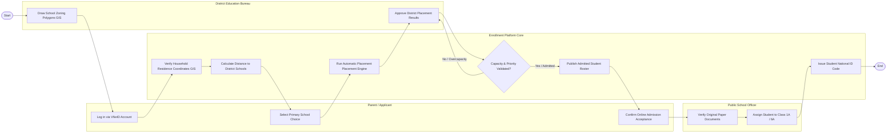

# Swimlane Diagram — Public School Zoning & Enrollment System

## Mermaid Code

## Flow Description | Mô tả luồng

| Lane | Actor | Role in Flow |
|------|-------|-------------|
| 1 | Parent / Applicant | Đăng nhập tài khoản VNeID, chọn nguyện vọng đăng ký tuyển sinh đúng tuyến và bấm xác nhận nhập học trực tuyến. |
| 2 | Enrollment Platform Core | Tự động đối soát tọa độ GIS nơi ở, tính khoảng cách đường bộ tới trường, phân bổ học sinh tự động và cấp mã định danh. |
| 3 | District Education Bureau | Vẽ bản đồ ranh giới phân tuyến địa lý cho từng trường công lập và ký phê duyệt danh sách trúng tuyển toàn quận. |
| 4 | Public School Officer | Kiểm tra đối chiếu hồ sơ bản cứng khi phụ huynh mang học bạ đến trường và xếp học sinh vào các lớp học chính thức. |
