# Action Tree — Public School Zoning & Enrollment System

## Mermaid Code

```mermaid
graph TD
    Root["Public School Zoning & Enrollment System"]

    Root --> M1["Online Application & VNeID GIS Verification"]
    Root --> M2["Geographic Zoning & Capacity Quota"]
    Root --> M3["Automatic Placement & Lottery Engine"]
    Root --> M4["Admission Selection & Appeal Resolution"]
    Root --> M5["Student Transfer & Academic Identity"]
    Root --> M6["Education BI & Overcrowding Analytics"]

    M1 --> A11["Submit Online School Enrollment Application"]
    M1 --> A12["Verify GIS Residence Proximity VNeID"]
    M1 --> A13["Verify Priority Beneficiary Categories"]
    M1 --> A14["Issue Electronic Application Receipts"]

    M2 --> A21["Define District School Geographic Zones"]
    M2 --> A22["Draw Zoning Polygon Boundaries GIS"]
    M2 --> A23["Approve School Classroom Capacity Quotas"]
    M2 --> A24["Detect Overlapping Zoning Polygons"]

    M3 --> A31["Assign Automatic School Placement"]
    M3 --> A32["Conduct Entrance Exam Lottery Selection"]
    M3 --> A33["Filter Non-Resident Out-of-Zone Applicants"]
    M3 --> A34["Rank Priority Applicants Score"]

    M4 --> A41["Confirm Student School Admission"]
    M4 --> A42["Publish Admission Selection Results"]
    M4 --> A43["Appeal Enrollment Placement Decisions"]
    M4 --> A44["Manage Waiting List Seat Replacement"]

    M5 --> A51["Issue Student National Identification Codes"]
    M5 --> A52["Transfer Students Between Public Schools"]
    M5 --> A53["Assign Students to Official Classes"]
    M5 --> A54["Sync National Education Database MOET"]

    M6 --> A61["Audit School Overcrowding Risk AI"]
    M6 --> A62["Render District Zoning Heatmaps GIS"]
    M6 --> A63["Export Education Bureau Analytics"]
    M6 --> A64["Log System Immutable Audit Trails"]
```

## Module Description | Mô tả Module

| # | Module | Description | Actions |
|---|--------|-------------|---------|
| 1 | Online Application & VNeID GIS Verification | Tiếp nhận đơn đăng ký tuyển sinh đầu cấp trực tuyến, đo khoảng cách đường bộ GIS từ VNeID và thẩm định điểm ưu tiên | Submit Online School Enrollment Application, Verify GIS Residence Proximity VNeID, Verify Priority Beneficiary Categories, Issue Electronic Application Receipts |
| 2 | Geographic Zoning & Capacity Quota | Cấu hình bản đồ ranh giới phân tuyến địa lý đa giác GIS cho từng trường công lập và duyệt chỉ tiêu số lớp/sĩ số | Define District School Geographic Zones, Draw Zoning Polygon Boundaries GIS, Approve School Classroom Capacity Quota, Detect Overlapping Zoning Polygons |
| 3 | Automatic Placement & Lottery Engine | Thuật toán tự động phân bổ học sinh đúng tuyến địa lý gần nhà, tổ chức bốc thăm/lọc điểm xét tuyển khi quá tải chỉ tiêu | Assign Automatic School Placement, Conduct Entrance Exam Lottery Selection, Filter Non-Resident Out-of-Zone Applicants, Rank Priority Applicants Score |
| 4 | Admission Selection & Appeal Resolution | Phụ huynh xác nhận nhập học trực tuyến, công khai danh sách trúng tuyển, tiếp nhận và giải quyết khiếu nại phúc khảo | Confirm Student School Admission, Publish Admission Selection Results, Appeal Enrollment Placement Decisions, Manage Waiting List Seat Replacement |
| 5 | Student Transfer & Academic Identity | Cấp Mã định danh học sinh toàn quốc (MOET Student ID), xử lý chuyển trường công lập và phân bổ học sinh vào danh sách lớp | Issue Student National Identification Codes, Transfer Students Between Public Schools, Assign Students to Official Classes, Sync National Education Database MOET |
| 6 | Education BI & Overcrowding Analytics | Phân tích rủi ro sĩ số học sinh/lớp quá tải ($> 45$), trực quan hóa bản đồ nhiệt phân tuyến GIS và trích xuất báo cáo | Audit School Overcrowding Risk AI, Render District Zoning Heatmaps GIS, Export Education Bureau Analytics, Log System Immutable Audit Trails |
