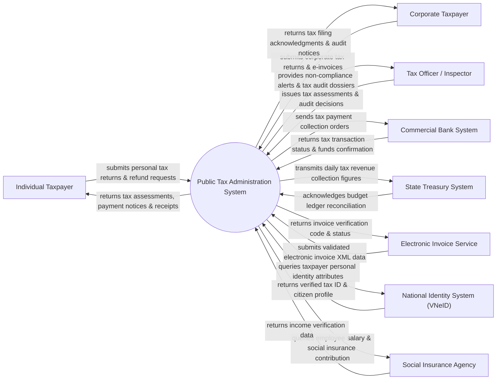

# Context Diagram — Public Tax Administration System

## Mermaid Code

## Actor & Interaction Table | Bảng Actor & Tương tác

| # | Actor | Actor Type | Data Sent TO System | Data Received FROM System | Notes |
|---|-------|------------|---------------------|---------------------------|-------|
| 1 | Individual Taxpayer | Primary | Personal income details, tax reduction claims, refund requests | Tax assessment notices, tax obligation summaries, receipts | Người nộp thuế cá nhân thực hiện nghĩa vụ thuế TNCN |
| 2 | Corporate Taxpayer | Primary | Corporate income tax filings, VAT returns, e-invoice summaries | Tax filing confirmations, compliance status, audit alerts | Doanh nghiệp thực hiện nghĩa vụ thuế TNDN, GTGT, XNK |
| 3 | Tax Officer / Inspector | Primary | Tax assessments, audit plans, debt enforcement decisions | Non-compliance risks, taxpayer dossiers, revenue reports | Cán bộ quản lý thuế, thanh tra kiểm tra thuế |
| 4 | Commercial Bank System | Supporting | Tax payment transactions, account balance verifications | Tax collection orders, taxpayer bank account query requests | Các ngân hàng thương mại thực hiện nộp thuế điện tử |
| 5 | State Treasury System | Supporting | Budget receipt confirmations, treasury account ledger updates | Daily tax collection summaries, tax refund disbursement orders | Kho bạc Nhà nước tiếp nhận tiền thuế và hoàn thuế |
| 6 | Electronic Invoice Service | Supporting | e-Invoice XML data batches, digital signatures | Invoice authentication codes, error feedback | Các nhà cung cấp giải pháp hóa đơn điện tử |
| 7 | National Identity System (VNeID) | Supporting | Taxpayer identity verification, taxpayer ID mapping | Verification queries, tax identification number (TIN) lookup | Hệ thống định danh quốc gia đồng bộ MST với số CCCD |
| 8 | Social Insurance Agency | Supporting | Employee salary data, social insurance contribution levels | Cross-checking queries for personal income tax auditing | Cơ quan BHXH đối soát thu nhập chịu thuế của người lao động |

## System Boundary Description | Mô tả Phạm vi Hệ thống

Hệ thống Public Tax Administration System (Hệ thống Quản lý Thuế Công cộng) là nền tảng cốt lõi chịu trách nhiệm quản lý mã số thuế, tiếp nhận tờ khai thuế điện tử, tính toán nghĩa vụ thuế, phát hành hóa đơn điện tử và kiểm tra thanh tra thuế toàn quốc. Hệ thống tự động hóa luồng nghiệp vụ từ khâu đăng ký thuế, kê khai, nộp thuế, hoàn thuế đến xử lý nợ thuế và cưỡng chế nợ thuế. Tuy nhiên, hệ thống KHÔNG trực tiếp lưu giữ quỹ tiền mặt (chuyển toàn bộ về Kho bạc Nhà nước) và KHÔNG thay thế ứng dụng ngân hàng thương mại khi thực hiện lệnh chuyển tiền nộp thuế của công dân/doanh nghiệp.
