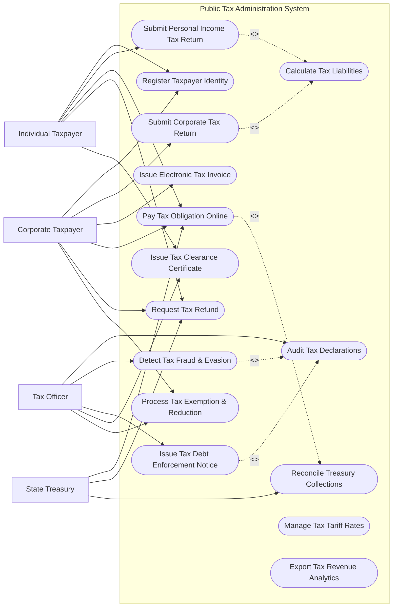

# Use Case Diagram — Public Tax Administration System

## Mermaid Code

## Actor Table | Bảng Actor

| # | Actor | Actor Type | Role Description | Related Use Cases |
|---|-------|------------|------------------|-------------------|
| 1 | Individual Taxpayer | Primary | Nguời nộp thuế cá nhân thực hiện kê khai và nộp thuế TNCN | UC01, UC02, UC05, UC06, UC11 |
| 2 | Corporate Taxpayer | Primary | Doanh nghiệp thực hiện kê khai thuế TNDN, GTGT, phát hành hóa đơn | UC01, UC03, UC04, UC05, UC06, UC14 |
| 3 | Tax Officer | Primary | Cán bộ kiểm tra, thanh tra thuế và quản lý nợ thuế | UC08, UC09, UC10, UC11, UC14 |
| 4 | State Treasury | Secondary / System | Kho bạc nhà nước ghi nhận thu ngân sách và chi hoàn thuế | UC05, UC06, UC12 |

## Use Case Table | Bảng Use Case

| # | UC ID | Use Case Name | Primary Actor | Secondary Actor | Description | Priority |
|---|-------|---------------|---------------|-----------------|-------------|----------|
| 1 | UC01 | Register Taxpayer Identity | Taxpayer | VNeID | Đăng ký cấp mã số thuế cá nhân hoặc mã số thuế doanh nghiệp | High |
| 2 | UC02 | Submit Personal Income Tax Return | IndividualTaxpayer | - | Kê khai quyết toán thuế thu nhập cá nhân hàng năm | High |
| 3 | UC03 | Submit Corporate Tax Return | CorporateTaxpayer | - | Kê khai thuế thu nhập doanh nghiệp và thuế GTGT định kỳ | High |
| 4 | UC04 | Issue Electronic Tax Invoice | CorporateTaxpayer | EInvoiceProvider | Khởi tạo và ký số hóa đơn điện tử có mã của cơ quan thuế | High |
| 5 | UC05 | Pay Tax Obligation Online | Taxpayer | Treasury, CommercialBank | Nộp tiền thuế vào Kho bạc Nhà nước qua ứng dụng ngân hàng | High |
| 6 | UC06 | Request Tax Refund | Taxpayer | Treasury | Gửi hồ sơ đề nghị hoàn thuế thu nhập hoặc hoàn thuế GTGT | High |
| 7 | UC07 | Calculate Tax Liabilities | System | - | Tự động tính toán số thuế phải nộp, giảm trừ gia cảnh, tiền chậm nộp | High |
| 8 | UC08 | Audit Tax Declarations | TaxOfficer | - | Kiểm tra hồ sơ khai thuế, đối soát doanh thu hóa đơn điện tử | High |
| 9 | UC09 | Detect Tax Fraud & Evasion | TaxOfficer | - | Sử dụng AI/Big Data phân tích rủi ro gian lận thuế và hóa đơn | High |
| 10 | UC10 | Issue Tax Debt Enforcement Notice | TaxOfficer | CommercialBank | Ban hành quyết định cưỡng chế nợ thuế qua tài khoản ngân hàng | High |
| 11 | UC11 | Issue Tax Clearance Certificate | Taxpayer, TaxOfficer | - | Xác nhận hoàn thành nghĩa vụ thuế để xuất cảnh hoặc giải thể | Medium |
| 12 | UC12 | Reconcile Treasury Collections | Treasury | CommercialBank | Đối soát dữ liệu thu nộp thuế giữa Thuế - Kho bạc - Ngân hàng | High |
| 13 | UC13 | Manage Tax Tariff Rates | SysAdmin | - | Cấu hình biểu thuế, thuế suất và định mức giảm trừ gia cảnh | Medium |
| 14 | UC14 | Process Tax Exemption & Reduction | Taxpayer, TaxOfficer | - | Thẩm định và quyết định miễn thuế, giảm thuế do thiên tai, dịch bệnh | Medium |
| 15 | UC15 | Export Tax Revenue Analytics | SysAdmin | - | Tổng hợp báo cáo số thu ngân sách nhà nước theo địa bàn và ngành hàng | Medium |

## Use Case Specification | Đặc tả Use Case

---

### UC02 — Submit Personal Income Tax Return

| Field | Detail |
|-------|--------|
| **UC ID** | UC02 |
| **Use Case Name** | Submit Personal Income Tax Return |
| **Actor(s)** | Primary: Individual Taxpayer / Secondary: None |
| **Description** | Nguời nộp thuế cá nhân nộp tờ khai quyết toán thuế thu nhập cá nhân (PIT) trực tuyến qua cổng thuế điện tử eTax. |
| **Precondition** | 1. Cá nhân đã có Mã số thuế (MST) hoặc Số CCCD được đồng bộ.   2. Các nguồn thu nhập trong năm đã được tổ chức trả thu nhập kê khai chứng từ khấu trừ. |
| **Main Flow** | 1. Taxpayer đăng nhập ứng dụng eTax Mobile bằng tài khoản VNeID.   2. Select "Quyết toán thuế TNCN" và chọn năm quyết toán.   3. System tự động tổng hợp dữ liệu thu nhập từ các cơ quan/doanh nghiệp đã chi trả cho Taxpayer trong năm.   4. Taxpayer nhập thông tin người phụ thuộc đăng ký giảm trừ gia cảnh và các khoản đóng góp từ thiện.   5. System thực hiện tự động tính toán (UC07): Tổng thu nhập, Tổng giảm trừ, Thu nhập tính thuế, Số thuế phát sinh và Số thuế nộp thừa/thừa thiếu.   6. Taxpayer kiểm tra dữ liệu, đính kèm chứng từ khấu trừ (nếu có) và nộp tờ khai bằng chữ ký số hoặc mã OTP SMS.   7. System sinh Mã giao dịch tờ khai, lưu trữ tờ khai và thông báo trạng thái "Đã nộp thành công". |
| **Alternative Flow** | **AF1** — Tờ khai ủy quyền cho doanh nghiệp: Taxpayer chọn "Ủy quyền quyết toán cho tổ chức trả thu nhập". System chuyển dữ liệu quyết toán sang cho kế toán doanh nghiệp tổng hợp chung. |
| **Exception Flow** | **EX1** — Số liệu thu nhập cá nhân kê khai không trùng khớp với dữ liệu doanh nghiệp báo cáo: System hiển thị danh sách chênh lệch và yêu cầu cá nhân kiểm tra lại chứng từ gốc. |
| **Postcondition** | Tờ khai quyết toán thuế TNCN được lưu vào hệ thống, chờ cán bộ thuế thẩm định duyệt hoàn thuế hoặc phát hành thông báo nộp thêm. |
| **Business Rule** | **BR1**: Mức giảm trừ gia cảnh cho bản thân và người phụ thuộc áp dụng theo đúng Nghị quyết của Quốc hội tại thời điểm tính thuế. |

---

### UC03 — Submit Corporate Tax Return

| Field | Detail |
|-------|--------|
| **UC ID** | UC03 |
| **Use Case Name** | Submit Corporate Tax Return |
| **Actor(s)** | Primary: Corporate Taxpayer / Secondary: None |
| **Description** | Doanh nghiệp kê khai và nộp tờ khai thuế TNDN, thuế GTGT định kỳ (tháng/quý) qua hệ thống Thuế điện tử. |
| **Precondition** | 1. Doanh nghiệp có chữ ký số doanh nghiệp (CA Token) đang còn hiệu lực.   2. Kỳ kê khai thuế đang trong thời hạn quy định của pháp luật. |
| **Main Flow** | 1. CorporateTaxpayer tạo tờ khai chuẩn định dạng XML từ phần mềm kê khai (HTKK).   2. CorporateTaxpayer tải tệp XML lên Cổng Dịch vụ Thuế điện tử.   3. System kiểm tra cấu trúc tệp XML, mã số thuế và chữ ký số doanh nghiệp.   4. System kiểm tra các chỉ tiêu logic trên tờ khai.   5. CorporateTaxpayer xác nhận và ký điện tử lên tờ khai.   6. System cấp Thông báo tiếp nhận tờ khai điện tử (Thông báo bước 1) lập tức.   7. Trong vòng 15 phút, System kiểm tra điều kiện nghiệp vụ và gửi Thông báo chấp nhận tờ khai (Thông báo bước 2). |
| **Alternative Flow** | **AF1** — Kê khai bổ sung điều chỉnh: Doanh nghiệp chọn "Tờ khai bổ sung", nhập các chỉ tiêu thay đổi. System tự động tính số tiền thuế chênh lệch và tiền chậm nộp. |
| **Exception Flow** | **EX1** — Nộp quá thời hạn quy định: System vẫn tiếp nhận tờ khai nhưng tự động lập Hồ sơ xử phạt vi phạm hành chính về thời hạn nộp tờ khai theo quy định. |
| **Postcondition** | Tờ khai thuế doanh nghiệp được ghi nhận chính thức vào sổ thuế và tự động phát sinh nghĩa vụ nộp thuế trên tài khoản thu ngân sách. |
| **Business Rule** | **BR1**: Tờ khai thuế giá trị gia tăng (GTGT) phải được tự động đối soát tổng doanh thu với tổng giá trị hóa đơn điện tử đã phát hành trong kỳ. |

---

### UC05 — Pay Tax Obligation Online

| Field | Detail |
|-------|--------|
| **UC ID** | UC05 |
| **Use Case Name** | Pay Tax Obligation Online |
| **Actor(s)** | Primary: IndividualTaxpayer, CorporateTaxpayer / Secondary: State Treasury, Commercial Bank |
| **Description** | Người nộp thuế lập Giấy nộp tiền và thanh toán nộp ngân sách nhà nước trực tuyến thông qua kết nối liên ngân hàng - kho bạc. |
| **Precondition** | 1. Người nộp thuế có khoản nợ thuế hoặc nghĩa vụ thuế phát sinh từ tờ khai.   2. Tài khoản ngân hàng có đủ số dư thanh toán. |
| **Main Flow** | 1. Taxpayer tra cứu "Nghĩa vụ thuế phải nộp" trên ứng dụng eTax.   2. System hiển thị danh sách các khoản thuế, chương, tiểu mục và số tiền chi tiết.   3. Taxpayer chọn khoản thuế cần nộp và ngân hàng thanh toán.   4. System tự động lập Giấy nộp tiền vào Ngân sách Nhà nước (GNT).   5. Taxpayer thực hiện xác thực giao dịch chuyển tiền tại Ngân hàng thương mại.   6. Commercial Bank trích tiền từ tài khoản, gửi điện báo Thu Ngân sách cho State Treasury và System.   7. System gạch nợ thuế tức thì cho Taxpayer và cấp Chứng từ nộp thuế điện tử. |
| **Alternative Flow** | **AF1** — Nộp thuế thay cho người khác: Taxpayer nhập MST của người khác để lập Giấy nộp tiền thanh toán hộ. |
| **Exception Flow** | **EX1** — Sai sót thông tin Tiểu mục thu ngân sách: System từ chối lập GNT và hướng dẫn người nộp thuế chọn đúng tiểu mục theo quy định biểu thuế. |
| **Postcondition** | Nghĩa vụ nợ thuế được xóa bớt trên hệ thống Thuế, số tiền được hạch toán chính xác vào Kho bạc Nhà nước. |
| **Business Rule** | **BR1**: Thời gian xử lý gạch nợ thuế tự động kể từ khi nhận điện báo từ ngân hàng không được quá 5 phút. |

---

### UC06 — Request Tax Refund

| Field | Detail |
|-------|--------|
| **UC ID** | UC06 |
| **Use Case Name** | Request Tax Refund |
| **Actor(s)** | Primary: Taxpayer / Secondary: State Treasury |
| **Description** | Người nộp thuế gửi hồ sơ đề nghị hoàn trả khoản tiền thuế nộp thừa hoặc hoàn thuế giá trị gia tăng xuất khẩu/đầu tư. |
| **Precondition** | 1. Đã hoàn thành quyết toán thuế và có số tiền thuế nộp thừa trên sổ nợ. |
| **Main Flow** | 1. Taxpayer lập Giấy đề nghị hoàn trả khoản thu ngân sách nhà nước (Form 01/HT).   2. Taxpayer cung cấp thông tin tài khoản ngân hàng nhận tiền hoàn thuế chính chủ.   3. Taxpayer ký số và nộp hồ sơ qua Cổng Thuế điện tử.   4. System phân loại hồ sơ vào luồng "Hoàn thuế trước kiểm tra sau" hoặc "Kiểm tra trước hoàn thuế sau" dựa trên điểm rủi ro.   5. Cán bộ thuế thẩm định hồ sơ và phê duyệt Quyết định hoàn thuế.   6. System truyền Quyết định hoàn thuế điện tử sang State Treasury.   7. State Treasury thực hiện chuyển tiền hoàn thuế vào tài khoản ngân hàng của Taxpayer. |
| **Alternative Flow** | **AF1** — Bù trừ nghĩa vụ thuế khác: Taxpayer chọn đề nghị dùng số tiền hoàn thuế để bù trừ cho nghĩa vụ nợ thuế của khoản khác thay vì nhận tiền về tài khoản. |
| **Exception Flow** | **EX1** — Hồ sơ hoàn thuế thuộc diện rủi ro cao: System chuyển hồ sơ sang luồng "Kiểm tra trước hoàn sau", phát hành thông báo kiểm tra tại trụ sở người nộp thuế. |
| **Postcondition** | Tiền hoàn thuế được giải ngân thành công từ Kho bạc, sổ nợ của người nộp thuế được điều chỉnh cân bằng. |
| **Business Rule** | **BR1**: Tài khoản ngân hàng nhận tiền hoàn thuế bắt buộc phải đứng tên chính chủ của Mã số thuế đề nghị hoàn. |

---

### UC08 — Audit Tax Declarations

| Field | Detail |
|-------|--------|
| **UC ID** | UC08 |
| **Use Case Name** | Audit Tax Declarations |
| **Actor(s)** | Primary: Tax Officer / Secondary: None |
| **Description** | Cán bộ thuế thực hiện kiểm tra tờ khai thuế tại cơ quan thuế, đối soát dữ liệu hóa đơn và lập hồ sơ thanh tra kiểm tra. |
| **Precondition** | 1. Tờ khai thuế của doanh nghiệp/cá nhân đã nộp trên hệ thống.   2. Cán bộ thuế được phân công địa bàn/doanh nghiệp quản lý. |
| **Main Flow** | 1. TaxOfficer truy cập Phân hệ Kiểm tra thuế.   2. System tự động chạy các thuật toán đối soát: Doanh thu tờ khai vs Tổng hóa đơn GTGT bán ra, Chi phí đầu vào vs Hóa đơn mua vào.   3. System hiển thị các rủi ro chênh lệch (nếu có).   4. TaxOfficer tạo Thông báo yêu cầu giải trình, bổ sung thông tin gửi cho doanh nghiệp.   5. Doanh nghiệp nộp văn bản giải trình hoặc tờ khai bổ sung.   6. TaxOfficer xem xét giải trình, lập Biên bản kiểm tra thuế và dự thảo Quyết định xử lý truy thu/xử phạt (nếu phát sinh vi phạm). |
| **Alternative Flow** | **AF1** — Doanh nghiệp giải trình hợp lý: TaxOfficer chấp nhận giải trình, ghi nhận kết quả kiểm tra đạt và đóng hồ sơ audit. |
| **Exception Flow** | **EX1** — Doanh nghiệp không giải trình quá 10 ngày: TaxOfficer chuyển hồ sơ sang danh sách đề xuất Kiểm tra tại trụ sở người nộp thuế. |
| **Postcondition** | Hồ sơ kiểm tra được lưu trữ, số thuế truy thu/xử phạt (nếu có) được đẩy tự động vào sổ nợ thuế của doanh nghiệp. |
| **Business Rule** | **BR1**: Thuật toán đối soát hóa đơn điện tử với tờ khai thuế GTGT phải tự động cảnh báo các hóa đơn xuất từ các doanh nghiệp đã bỏ trốn/ngừng hoạt động. |
