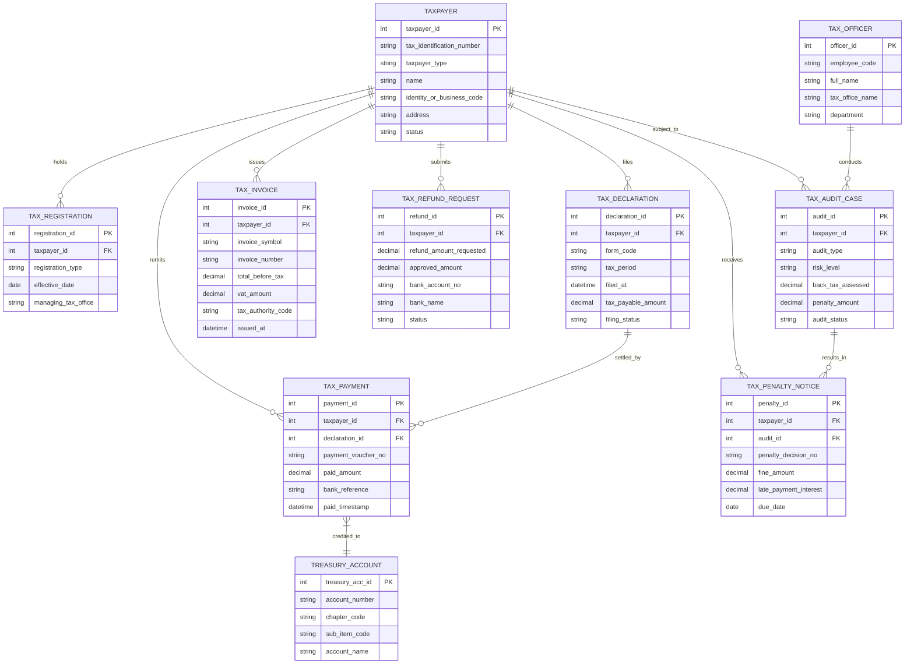

# Conceptual ERD — Public Tax Administration System

## Mermaid Code

## Entity Description Table | Bảng mô tả Entity

| # | Entity Name | Vietnamese Name | Description | Key Attributes | Main Relationships |
|---|-------------|-----------------|-------------|----------------|-------------------|
| 1 | TAXPAYER | Người Nộp Thuế | Thông tin đối tượng chịu thuế (cá nhân hoặc doanh nghiệp) | taxpayer_id, tax_identification_number, name, status | Holds TAX_REGISTRATION, files TAX_DECLARATION |
| 2 | TAX_REGISTRATION | Hồ sơ Đăng ký Thuế | Quản lý thông tin đăng ký mã số thuế và đơn vị quản lý thuế trực tiếp | registration_id, registration_type, managing_tax_office | Belongs to TAXPAYER |
| 3 | TAX_DECLARATION | Tờ khai Thuế | Các tờ khai nghĩa vụ thuế (GTGT, TNDN, TNCN) do người nộp thuế gửi | declaration_id, form_code, tax_period, tax_payable_amount | Belongs to TAXPAYER, settled by TAX_PAYMENT |
| 4 | TAX_INVOICE | Hóa đơn Điện tử | Lưu trữ hóa đơn điện tử có mã/không mã của cơ quan thuế | invoice_id, invoice_symbol, invoice_number, vat_amount | Belongs to TAXPAYER |
| 5 | TAX_PAYMENT | Chứng từ Nộp tiền Thuế | Nhật ký tiền thuế đã nộp vào Kho bạc Nhà nước | payment_id, payment_voucher_no, paid_amount, paid_timestamp | Belongs to TAXPAYER, TAX_DECLARATION, credited to TREASURY_ACCOUNT |
| 6 | TAX_REFUND_REQUEST | Đề nghị Hoàn thuế | Hồ sơ yêu cầu hoàn tiền thuế nộp thừa hoặc hoàn GTGT | refund_id, refund_amount_requested, approved_amount, status | Belongs to TAXPAYER |
| 7 | TAX_AUDIT_CASE | Vụ việc Thanh tra Kiểm tra Thuế | Quản lý hồ sơ audit, phân tích rủi ro và truy thu thuế | audit_id, audit_type, risk_level, back_tax_assessed | Belongs to TAXPAYER, conducted by TAX_OFFICER |
| 8 | TAX_OFFICER | Cán bộ Thuế | Thông tin công chức thuế thực hiện quản lý, kiểm tra thuế | officer_id, employee_code, full_name, tax_office_name | Conducts TAX_AUDIT_CASE |
| 9 | TREASURY_ACCOUNT | Tài khoản Thu Ngân sách Kho bạc | Định khoản mục lục ngân sách (chương, tiểu mục) tiếp nhận tiền thuế | treasury_acc_id, account_number, chapter_code, sub_item_code | Credits TAX_PAYMENT |
| 10 | TAX_PENALTY_NOTICE | Quyết định Xử phạt Thuế | Quyết định phạt vi phạm hành chính thuế và tiền chậm nộp | penalty_id, penalty_decision_no, fine_amount, due_date | Belongs to TAXPAYER, TAX_AUDIT_CASE |

## Relationship Description | Mô tả Quan hệ

| # | From Entity | Cardinality | To Entity | Relationship Label | Business Explanation |
|---|-------------|-------------|-----------|-------------------|----------------------|
| 1 | TAXPAYER | one-to-many | TAX_REGISTRATION | holds | Một người nộp thuế sở hữu các thông tin đăng ký thuế lịch sử |
| 2 | TAXPAYER | one-to-many | TAX_DECLARATION | files | Một người nộp thuế nộp nhiều tờ khai thuế định kỳ |
| 3 | TAXPAYER | one-to-many | TAX_INVOICE | issues | Một doanh nghiệp phát hành nhiều hóa đơn điện tử |
| 4 | TAXPAYER | one-to-many | TAX_PAYMENT | remits | Một người nộp thuế thực hiện nhiều giao dịch nộp tiền thuế |
| 5 | TAXPAYER | one-to-many | TAX_REFUND_REQUEST | submits | Một người nộp thuế có thể nộp nhiều hồ sơ đề nghị hoàn thuế |
| 6 | TAXPAYER | one-to-many | TAX_AUDIT_CASE | subject_to | Một người nộp thuế có thể bị thanh tra kiểm tra thuế nhiều lần |
| 7 | TAXPAYER | one-to-many | TAX_PENALTY_NOTICE | receives | Một người nộp thuế có thể nhận các quyết định xử phạt vi phạm thuế |
| 8 | TAX_DECLARATION | one-to-many | TAX_PAYMENT | settled_by | Một tờ khai thuế phát sinh nghĩa vụ nộp có thể được thanh toán qua nhiều lần nộp |
| 9 | TAX_AUDIT_CASE | one-to-many | TAX_PENALTY_NOTICE | results_in | Một vụ việc thanh tra kiểm tra có thể dẫn đến quyết định truy thu/xử phạt |
| 10 | TAX_OFFICER | one-to-many | TAX_AUDIT_CASE | conducts | Một cán bộ thuế phụ trách kiểm tra nhiều hồ sơ vụ việc audit |
| 11 | TAX_PAYMENT | many-to-one | TREASURY_ACCOUNT | credited_to | Nhiều giao dịch nộp thuế được hạch toán vào một tiểu mục tài khoản kho bạc |
