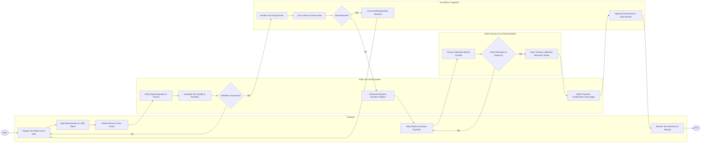

# Swimlane Diagram — Public Tax Administration System

## Mermaid Code

## Flow Description | Mô tả luồng

| Lane | Actor | Role in Flow |
|------|-------|-------------|
| 1 | Taxpayer | Lập tờ khai thuế điện tử, ký số cá nhân/doanh nghiệp, gửi tờ khai, thực hiện lệnh chuyển tiền nộp thuế và nhận chứng từ xác nhận. |
| 2 | Public Tax Portal System | Kiểm tra định dạng và chữ ký số, tự động hạch toán nghĩa vụ thuế, sinh chứng từ nộp tiền và đối soát tự động gạch nợ. |
| 3 | Tax Officer / Inspector | Kiểm tra tính chính xác của tờ khai, đối soát hóa đơn điện tử mua vào/bán ra, yêu cầu giải trình nếu phát hiện rủi ro và phê duyệt hoàn thành nghĩa vụ. |
| 4 | State Treasury & Commercial Bank | Tiếp nhận tiền nộp thuế qua kênh liên ngân hàng, hạch toán vào Ngân sách Nhà nước và gửi thông báo điện tử xác nhận thu tiền. |
