# Action Tree — Public Tax Administration System

## Mermaid Code

```mermaid
graph TD
    Root["Public Tax Administration System"]

    Root --> M1["Taxpayer Registration & Profiles"]
    Root --> M2["Tax Declaration & Filing Engine"]
    Root --> M3["E-Invoicing & Authentication"]
    Root --> M4["Tax Payment & Treasury Reconciliation"]
    Root --> M5["Tax Audit & Risk Management"]
    Root --> M6["Tax Refund & Debt Enforcement"]

    M1 --> A11["Issue Individual Tax ID"]
    M1 --> A12["Issue Corporate Tax ID"]
    M1 --> A13["Update Taxpayer Information"]
    M1 --> A14["Sync Tax ID with VNeID CCCD"]

    M2 --> A21["Submit PIT Annual Settlement"]
    M2 --> A22["Submit Monthly/Quarterly VAT Returns"]
    M2 --> A23["Submit Corporate Income Tax Return"]
    M2 --> A24["Calculate Automatic Tax Liabilities"]

    M3 --> A31["Issue Tax Authority Invoicing Code"]
    M3 --> A32["Validate Electronic Invoice Signature"]
    M3 --> A33["Cross-check Invoice Purchase Sales"]
    M3 --> A34["Manage Cash Register E-Invoices"]

    M4 --> A41["Generate State Treasury Voucher"]
    M4 --> A42["Execute Online Tax Payment"]
    M4 --> A43["Reconcile Treasury Receipts"]
    M4 --> A44["Issue Digital Tax Receipt"]

    M5 --> A51["Run AI Tax Evasion Risk Scoring"]
    M5 --> A52["Issue Tax Explanation Notice"]
    M5 --> A53["Audit High-Risk Tax Dossiers"]
    M5 --> A54["Track Fraudulent Invoice Sellers"]

    M6 --> A61["Process PIT Tax Refund Claims"]
    M6 --> A62["Process Export VAT Refund Claims"]
    M6 --> A63["Issue Tax Clearance Certificates"]
    M6 --> A64["Execute Tax Debt Account Freeze"]
```

## Module Description | Mô tả Module

| # | Module | Description | Actions |
|---|--------|-------------|---------|
| 1 | Taxpayer Registration & Profiles | Quản lý đăng ký cấp mã số thuế cá nhân, doanh nghiệp và đồng bộ định danh VNeID | Issue Individual Tax ID, Issue Corporate Tax ID, Update Taxpayer Information, Sync Tax ID with VNeID CCCD |
| 2 | Tax Declaration & Filing Engine | Động cơ tiếp nhận, kiểm tra định dạng và tự động tính toán số thuế trên tờ khai thuế GTGT, TNDN, TNCN | Submit PIT Annual Settlement, Submit Monthly/Quarterly VAT Returns, Submit Corporate Income Tax Return, Calculate Automatic Tax Liabilities |
| 3 | E-Invoicing & Authentication | Quản lý hệ thống hóa đơn điện tử có mã của cơ quan thuế và đối soát mua vào bán ra | Issue Tax Authority Invoicing Code, Validate Electronic Invoice Signature, Cross-check Invoice Purchase Sales, Manage Cash Register E-Invoices |
| 4 | Tax Payment & Treasury Reconciliation | Xử lý nộp thuế điện tử liên ngân hàng, gạch nợ tự động và đối soát Kho bạc Nhà nước | Generate State Treasury Voucher, Execute Online Tax Payment, Reconcile Treasury Receipts, Issue Digital Tax Receipt |
| 5 | Tax Audit & Risk Management | Phân tích rủi ro gian lận thuế bằng AI, đối soát hóa đơn bất thường và thanh tra kiểm tra | Run AI Tax Evasion Risk Scoring, Issue Tax Explanation Notice, Audit High-Risk Tax Dossiers, Track Fraudulent Invoice Sellers |
| 6 | Tax Refund & Debt Enforcement | Quản lý hoàn thuế thu nhập/GTGT, xác nhận hoàn thành nghĩa vụ thuế và cưỡng chế nợ thuế | Process PIT Tax Refund Claims, Process Export VAT Refund Claims, Issue Tax Clearance Certificates, Execute Tax Debt Account Freeze |
