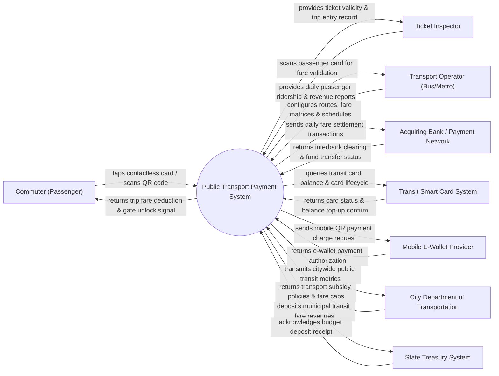

# Context Diagram — Public Transport Payment System

## Mermaid Code

## Actor & Interaction Table | Bảng Actor & Tương tác

| # | Actor | Actor Type | Data Sent TO System | Data Received FROM System | Notes |
|---|-------|------------|---------------------|---------------------------|-------|
| 1 | Commuter (Passenger) | Primary | Tap contactless card (EMV/NFC), scan QR code, top-up cash | Gate unlock signal, fare deducted notification, trip history | Hành khách đi xe buýt, tàu điện metro hoặc tàu hỏa đô thị |
| 2 | Ticket Inspector | Primary | Handheld card scan query, passenger ID | Fare validation status, entry station log, penalty flag | Nhân viên kiểm tra vé soát vé trên phương tiện công cộng |
| 3 | Transport Operator (Bus/Metro) | Primary | Route definitions, fare table rules, vehicle IDs, bus schedules | Daily ridership analytics, revenue settlement reports | Đơn vị vận hành các tuyến xe buýt, tuyến Metro đô thị |
| 4 | Acquiring Bank / Payment Network | Supporting | Interbank settlement status, credit/debit card authorization | Daily fare clearing batches, merchant transaction fees | Ngân hàng thanh toán và các tổ chức thẻ (Visa, Mastercard, Napas) |
| 5 | Transit Smart Card System | Supporting | Smart card balance, card blacklist status, top-up credits | Card deduction authorization, trip entry/exit tap logs | Hệ thống thẻ vé thông minh đô thị (Thẻ Vé lượt/Vé tháng) |
| 6 | Mobile E-Wallet Provider | Supporting | E-wallet payment authorization, user wallet token | Dynamic QR payment charge requests, trip transaction IDs | Các ví điện tử (Momo, VNPay, ZaloPay) tích hợp thanh toán vé |
| 7 | City Department of Transportation | Regulatory | Transport subsidy policies, maximum fare caps, route licenses | Citywide ridership statistics, peak-hour congestion data | Sở Giao thông Vận tải quy định chính sách giá vé và trợ giá |
| 8 | State Treasury System | Supporting | Budget deposit confirmations, revenue accounting records | Daily transit revenue transfers, municipal fund ledgers | Kho bạc Nhà nước tiếp nhận nguồn thu vé giao thông công cộng |

## System Boundary Description | Mô tả Phạm vi Hệ thống

Hệ thống Public Transport Payment System (Hệ thống Thanh toán Giao thông Công cộng) chịu trách nhiệm quản lý toàn bộ quy trình thu phí tự động (Automated Fare Collection - AFC) cho các phương tiện giao thông công cộng đô thị (xe buýt, Metro, BRT). Hệ thống bao gồm tính năng chạm thẻ NFC/EMV/QR code tại cửa soát vé (Turnstile Gate), tự động tính toán giá vé theo quãng đường di chuyển (Distance-based Fare), khấu trừ tài khoản, thanh toán vé tháng và trợ giá sinh viên/người cao tuổi. Tuy nhiên, hệ thống KHÔNG trực tiếp vận hành hệ thống cơ khí cổng xoay (turnstile) và KHÔNG thay thế ứng dụng ngân hàng trong việc nạp tiền vào thẻ.
