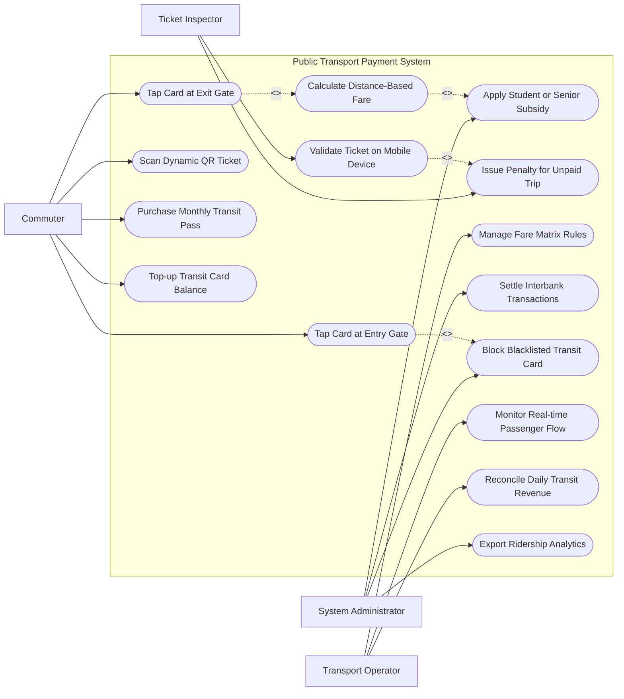

# Use Case Diagram — Public Transport Payment System

## Mermaid Code

## Actor Table | Bảng Actor

| # | Actor | Actor Type | Role Description | Related Use Cases |
|---|-------|------------|------------------|-------------------|
| 1 | Commuter | Primary | Hành khách sử dụng phương tiện công cộng chạm thẻ/quét QR đi xe | UC01, UC02, UC03, UC05, UC06 |
| 2 | Ticket Inspector | Primary | Nhân viên kiểm tra vé soát vé trên xe/tàu và xử phạt vi phạm | UC07, UC09 |
| 3 | Transport Operator | Primary | Đơn vị vận hành quản lý biểu giá, giám sát luồng hành khách và thu doanh thu | UC10, UC13, UC14 |
| 4 | System Administrator | System | Quản trị viên cấu hình mức trợ giá, đối soát liên ngân hàng và xuất báo cáo | UC08, UC11, UC12, UC15 |

## Use Case Table | Bảng Use Case

| # | UC ID | Use Case Name | Primary Actor | Secondary Actor | Description | Priority |
|---|-------|---------------|---------------|-----------------|-------------|----------|
| 1 | UC01 | Tap Card at Entry Gate | Commuter | Gate Hardware | Chạm thẻ vé/thẻ ngân hàng tại cửa vào trạm xe buýt/Metro | High |
| 2 | UC02 | Tap Card at Exit Gate | Commuter | Gate Hardware | Chạm thẻ vé tại cửa ra để tính toán quãng đường và trừ tiền | High |
| 3 | UC03 | Scan Dynamic QR Ticket | Commuter | Mobile App | Quét mã QR động trên ứng dụng di động để mở cửa soát vé | High |
| 4 | UC04 | Calculate Distance-Based Fare | System | - | Tự động tính toán giá tiền vé dựa trên ga/trạm vào và ga/trạm ra | High |
| 5 | UC05 | Purchase Monthly Transit Pass | Commuter | E-Wallet, Bank | Đăng ký mua và gia hạn vé tháng không giới hạn lượt đi | High |
| 6 | UC06 | Top-up Transit Card Balance | Commuter | E-Wallet, Bank | Nạp tiền vào thẻ vé thông minh qua ứng dụng ngân hàng/ví điện tử | High |
| 7 | UC07 | Validate Ticket on Mobile Device | Inspector | Handheld Scanner | Đọc thông tin thẻ/QR để kiểm tra hợp lệ lượt đi của hành khách | High |
| 8 | UC08 | Apply Student or Senior Subsidy | Admin | VNeID | Tự động giảm giá vé cho đối tượng ưu tiên (học sinh, sinh viên, người già) | Medium |
| 9 | UC09 | Issue Penalty for Unpaid Trip | Inspector | Commuter | Lập biên bản phạt vi phạm hành khách đi chui vé hoặc không quẹt thẻ ra | High |
| 10 | UC10 | Manage Fare Matrix Rules | Operator | - | Cấu hình biểu giá vé theo chặng, giá vé trần và các khung giờ cao điểm | Medium |
| 11 | UC11 | Settle Interbank Transactions | Admin | Acquiring Bank | Thanh toán đối soát số dư giao dịch giữa các ngân hàng phát hành thẻ | High |
| 12 | UC12 | Block Blacklisted Transit Card | Admin | - | Khóa thẻ vé bị báo mất, thẻ nợ cước hoặc gian lận thanh toán | High |
| 13 | UC13 | Monitor Real-time Passenger Flow | Operator | GIS Map | Giám sát lưu lượng hành khách lên xuống theo thời gian thực | Medium |
| 14 | UC14 | Reconcile Daily Transit Revenue | Operator | Treasury | Tổng hợp và đối soát doanh thu bán vé hàng ngày với Kho bạc | High |
| 15 | UC15 | Export Ridership Analytics | Admin | Transport Dept | Trích xuất báo cáo mật độ di chuyển hành khách phục vụ quy hoạch giao thông | Low |

## Use Case Specification | Đặc tả Use Case

---

### UC01 — Tap Card at Entry Gate

| Field | Detail |
|-------|--------|
| **UC ID** | UC01 |
| **Use Case Name** | Tap Card at Entry Gate |
| **Actor(s)** | Primary: Commuter / Secondary: Gate Hardware, Transit Card Provider |
| **Description** | Hành khách chạm thẻ thông minh (NFC/EMV) hoặc thẻ vé lượt tại đầu đọc cửa vào trạm để ghi nhận ga vào. |
| **Precondition** | 1. Cửa soát vé (Turnstile) ở trạng thái hoạt động bình thường.   2. Thẻ vé có số dư tối thiểu lớn hơn hoặc bằng giá vé chặng ngắn nhất. |
| **Main Flow** | 1. Commuter đưa thẻ vé chạm vào vùng nhận diện NFC của cửa soát vé.   2. Gate Hardware đọc mã UID và số dư hiện tại trên chip thẻ.   3. System kiểm tra thẻ không nằm trong danh sách đen (UC12).   4. System ghi nhận Mã trạm vào (Check-in Station ID) và Thời gian chạm vào chip thẻ.   5. System phát tín hiệu "Bíp" xác nhận và điều khiển mở cửa xoay cho Commuter đi qua.   6. Màn hình cửa soát vé hiển thị "Mời vào - Số dư: XXX VNĐ". |
| **Alternative Flow** | **AF1** — Thẻ vé tháng: System kiểm tra thời hạn vé tháng còn hiệu lực, cho phép qua cửa mà không cần kiểm tra số dư tiền. |
| **Exception Flow** | **EX1** — Số dư không đủ (Thấp hơn mức tối thiểu 10,000 VNĐ): Cửa soát vé báo đèn đỏ, phát âm thanh cảnh báo "Số dư không đủ", cửa không mở.   **EX2** — Thẻ bị khóa trong blacklist: Cửa phát cảnh báo "Thẻ bị khóa - Liên hệ quầy vé", giữ nguyên cửa đóng. |
| **Postcondition** | Trạng thái thẻ chuyển sang "Đang trong chuyến đi (Checked-In)", thông tin ga vào được lưu trong chip thẻ và hệ thống central. |
| **Business Rule** | **BR1**: Thời gian xử lý giao dịch chạm thẻ mở cửa (Tap-in) không được vượt quá 300ms để tránh ùn tắc cửa soát vé. |

---

### UC02 — Tap Card at Exit Gate

| Field | Detail |
|-------|--------|
| **UC ID** | UC02 |
| **Use Case Name** | Tap Card at Exit Gate |
| **Actor(s)** | Primary: Commuter / Secondary: Gate Hardware |
| **Description** | Hành khách chạm thẻ tại cửa ra để hệ thống tính giá tiền theo quãng đường và trừ tiền trên tài khoản thẻ. |
| **Precondition** | 1. Thẻ đã được chạm ghi nhận ga vào hợp lệ (UC01). |
| **Main Flow** | 1. Commuter chạm thẻ vào đầu đọc cửa ra.   2. System đọc Mã trạm vào và Thời gian vào từ chip thẻ.   3. System xác định Mã trạm ra hiện tại.   4. System tính toán khoảng cách và tra cứu Biểu giá vé chặng (UC04).   5. System áp dụng các chính sách giảm giá/trợ giá (UC08) nếu có.   6. System trừ số tiền vé tương ứng vào số dư thẻ.   7. System ghi nhận trạng thái thẻ "Hoàn thành chuyến đi (Checked-Out)".   8. Cửa soát vé mở ra, màn hình hiển thị "Số tiền trừ: YY VNĐ - Số dư còn lại: ZZ VNĐ". |
| **Alternative Flow** | **AF1** — Thẻ vé tháng: System ghi nhận chuyến đi hoàn thành nhưng số tiền trừ = 0 VNĐ. |
| **Exception Flow** | **EX1** — Thẻ chưa được chạm ga vào (Bỏ qua Tap-in): System không tìm thấy thông tin ga vào, tính giá vé phạt tối đa (Maximum Fare) và trừ tiền trước khi cho ra.   **EX2** — Số dư sau khi trừ bị âm: Cửa vẫn cho ra nhưng khóa thẻ ở trạng thái nợ cước, yêu cầu nạp tiền để mở khóa. |
| **Postcondition** | Chuyến đi kết thúc hợp lệ, số dư thẻ được cập nhật, dữ liệu hành trình được ghi nhận cho nhà vận hành. |
| **Business Rule** | **BR1**: Nếu thời gian ở trong hệ thống metro vượt quá 120 phút (quá thời gian di chuyển hợp lý), hệ thống sẽ tự động tính thêm phí quá giờ. |

---

### UC04 — Calculate Distance-Based Fare

| Field | Detail |
|-------|--------|
| **UC ID** | UC04 |
| **Use Case Name** | Calculate Distance-Based Fare |
| **Actor(s)** | Primary: System / Secondary: None |
| **Description** | Thuật toán tự động tính toán số tiền vé chính xác dựa trên khoảng cách giữa trạm vào và trạm ra. |
| **Precondition** | 1. Có thông tin Mã trạm vào và Mã trạm ra hợp lệ. |
| **Main Flow** | 1. System tiếp nhận Mã trạm vào (Station A) và Mã trạm ra (Station B).   2. System tra cứu Ma trận khoảng cách (Distance Matrix) giữa 2 trạm.   3. System áp dụng Biểu giá vé theo kilomet: Giá mở cửa $F_{base} + (Số km \times Đơn giá/km)$.   4. System kiểm tra loại đối tượng (Người lớn, Sinh viên, Người cao tuổi) để tính tỷ lệ giảm giá (0%, 50%, 100%).   5. System kiểm tra quy định Giá vé trần (Cap Fare - Mức giá tối đa trong ngày).   6. System tính ra Số tiền vé cuối cùng và trả kết quả cho phân hệ trừ tiền. |
| **Alternative Flow** | **AF1** — Chuyển tuyến giữa Bus và Metro trong vòng 30 phút: System nhận diện giao dịch chuyển tuyến (Transfer), áp dụng mức giảm giá chuyển tuyến theo chính sách thành phố. |
| **Exception Flow** | **EX1** — Trạm vào và trạm ra trùng nhau (Vào ra cùng 1 ga): System áp dụng mức phí tối thiểu (Minimum Stay Fare) nếu ở quá 15 phút. |
| **Postcondition** | Số tiền vé chính xác được xác định minh bạch theo đúng quy định của Sở Giao thông Vận tải. |
| **Business Rule** | **BR1**: Công thức tính toán giá vé phải hỗ trợ làm tròn số tiền xuống bội số 500 VNĐ gần nhất. |

---

### UC06 — Top-up Transit Card Balance

| Field | Detail |
|-------|--------|
| **UC ID** | UC06 |
| **Use Case Name** | Top-up Transit Card Balance |
| **Actor(s)** | Primary: Commuter / Secondary: E-Wallet Provider, Commercial Bank |
| **Description** | Hành khách thực hiện nạp tiền vào thẻ vé thông minh qua ứng dụng di động hoặc cây nạp tiền tự động (TVM). |
| **Precondition** | 1. Thẻ vé thông minh đang ở trạng thái hoạt động.   2. Tài khoản ngân hàng/ví điện tử có đủ tiền nạp. |
| **Main Flow** | 1. Commuter mở ứng dụng Ngân hàng/Ví điện tử, chọn "Nạp thẻ Vé Giao thông".   2. Commuter nhập Số thẻ vé (hoặc áp mặt lưng thẻ vào điện thoại để đọc chip NFC).   3. Commuter chọn số tiền cần nạp (Ví dụ: 100,000 VNĐ, 200,000 VNĐ).   4. Commuter xác nhận thanh toán bằng PIN/Sinh trắc học.   5. E-Wallet Provider thực hiện trừ tiền và gửi xác nhận nạp tiền tới System.   6. System ghi nhận khoản nạp chờ (Pending Top-up Credit).   7. Khi Commuter chạm thẻ tại cửa soát vé lần tới, System tự động cập nhật ghi số tiền nạp mới vào chip thẻ. |
| **Alternative Flow** | **AF1** — Nạp tiền bằng tiền mặt tại Cây bán vé tự động (TVM): Commuter nhét tiền mặt vào máy TVM, đặt thẻ lên khay, máy tự động nạp tiền trực tiếp vào chip thẻ lập tức. |
| **Exception Flow** | **EX1** — Nạp tiền thành công tại ví nhưng lỗi đồng bộ thẻ: Commuter bấm "Đồng bộ nạp NFC" trên ứng dụng để chạm thẻ ghi số dư trực tiếp. |
| **Postcondition** | Số dư thẻ vé thông minh được gia tăng, biên lai nạp tiền điện tử được gửi về email/ứng dụng hành khách. |
| **Business Rule** | **BR1**: Số dư tối đa lưu trữ trên một thẻ vé thông minh trả trước không được vượt quá 5,000,000 VNĐ. |

---

### UC07 — Validate Ticket on Mobile Device

| Field | Detail |
|-------|--------|
| **UC ID** | UC07 |
| **Use Case Name** | Validate Ticket on Mobile Device |
| **Actor(s)** | Primary: Ticket Inspector / Secondary: Handheld Scanner |
| **Description** | Nhân viên kiểm tra vé sử dụng thiết bị đọc cầm tay để quét thẻ/mã QR của hành khách trên xe buýt hoặc tàu điện để kiểm tra vé hợp lệ. |
| **Precondition** | 1. Ticket Inspector đang trong ca trực trên phương tiện giao thông.   2. Thiết bị kiểm tra vé cầm tay (Handheld Validation Reader) được kết nối mạng. |
| **Main Flow** | 1. Inspector yêu cầu hành khách xuất trình thẻ vé hoặc mã QR trên điện thoại.   2. Inspector chạm thẻ vào thiết bị cầm tay (hoặc quét mã QR).   3. Handheld Reader đọc dữ liệu và gửi truy vấn đối soát tới System.   4. System kiểm tra trạng thái thẻ: Đã chạm ga vào chưa, Vé tháng còn hạn không, Số dư hợp lệ không.   5. Thiết bị cầm tay hiển thị kết quả: Đèn xanh + Âm thanh "Hợp lệ - Vé đã quẹt trạm A lúc 08:15" hoặc Đèn đỏ + Âm thanh "KHÔNG HỢP LỆ".   6. Inspector trả lại thẻ cho hành khách nếu hợp lệ. |
| **Alternative Flow** | **AF1** — Kiểm tra vé của đối tượng ưu tiên (Sinh viên/Người cao tuổi): Thiết bị hiển thị thêm ảnh chân dung chủ thẻ để Inspector đối soát khuôn mặt tránh dùng chung thẻ. |
| **Exception Flow** | **EX1** — Phát hiện hành khách đi chui vé (Chưa chạm thẻ vào trạm): Thiết bị báo đèn đỏ "Vi phạm trốn vé", Inspector chuyển sang Use Case lập biên bản xử phạt (UC09). |
| **Postcondition** | Lượt kiểm tra vé được ghi nhận vào nhật ký kiểm soát của tuyến xe/tàu. |
| **Business Rule** | **BR1**: Thiết bị kiểm tra cầm tay phải có khả năng hoạt động offline tra cứu cache thẻ trong trường hợp xe đi vào vùng mất sóng di động. |
