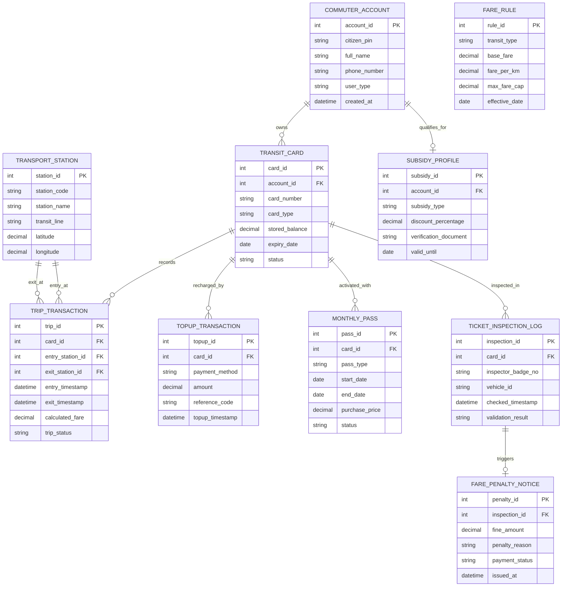

# Conceptual ERD — Public Transport Payment System

## Mermaid Code

## Entity Description Table | Bảng mô tả Entity

| # | Entity Name | Vietnamese Name | Description | Key Attributes | Main Relationships |
|---|-------------|-----------------|-------------|----------------|-------------------|
| 1 | COMMUTER_ACCOUNT | Tài khoản Hành khách | Thông tin tài khoản người dùng ứng dụng giao thông công cộng | account_id, citizen_pin, full_name, user_type | Owns TRANSIT_CARD, qualifies for SUBSIDY_PROFILE |
| 2 | TRANSIT_CARD | Thẻ Vé Thông minh | Thông tin phôi thẻ thông minh NFC/EMV hoặc thẻ ảo QR | card_id, card_number, card_type, stored_balance | Belongs to COMMUTER_ACCOUNT, records TRIP_TRANSACTION |
| 3 | TRANSPORT_STATION | Trạm / Ga Giao thông | Danh mục các nhà ga Metro, bến xe buýt và điểm dừng | station_id, station_code, station_name, transit_line | Entry and exit point for TRIP_TRANSACTION |
| 4 | TRIP_TRANSACTION | Chuyến đi & Giao dịch Vé | Nhật ký thông tin lượt đi, trạm vào/ra, thời gian và tiền cước | trip_id, entry_timestamp, exit_timestamp, calculated_fare | Belongs to TRANSIT_CARD, TRANSPORT_STATION |
| 5 | TOPUP_TRANSACTION | Giao dịch Nạp tiền | Lịch sử các lần nạp tiền vào tài khoản thẻ qua ngân hàng/ví | topup_id, payment_method, amount, reference_code | Belongs to TRANSIT_CARD |
| 6 | MONTHLY_PASS | Vé tháng | Thông tin đăng ký gói vé tháng không giới hạn lượt đi | pass_id, pass_type, start_date, end_date | Belongs to TRANSIT_CARD |
| 7 | FARE_RULE | Quy tắc Biểu giá Vé | Cấu hình công thức tính giá vé cơ sở, giá theo km và giá trần | rule_id, transit_type, base_fare, fare_per_km | Used by System to calculate TRIP_TRANSACTION |
| 8 | SUBSIDY_PROFILE | Hồ sơ Trợ giá Ưu đãi | Thông tin đối tượng ưu tiên (học sinh, sinh viên, người cao tuổi) | subsidy_id, subsidy_type, discount_percentage | Belongs to COMMUTER_ACCOUNT |
| 9 | TICKET_INSPECTION_LOG | Nhật ký Soát vé | Nhật ký kiểm tra thẻ vé của nhân viên kiểm soát trên xe/tàu | inspection_id, inspector_badge_no, validation_result | Belongs to TRANSIT_CARD, triggers FARE_PENALTY_NOTICE |
| 10 | FARE_PENALTY_NOTICE | Quyết định Xử phạt Trốn vé | Biên bản xử phạt vi phạm đối với hành khách đi chui vé | penalty_id, fine_amount, penalty_reason, payment_status | Belongs to TICKET_INSPECTION_LOG |

## Relationship Description | Mô tả Quan hệ

| # | From Entity | Cardinality | To Entity | Relationship Label | Business Explanation |
|---|-------------|-------------|-----------|-------------------|----------------------|
| 1 | COMMUTER_ACCOUNT | one-to-many | TRANSIT_CARD | owns | Một tài khoản hành khách sở hữu nhiều thẻ vé giao thông |
| 2 | COMMUTER_ACCOUNT | one-to-one | SUBSIDY_PROFILE | qualifies_for | Một tài khoản có thể được xác nhận một hồ sơ trợ giá ưu tiên |
| 3 | TRANSIT_CARD | one-to-many | TRIP_TRANSACTION | records | Một thẻ vé ghi nhận lịch sử di chuyển nhiều chuyến đi |
| 4 | TRANSIT_CARD | one-to-many | TOPUP_TRANSACTION | recharged_by | Một thẻ vé được nạp tiền nhiều lần qua các kênh thanh toán |
| 5 | TRANSIT_CARD | one-to-many | MONTHLY_PASS | activated_with | Một thẻ vé có thể đăng ký gia hạn nhiều đợt vé tháng |
| 6 | TRANSIT_CARD | one-to-many | TICKET_INSPECTION_LOG | inspected_in | Một thẻ vé được ghi nhật ký kiểm tra soát vé trên phương tiện |
| 7 | TRANSPORT_STATION | one-to-many | TRIP_TRANSACTION | entry_at | Một nhà ga đóng vai trò là điểm trạm vào cho nhiều chuyến đi |
| 8 | TRANSPORT_STATION | one-to-many | TRIP_TRANSACTION | exit_at | Một nhà ga đóng vai trò là điểm trạm ra cho nhiều chuyến đi |
| 9 | TICKET_INSPECTION_LOG | one-to-one | FARE_PENALTY_NOTICE | triggers | Lượt kiểm tra soát vé phát hiện trốn vé sẽ kích hoạt một quyết định phạt |
