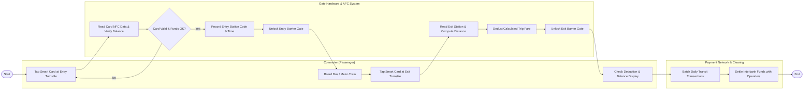

# Swimlane Diagram — Public Transport Payment System

## Mermaid Code

## Flow Description | Mô tả luồng

| Lane | Actor | Role in Flow |
|------|-------|-------------|
| 1 | Commuter (Passenger) | Chạm thẻ vé tại cửa vào, di chuyển trên phương tiện công cộng, chạm thẻ tại cửa ra và kiểm tra số tiền khấu trừ. |
| 2 | Gate Hardware & AFC System | Đọc chip NFC thẻ, xác minh điều kiện và số dư, ghi nhận ga vào, mở cửa xoay, tính toán cước phí chặng ra, trừ tiền và mở cửa ra. |
| 3 | Payment Network & Clearing | Gom lô các giao dịch quẹt thẻ trong ngày và thực hiện đối soát quyết toán dòng tiền giữa ngân hàng và đơn vị vận hành. |
