# Action Tree — Public Transport Payment System

## Mermaid Code

```mermaid
graph TD
    Root["Public Transport Payment System"]

    Root --> M1["Fare Collection & Entry Gates"]
    Root --> M2["Distance-Based Fare Calculation"]
    Root --> M3["Transit Card & Top-up Engine"]
    Root --> M4["Mobile QR & E-Wallet Payment"]
    Root --> M5["Inspection & Enforcement"]
    Root --> M6["Interbank Clearing & Analytics"]

    M1 --> A11["Process Tap-In NFC Entry Gate"]
    M1 --> A12["Process Tap-Out NFC Exit Gate"]
    M1 --> A13["Control Turnstile Barrier Gates"]
    M1 --> A14["Display Gate Passenger Messages"]

    M2 --> A21["Lookup Distance Matrix Stations"]
    M2 --> A22["Apply Student Senior Subsidies"]
    M2 --> A23["Calculate Peak-Hour Fare Surcharge"]
    M2 --> A24["Enforce Maximum Daily Fare Cap"]

    M3 --> A31["Issue Transit Smart Cards"]
    M3 --> A32["Process Online E-Wallet Top-ups"]
    M3 --> A33["Process Cash TVM Machine Top-ups"]
    M3 --> A34["Block Blacklisted Lost Cards"]

    M4 --> A41["Generate Dynamic QR Tickets"]
    M4 --> A42["Process Mobile NFC Wallet Payments"]
    M4 --> A43["Activate Monthly Unlimited Passes"]
    M4 --> A44["Issue Electronic Fare Receipts"]

    M5 --> A51["Scan Passengers via Handheld Readers"]
    M5 --> A52["Validate Entry Check-in Status"]
    M5 --> A53["Issue Fare Evasion Penalty Notices"]
    M5 --> A54["Log Inspector Patrol Routes"]

    M6 --> A61["Batch Daily Interbank Clearing"]
    M6 --> A62["Reconcile Operator Revenue Ledgers"]
    M6 --> A63["Monitor Real-time Passenger Flow"]
    M6 --> A64["Export Transport Ministry Reports"]
```

## Module Description | Mô tả Module

| # | Module | Description | Actions |
|---|--------|-------------|---------|
| 1 | Fare Collection & Entry Gates | Xử lý chạm thẻ NFC tại cửa vào/ra, điều khiển mở cửa xoay turnstile và hiển thị thông điệp trên màn hình | Process Tap-In NFC Entry Gate, Process Tap-Out NFC Exit Gate, Control Turnstile Barrier Gates, Display Gate Passenger Messages |
| 2 | Distance-Based Fare Calculation | Động cơ tính giá vé tự động theo kilomet di chuyển, áp dụng giảm giá ưu đãi và tính giá vé trần | Lookup Distance Matrix Stations, Apply Student Senior Subsidies, Calculate Peak-Hour Fare Surcharge, Enforce Maximum Daily Fare Cap |
| 3 | Transit Card & Top-up Engine | Phát hành thẻ vé thông minh, xử lý nạp tiền qua ví điện tử/ngân hàng và khóa thẻ blacklist | Issue Transit Smart Cards, Process Online E-Wallet Top-ups, Process Cash TVM Machine Top-ups, Block Blacklisted Lost Cards |
| 4 | Mobile QR & E-Wallet Payment | Khởi tạo vé mã QR động, thanh toán chạm ví NFC di động và gia hạn các gói vé tháng | Generate Dynamic QR Tickets, Process Mobile NFC Wallet Payments, Activate Monthly Unlimited Passes, Issue Electronic Fare Receipts |
| 5 | Inspection & Enforcement | Phân hệ soát vé cầm tay của thanh tra giao thông, xác minh quẹt thẻ hợp lệ và lập biên bản phạt trốn vé | Scan Passengers via Handheld Readers, Validate Entry Check-in Status, Issue Fare Evasion Penalty Notices, Log Inspector Patrol Routes |
| 6 | Interbank Clearing & Analytics | Gom lô quyết toán doanh thu liên ngân hàng, hạch toán ngân sách và phân tích mật độ di chuyển hành khách | Batch Daily Interbank Clearing, Reconcile Operator Revenue Ledgers, Monitor Real-time Passenger Flow, Export Transport Ministry Reports |
