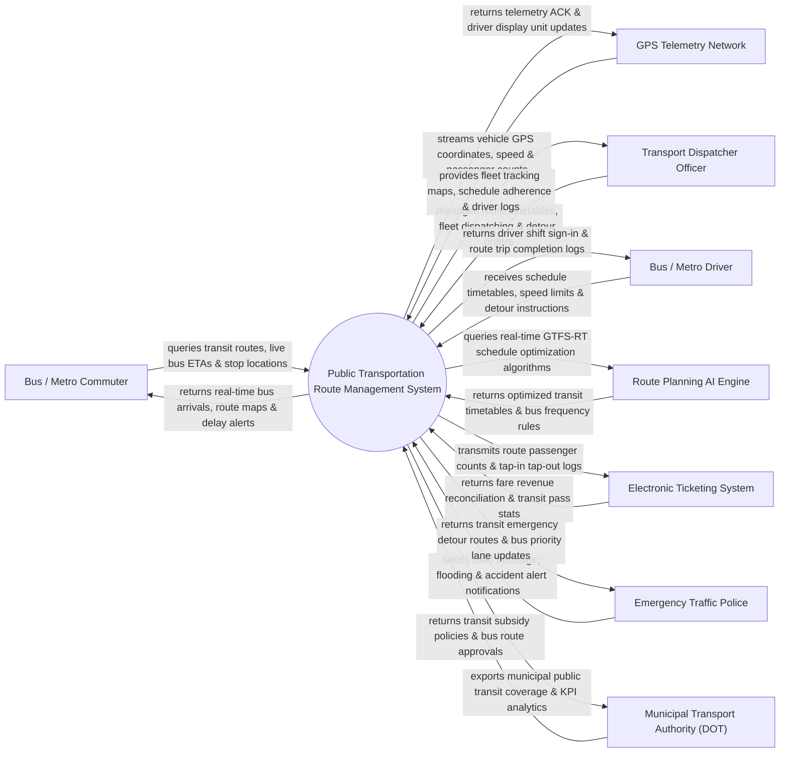

# Context Diagram — Public Transportation Route Management System

## Mermaid Code

## Actor & Interaction Table | Bảng Actor & Tương tác

| # | Actor | Actor Type | Data Sent TO System | Data Received FROM System | Notes |
|---|-------|------------|---------------------|---------------------------|-------|
| 1 | Bus / Metro Commuter | Primary | Route queries, ETA requests, stop location searches | Real-time bus ETAs, route maps, delay notification alerts | Hành khách đi xe buýt, tàu điện ngầm metro đô thị |
| 2 | Transport Dispatcher Officer | Primary | Timetables, fleet dispatch commands, emergency detour orders | Fleet tracking maps, schedule adherence metrics, driver logs | Cán bộ Điều hành Trung tâm Quản lý Giao thông Công cộng |
| 3 | Bus / Metro Driver | Primary | Driver shift sign-ins, trip status, incident reports | Schedule timetables, speed limit warnings, detour instructions | Lái xe buýt và lái tàu điện ngầm đô thị |
| 4 | GPS Telemetry Network | Supporting | Real-time GPS coordinates, speed, heading, passenger counter | Telemetry ACK, driver display unit (DDU) configuration | Mạng lưới thiết bị giám sát hành trình GPS và cảm biến đếm người |
| 5 | Municipal Transport Authority (DOT) | Regulatory | Transit subsidy policies, bus route licensing approvals | Municipal public transit coverage BI dashboards, KPI reports | Sở Giao thông Vận tải quản lý quy hoạch luồng tuyến giao thông |
| 6 | Electronic Ticketing System | Supporting | Fare revenue reconciliation data, transit pass statistics | Route passenger counts, tap-in tap-out validation logs | Hệ thống vé điện tử liên thông (Thẻ xe buýt/Metro thông minh) |
| 7 | Emergency Traffic Police | Supporting | Road blockage notices, flooding alerts, accident logs | Transit emergency detour routes, bus priority lane updates | Cảnh sát Giao thông phân luồng điều tiết khi có sự cố |
| 8 | Route Planning AI Engine | Supporting | Optimized transit timetables, bus frequency rules | GTFS-RT historical traffic data, passenger demand matrices | Thuật toán AI tối ưu hóa biểu đồ giờ xe chạy và giãn cách tuyến |

## System Boundary Description | Mô tả Phạm vi Hệ thống

Hệ thống Public Transportation Route Management System (Hệ thống Quản lý và Điều hành Tương tác Tuyến Giao thông Công cộng Đô thị / Transit Route Management System) chịu trách nhiệm tự động hóa quy trình quản lý mạng lưới xe buýt và tàu điện ngầm metro: Giám sát hành trình fleet tàu/xe thời gian thực qua định vị GPS, tự động lập biểu đồ giờ xe chạy (Timetable) tối ưu bằng AI theo chuẩn dữ liệu GTFS-RT (General Transit Feed Specification), điều hành tần suất chuyến (Headway Management), hiển thị thời gian xe đến trạm (ETA) cho hành khách qua bảng LED và ứng dụng di động, tự động phân luồng tránh ùn tắc/ngập lụt và đánh giá chỉ số đúng giờ (On-Time Performance - OTP). Tuy nhiên, hệ thống KHÔNG trực tiếp điều khiển vô lăng xe buýt và KHÔNG thay thế việc sửa chữa cơ khí xe tại gara.
