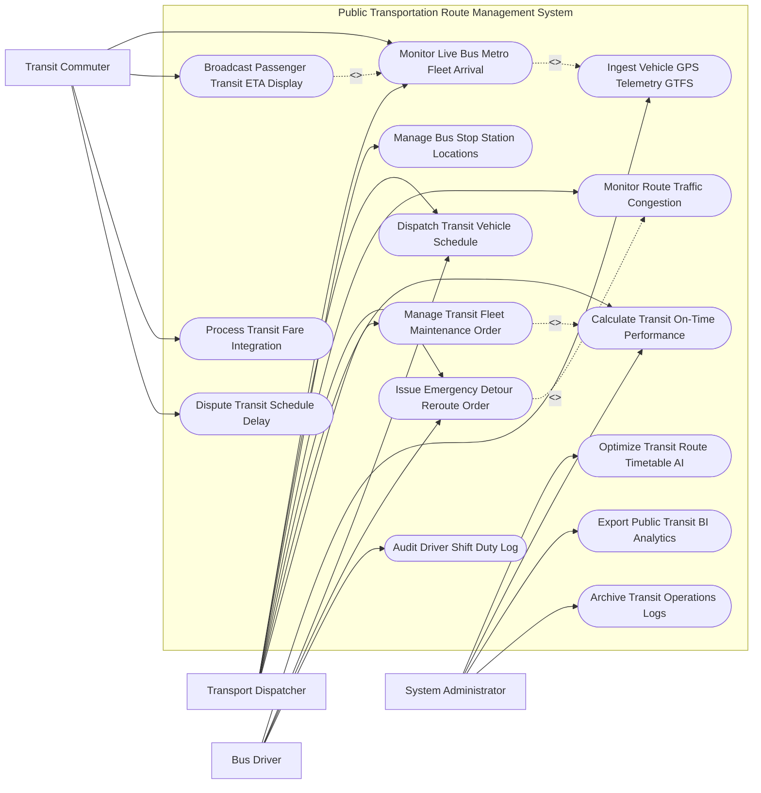

# Use Case Diagram — Public Transportation Route Management System

## Mermaid Code

## Actor Table | Bảng Actor

| # | Actor | Actor Type | Role Description | Related Use Cases |
|---|-------|------------|------------------|-------------------|
| 1 | Transit Commuter | Primary | Hành khách tra cứu thời gian xe đến trạm (ETA), sử dụng thẻ vé điện tử và phản hồi chậm chuyến | UC03, UC09, UC11, UC13 |
| 2 | Transport Dispatcher | Primary | Cán bộ điều độ giám sát xe trên tuyến, phân công nốt tài, điều chỉnh tần suất và ra lệnh phân luồng | UC03, UC04, UC05, UC06, UC07, UC08, UC12 |
| 3 | Bus Driver | Primary | Lái xe/Lái tàu thực hiện nốt tài theo biểu đồ giờ, truyền dữ liệu GPS và nhận lệnh điều hướng | UC01, UC04, UC07, UC10 |
| 4 | System Administrator | System | Quản trị viên sử dụng AI tối ưu biểu đồ giờ, đánh giá chỉ số OTP và xuất báo cáo nộp Sở TTVT | UC02, UC08, UC14, UC15 |

## Use Case Table | Bảng Use Case

| # | UC ID | Use Case Name | Primary Actor | Secondary Actor | Description | Priority |
|---|-------|---------------|---------------|-----------------|-------------|----------|
| 1 | UC01 | Ingest Vehicle GPS Telemetry GTFS | Driver | GPSTelemetry | Thu thập dữ liệu GPS định vị, tốc độ xe buýt/metro theo định dạng chuẩn GTFS-Realtime | High |
| 2 | UC02 | Optimize Transit Route Timetable AI | Admin | RouteAIEngine | Thuật toán AI phân tích nhu cầu đi lại để tối ưu hóa biểu đồ giờ xe chạy và giãn cách nốt | High |
| 3 | UC03 | Monitor Live Bus Metro Fleet Arrival | Commuter, Dispatcher | - | Giám sát vị trí thực tế của toàn bộ đoàn xe buýt/metro trên sơ đồ luồng tuyến đô thị | High |
| 4 | UC04 | Dispatch Transit Vehicle Schedule | Dispatcher, Driver | - | Phát lệnh xuất bến, phân công nốt tài cho lái xe và điều chỉnh khoảng cách giữa các xe (Headway) | High |
| 5 | UC05 | Manage Bus Stop Station Locations | Dispatcher | GIS | Quản lý tọa độ nhà chờ xe buýt, ga metro và bán kính vùng dừng đón trả khách | Medium |
| 6 | UC06 | Monitor Route Traffic Congestion | Dispatcher | TrafficPolice | Kết nối camera giao thông phát hiện các điểm ùn tắc, ngập lụt trên lộ trình xe buýt | High |
| 7 | UC07 | Issue Emergency Detour Reroute Order | Dispatcher, Driver | TrafficPolice | Ban hành lệnh phân luồng tạm thời cho xe buýt tránh tuyến đường đang bị ùn tắc/tai nạn | High |
| 8 | UC08 | Calculate Transit On-Time Performance | Dispatcher, Admin | - | Tự động tính toán tỷ lệ xe chạy đúng giờ (OTP - On-Time Performance) theo biểu đồ | High |
| 9 | UC09 | Broadcast Passenger Transit ETA Display | Commuter | DigitalSignage | Phát thông báo thời gian xe dự kiến đến trạm (ETA) lên bảng LED nhà chờ và ứng dụng di động | High |
| 10 | UC10 | Audit Driver Shift Duty Log | Driver | Dispatcher | Ghi nhận thời gian làm việc, số km vận hành và cảnh báo tài xế lái xe quá giờ quy định | Medium |
| 11 | UC11 | Process Transit Fare Integration | Commuter | Ticketing | Tích hợp dữ liệu quẹt thẻ vé điện tử liên thông xe buýt/metro để tính sản lượng khách | High |
| 12 | UC12 | Manage Transit Fleet Maintenance Order | Dispatcher | Garage | Lập lệnh bảo dưỡng định kỳ xe buýt hoặc rút xe hỏng hóc khỏi luồng tuyến vận hành | Medium |
| 13 | UC13 | Dispute Transit Schedule Delay | Commuter | Dispatcher | Tiếp nhận và xử lý phản ánh của hành khách về tình trạng bỏ chuyến, bỏ trạm, chậm giờ | Low |
| 14 | UC14 | Export Public Transit BI Analytics | Admin | TransportAuthority | Trích xuất báo cáo tỷ lệ đáp ứng vận tải công cộng và số tiền trợ giá nộp Sở GTVT | Low |
| 15 | UC15 | Archive Transit Operations Logs | System | Archives | Đóng gói và lưu trữ vĩnh viễn nhật ký vận hành xe buýt/metro phục vụ kiểm toán trợ giá | Low |

## Use Case Specification | Đặc tả Use Case

---

### UC01 — Ingest Vehicle GPS Telemetry GTFS

| Field | Detail |
|-------|--------|
| **UC ID** | UC01 |
| **Use Case Name** | Ingest Vehicle GPS Telemetry GTFS |
| **Actor(s)** | Primary: Bus Driver / Secondary: GPS Telemetry Network |
| **Description** | Thu thập dữ liệu định vị GPS, tốc độ hải lý, số lượng hành khách trên xe buýt/metro theo chuẩn quốc tế GTFS-RT. |
| **Precondition** | 1. Thiết bị giám sát hành trình GPS và cảm biến đếm người trên xe buýt đã được bật và kết nối 4G/5G. |
| **Main Flow** | 1. Thiết bị GPS trên xe phát thông điệp định vị định kỳ (02-05 giây/lần) về Hệ thống Trung tâm.   2. System tiếp nhận và chuẩn hóa dữ liệu theo định dạng chuẩn GTFS-Realtime (GTFS-RT Feed).   3. System bóc tách: Mã định danh xe (Vehicle ID), Mã tuyến (Route ID), Mã nốt tài (Trip ID), Vị trí GPS (Kinh độ, Vĩ độ), Tốc độ di chuyển ($km/h$), Hướng di chuyển và Số lượng hành khách trên xe (Occupancy Level).   4. System đối soát vị trí GPS thực tế vs Lộ trình tuyến quy định: Xác định xe đang ở giữa trạm A và trạm B.   5. System tính toán sai lệch thời gian vs Biểu đồ giờ quy định (Ahead / Behind Schedule).   6. System ghi nhận bản ghi hành trình vào CSDL Vận hành Tuyến.   7. System tự động đẩy dữ liệu GTFS-RT cập nhật sang Phân hệ Hiển thị thời gian chờ ETA cho hành khách (UC09). |
| **Alternative Flow** | **AF1** — Xe đi vào vùng mất sóng GPS (Hầm chui, tuyến Metro ngầm): System sử dụng thuật toán suy đoán vị trí (Dead Reckoning) dựa trên tốc độ cuối cùng để duy trì đường đi. |
| **Exception Flow** | **EX1** — Tín hiệu GPS bị nhiễu sai lệch quá 500m: System đánh dấu dữ liệu không tin cậy, phát cảnh báo kiểm tra thiết bị GPS cho kỹ thuật viên. |
| **Postcondition** | Vị trí toàn bộ lực lượng xe buýt/metro được cập nhật thời gian thực, sẵn sàng cho công tác điều độ (UC04). |
| **Business Rule** | **BR1**: Tần suất cập nhật vị trí GPS xe buýt thời gian thực không được chậm quá 05 giây/lần. |

---

### UC02 — Optimize Transit Route Timetable AI

| Field | Detail |
|-------|--------|
| **UC ID** | UC02 |
| **Use Case Name** | Optimize Transit Route Timetable AI |
| **Actor(s)** | Primary: System Administrator / Secondary: Route Planning AI Engine |
| **Description** | Thuật toán AI phân tích dữ liệu nhu cầu hành khách lịch sử và tình trạng giao thông để tự động lập biểu đồ giờ xe chạy tối ưu. |
| **Precondition** | 1. Dữ liệu quẹt thẻ vé điện tử (UC11) và lịch sử tốc độ xe (UC01) trong 06 tháng gần nhất đã được nạp vào AI. |
| **Main Flow** | 1. Admin mở Phân hệ Lập Biểu đồ Giờ Xe chạy Thông minh (AI Timetable Optimizer).   2. Admin chọn Tuyến xe buýt/metro cần lập biểu đồ (Ví dụ: Tuyến số 08: Bến xe Quận 8 - Đại học Quốc gia).   3. AI Engine phân tích biểu đồ mật độ nhu cầu hành khách theo từng khung giờ trong ngày: Khung giờ cao điểm ($6h30-8h30$, $16h30-18h30$) vs Khung giờ thấp điểm.   4. AI tính toán các thông số vận hành tối ưu:   - Tần suất xe chạy (Headway): 05 phút/chuyến giờ cao điểm, 15 phút/chuyến giờ thấp điểm.   - Thời gian giãn cách giữa các xe.   - Số lượng xe buýt cần huy động trên tuyến.   - Thời gian chạy trọn một lượt (Round-trip running time) có tính tới kẹt xe.   5. System xuất Dự thảo Biểu đồ Giờ xe chạy (Timetable Schedule) đính kèm dự báo sản lượng khách.   6. Admin kiểm tra và ký số phê duyệt biểu đồ giờ xe chạy mới.   7. System tự động đồng bộ biểu đồ giờ xuống ứng dụng của Lái xe (UC04) và bảng hiển thị trạm dừng (UC09). |
| **Alternative Flow** | **AF1** — Lập biểu đồ giờ xe chạy cho ngày Lễ/Tết: AI áp dụng mô hình dự báo ngày lễ, tự động tăng số lượng chuyến xe buýt phục vụ các khu vui chơi, bến xe. |
| **Exception Flow** | **EX1** — Tần suất xe chạy dự xuất quá mỏng mâu thuẫn với tiêu chuẩn trợ giá tối thiểu: System báo lỗi "Dưới định mức hạ tầng", yêu cầu điều chỉnh lại tần suất. |
| **Postcondition** | Biểu đồ giờ xe chạy được tối ưu hóa theo nhu cầu thực tế, giảm thời gian chờ đợi của hành khách và tiết kiệm chi phí nhiên liệu. |
| **Business Rule** | **BR1**: Biểu đồ giờ xe chạy mới phải được phê duyệt và công bố công khai trước ít nhất 05 ngày trước khi chính thức áp dụng. |

---

### UC04 — Dispatch Transit Vehicle Schedule

| Field | Detail |
|-------|--------|
| **UC ID** | UC04 |
| **Use Case Name** | Dispatch Transit Vehicle Schedule |
| **Actor(s)** | Primary: Transport Dispatcher, Bus Driver / Secondary: None |
| **Description** | Phát lệnh điều độ xuất bến, phân công nốt tài cho lái xe và điều chỉnh tần suất xe chạy trên luồng tuyến thời gian thực. |
| **Precondition** | 1. Biểu đồ giờ xe chạy (UC02) đã có hiệu lực và xe buýt đã sẵn sàng tại bến xuất phát. |
| **Main Flow** | 1. Dispatcher mở Màn hình Tác chiến Điều độ Tuyến (Dispatcher Operations Dashboard).   2. System hiển thị Danh sách các xe buýt đang chờ xuất bến và thời gian xuất bến quy định.   3. Dispatcher chọn xe buýt và gán Lái xe (Driver) đảm nhận nốt tài đó.   4. System truyền Lệnh xuất bến (Dispatch Order) xuống màn hình hiển thị trên xe (DDU - Driver Display Unit) của BusDriver.   5. BusDriver bấm "Xác nhận nhận nốt tài" và cho xe xuất bến đúng giây quy định.   6. Trong quá trình xe chạy trên tuyến: System tự động theo dõi khoảng cách giữa 2 xe liền kề (Headway Control).   7. If Xe trước chạy quá chậm do kẹt xe làm dồn chuyến (Bunching Effect): System phát cảnh báo cho Dispatcher.   8. Dispatcher ra lệnh cho xe sau: "Giảm tốc độ/Cho xe dừng chờ 02 phút tại trạm X để giãn khoảng cách đúng 05 phút". |
| **Alternative Flow** | **AF1** — Xe bị hỏng hóc giữa đường: BusDriver bấm báo sự cố, Dispatcher phát lệnh cho xe buýt dự phòng xuất bến thay thế ngay lập tức (UC12). |
| **Exception Flow** | **EX1** — Lái xe xuất bến trễ quá 10 phút không có lý do: System ghi nhận vi phạm bỏ nốt tài, tự động phạt trừ điểm thi đua của lái xe (UC10). |
| **Postcondition** | Các chuyến xe buýt được xuất bến đúng giờ, khoảng cách giữa các xe trên tuyến được duy trì đều đặn. |
| **Business Rule** | **BR1**: Tỷ lệ xuất bến đúng giờ (On-Time Departure Rate) tại bến xuất phát bắt buộc phải đạt tối thiểu $98\%$. |

---

### UC07 — Issue Emergency Detour Reroute Order

| Field | Detail |
|-------|--------|
| **UC ID** | UC07 |
| **Use Case Name** | Issue Emergency Detour Reroute Order |
| **Actor(s)** | Primary: Transport Dispatcher, Bus Driver / Secondary: Emergency Traffic Police |
| **Description** | Phát lệnh phân luồng tạm thời cho xe buýt chuyển hướng tránh tuyến đường đang bị ùn tắc nghiêm trọng, ngập lụt hoặc tai nạn. |
| **Precondition** | 1. Phát hiện sự cố tắc đường nghiêm trọng hoặc nhận thông báo phân luồng từ Cảnh sát Giao thông (UC06). |
| **Main Flow** | 1. System nhận cảnh báo ùn tắc/ngập lụt tại đoạn đường X trên Lộ trình Tuyến số Y.   2. Dispatcher mở Phân hệ Phân luồng Tạm thời (Emergency Rerouting).   3. System tự động đề xuất 03 Lộ trình tránh (Detour Routes) thay thế dựa trên bản đồ GIS giao thông đô thị.   4. Dispatcher chọn Lộ trình tránh tối ưu nhất và bấm "Phê duyệt Lệnh phân luồng tạm thời".   5. System tự động truyền Lệnh phân luồng và Bản đồ chỉ đường mới xuống màn hình DDU của toàn bộ BusDriver đang chạy trên tuyến đó.   6. System tự động cập nhật Lộ trình tránh lên ứng dụng di động của Commuter và bảng LED nhà chờ xe buýt (UC09): Thông báo "Tuyến số Y tạm thời không phục vụ trạm A, B do ngập lụt, chuyển hướng qua đường Z".   7. BusDriver điều khiển xe buýt di chuyển theo Lộ trình tránh cho đến khi đoạn đường chính được thông xe trở lại. |
| **Alternative Flow** | **AF1** — Phân luồng phục vụ sự kiện chính trị/thể thao lớn: Dispatcher lập sẵn Lộ trình tránh từ trước 24 giờ và tự động kích hoạt đúng giờ diễn ra sự kiện. |
| **Exception Flow** | **EX1** — Lái xe không tuân thủ lệnh phân luồng cố tình đi vào đường ngập làm chết máy xe: System bật báo động sự cố nghiêm trọng, chuyển thông tin sang Phân hệ Bảo dưỡng xe (UC12). |
| **Postcondition** | Đoàn xe buýt né tránh thành công điểm ùn tắc, đảm bảo hành trình liên tục và an toàn cho hành khách. |
| **Business Rule** | **BR1**: Thông báo phân luồng tránh đường phải được phát tới hành khách trên ứng dụng di động trong vòng không quá 01 phút kể từ khi phát lệnh. |
