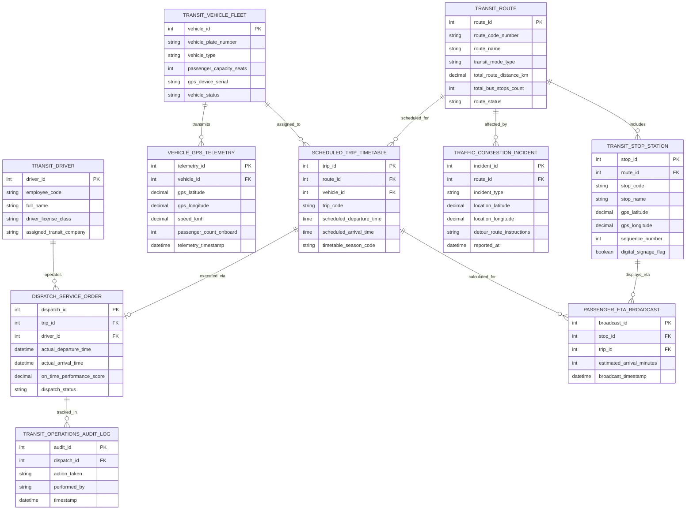

# Conceptual ERD — Public Transportation Route Management System

## Mermaid Code

## Entity Description Table | Bảng mô tả Entity

| # | Entity Name | Vietnamese Name | Description | Key Attributes | Main Relationships |
|---|-------------|-----------------|-------------|----------------|-------------------|
| 1 | TRANSIT_ROUTE | Tuyến Giao thông Công cộng | Thông tin lộ trình tuyến xe buýt hoặc metro (mã tuyến, tên tuyến, cự ly km, số trạm) | route_id, route_code_number, route_name, transit_mode_type, route_status | Includes STOP_STATION, scheduled for TIMETABLE |
| 2 | TRANSIT_STOP_STATION | Nhà chờ / Ga Metro | Tọa độ GPS địa lý của các nhà chờ xe buýt và ga metro trên luồng tuyến | stop_id, stop_code, stop_name, gps_latitude, gps_longitude, sequence_number | Belongs to TRANSIT_ROUTE, displays ETA |
| 3 | TRANSIT_VEHICLE_FLEET | Đoàn Xe buýt / Metro | Danh mục phương tiện vận tải công cộng (biển số, loại xe, sức chứa, mã GPS) | vehicle_id, vehicle_plate_number, vehicle_type, passenger_capacity_seats, vehicle_status | Transmits TELEMETRY, assigned to TIMETABLE |
| 4 | VEHICLE_GPS_TELEMETRY | Nhật ký Định vị GPS | Tọa độ GPS định vị, tốc độ $km/h$ và số lượng hành khách trên xe thời gian thực | telemetry_id, gps_latitude, gps_longitude, speed_kmh, telemetry_timestamp | Belongs to TRANSIT_VEHICLE_FLEET |
| 5 | SCHEDULED_TRIP_TIMETABLE | Biểu đồ Giờ Xe chạy | Khung giờ xe chạy quy định (Timetable) theo nốt tài trong ngày xuất phát tại bến | trip_id, trip_code, scheduled_departure_time, scheduled_arrival_time | Belongs to ROUTE, VEHICLE, executed via DISPATCH |
| 6 | DISPATCH_SERVICE_ORDER | Lệnh Điều độ Nốt tài | Kết quả điều độ thực tế chuyến đi (giờ xuất bến thực tế, giờ cập bến, điểm OTP) | dispatch_id, actual_departure_time, on_time_performance_score, dispatch_status | Executed for TIMETABLE, operated by DRIVER |
| 7 | TRAFFIC_CONGESTION_INCIDENT | Sự cố Ùn tắc Giao thông | Ghi nhận các điểm ngập lụt, tai nạn, tắc đường ảnh hưởng đến lộ trình xe buýt | incident_id, incident_type, location_latitude, detour_route_instructions | Belongs to TRANSIT_ROUTE |
| 8 | TRANSIT_DRIVER | Lái xe / Lái tàu Metro | Thông tin tài xế điều khiển phương tiện vận tải công cộng, bằng lái và ca trực | driver_id, employee_code, full_name, driver_license_class | Operates DISPATCH_SERVICE_ORDER |
| 9 | PASSENGER_ETA_BROADCAST | Bản tin Thời gian Xe đến ETA | Dữ liệu thời gian dự kiến xe buýt đến trạm ($phút$) phát lên bảng LED và App | broadcast_id, estimated_arrival_minutes, broadcast_timestamp | Belongs to STOP_STATION, TIMETABLE |
| 10 | TRANSIT_OPERATIONS_AUDIT_LOG | Nhật ký Kiểm toán Vận hành | Lưu toàn bộ vết thu thập GPS, xuất bến, điều chỉnh tần suất, phân luồng và trợ giá | audit_id, action_taken, performed_by, timestamp | Belongs to DISPATCH_SERVICE_ORDER |

## Relationship Description | Mô tả Quan hệ

| # | From Entity | Cardinality | To Entity | Relationship Label | Business Explanation |
|---|-------------|-------------|-----------|-------------------|----------------------|
| 1 | TRANSIT_ROUTE | one-to-many | TRANSIT_STOP_STATION | includes | Một tuyến giao thông công cộng bao gồm chuỗi nhiều nhà chờ xe buýt/ga metro |
| 2 | TRANSIT_ROUTE | one-to-many | SCHEDULED_TRIP_TIMETABLE | scheduled_for | Một tuyến đường được lập biểu đồ nhiều nốt tài xe chạy trong ngày |
| 3 | TRANSIT_VEHICLE_FLEET | one-to-many | VEHICLE_GPS_TELEMETRY | transmits | Một xe buýt truyền hàng ngàn bản ghi tọa độ định vị GPS thời gian thực về trung tâm |
| 4 | TRANSIT_VEHICLE_FLEET | one-to-many | SCHEDULED_TRIP_TIMETABLE | assigned_to | Một xe buýt được phân công đảm nhận thực hiện nhiều nốt tài trong ngày |
| 5 | SCHEDULED_TRIP_TIMETABLE | one-to-one | DISPATCH_SERVICE_ORDER | executed_via | Mỗi nốt tài trong biểu đồ giờ được thực thi bởi duy nhất một Lệnh điều độ xuất bến |
| 6 | TRANSIT_DRIVER | one-to-many | DISPATCH_SERVICE_ORDER | operates | Một tài xế trực tiếp điều khiển phương tiện thực hiện nhiều lệnh điều độ chuyến |
| 7 | TRANSIT_ROUTE | one-to-many | TRAFFIC_CONGESTION_INCIDENT | affected_by | Một tuyến đường xe buýt có thể chịu ảnh hưởng bởi nhiều điểm ùn tắc giao thông |
| 8 | TRANSIT_STOP_STATION | one-to-many | PASSENGER_ETA_BROADCAST | displays_eta | Một nhà chờ xe buýt phát hiển thị nhiều bản tin dự báo thời gian xe đến ETA |
| 9 | SCHEDULED_TRIP_TIMETABLE | one-to-many | PASSENGER_ETA_BROADCAST | calculated_for | Mỗi nốt tài đang chạy được tính toán thời gian ETA tới các trạm phía trước |
| 10 | DISPATCH_SERVICE_ORDER | one-to-many | TRANSIT_OPERATIONS_AUDIT_LOG | tracked_in | Mọi thao tác điều độ chuyến xe buýt được ghi lại nhật ký kiểm toán bất biến |
