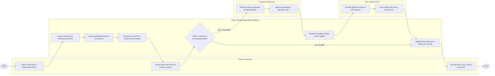

# Swimlane Diagram — Public Transportation Route Management System

## Mermaid Code

## Flow Description | Mô tả luồng

| Lane | Actor | Role in Flow |
|------|-------|-------------|
| 1 | Transit Commuter | Mở ứng dụng tra cứu tuyến xe buýt, xem thời gian dự kiến xe đến trạm (ETA) và quẹt thẻ vé điện tử khi lên xe. |
| 2 | Public Transportation Route Platform | Thu thập dữ liệu GPS GTFS-RT, tính toán thời gian ETA bằng AI, hiển thị thông tin lên nhà chờ và tự động gạch nợ vé. |
| 3 | Transport Dispatcher | Giám sát giãn cách các xe buýt trên tuyến, phê duyệt lệnh phân luồng chuyển hướng khi có kẹt xe hoặc ngập lụt. |
| 4 | Bus / Metro Driver | Nhận lệnh điều độ và sơ đồ chỉ đường né kẹt xe trên màn hình hiển thị DDU để điều khiển xe an toàn. |
