# Action Tree — Public Transportation Route Management System

## Mermaid Code

```mermaid
graph TD
    Root["Public Transportation Route Management System"]

    Root --> M1["Vehicle Telemetry & GTFS Real-Time Ingestion"]
    Root --> M2["AI Route Optimization & Timetable Scheduling"]
    Root --> M3["Fleet Dispatching & Driver Shift Management"]
    Root --> M4["Traffic Congestion & Emergency Rerouting"]
    Root --> M5["Passenger Information & Bus Stop Signage"]
    Root --> M6["Transit BI & Performance Analytics"]

    M1 --> A11["Ingest Vehicle GPS Telemetry GTFS"]
    M1 --> A12["Process Passenger Counter Sensors"]
    M1 --> A13["Monitor Driver Display Unit DDU Status"]
    M1 --> A14["Detect Vehicle Speeding Violations"]

    M2 --> A21["Optimize Transit Route Timetable AI"]
    M2 --> A22["Calculate Transit On-Time Performance OTP"]
    M2 --> A23["Manage Bus Stop Station Locations GIS"]
    M2 --> A24["Forecast Hourly Passenger Transit Demand"]

    M3 --> A31["Dispatch Transit Vehicle Schedules"]
    M3 --> A32["Audit Driver Shift Duty Logs"]
    M3 --> A33["Control Headway Vehicle Bunching"]
    M3 --> A34["Manage Transit Fleet Maintenance Orders"]

    M4 --> A41["Monitor Route Traffic Congestion AI"]
    M4 --> A42["Issue Emergency Detour Reroute Orders"]
    M4 --> A43["Integrate Traffic Police Flooding Alerts"]
    M4 --> A44["Manage Priority Signal Transit Lanes"]

    M5 --> A51["Broadcast Passenger Transit ETA Display"]
    M5 --> A52["Monitor Live Bus Metro Fleet Arrival"]
    M5 --> A53["Process Transit Fare Integration Tap"]
    M5 --> A54["Dispute Transit Schedule Delays"]

    M6 --> A61["Export Public Transit BI Analytics"]
    M6 --> A62["Calculate Municipal Bus Subsidy Payouts"]
    M6 --> A63["Log System Immutable Operations Audits"]
    M6 --> A64["Archive Transit Operations GTFS Logs"]
```

## Module Description | Mô tả Module

| # | Module | Description | Actions |
|---|--------|-------------|---------|
| 1 | Vehicle Telemetry & GTFS Real-Time Ingestion | Thu thập tự động dữ liệu định vị GPS theo chuẩn GTFS-RT, cảm biến đếm hành khách và giám sát tốc độ phương tiện | Ingest Vehicle GPS Telemetry GTFS, Process Passenger Counter Sensors, Monitor Driver Display Unit DDU Status, Detect Vehicle Speeding Violations |
| 2 | AI Route Optimization & Timetable Scheduling | Thuật toán AI lập biểu đồ giờ xe chạy tối ưu theo nhu cầu khách hàng, quản lý vị trí nhà chờ và tính toán chỉ số OTP | Optimize Transit Route Timetable AI, Calculate Transit On-Time Performance OTP, Manage Bus Stop Station Locations GIS, Forecast Hourly Passenger Transit Demand |
| 3 | Fleet Dispatching & Driver Shift Management | Điều độ xuất bến, điều chỉnh khoảng cách giãn xe (Headway), phân công ca trực tài xế và quản lý bảo dưỡng xe buýt | Dispatch Transit Vehicle Schedules, Audit Driver Shift Duty Logs, Control Headway Vehicle Bunching, Manage Transit Fleet Maintenance Orders |
| 4 | Traffic Congestion & Emergency Rerouting | Phát hiện điểm ùn tắc/ngập lụt bằng AI camera, ra lệnh phân luồng tạm thời và ưu tiên tín hiệu đèn cho xe buýt | Monitor Route Traffic Congestion AI, Issue Emergency Detour Reroute Orders, Integrate Traffic Police Flooding Alerts, Manage Priority Signal Transit Lanes |
| 5 | Passenger Information & Bus Stop Signage | Phát thời gian xe dự kiến đến trạm (ETA) lên bảng LED nhà chờ/App, tích hợp quẹt thẻ vé điện tử và xử lý phản ánh trễ chuyến | Broadcast Passenger Transit ETA Display, Monitor Live Bus Metro Fleet Arrival, Process Transit Fare Integration Tap, Dispute Transit Schedule Delays |
| 6 | Transit BI & Performance Analytics | Trích xuất báo cáo tổng hợp chất lượng dịch vụ vận tải công cộng nộp Sở GTVT, tính tiền trợ giá xe buýt và lưu trữ GTFS | Export Public Transit BI Analytics, Calculate Municipal Bus Subsidy Payouts, Log System Immutable Operations Audits, Archive Transit Operations GTFS Logs |
