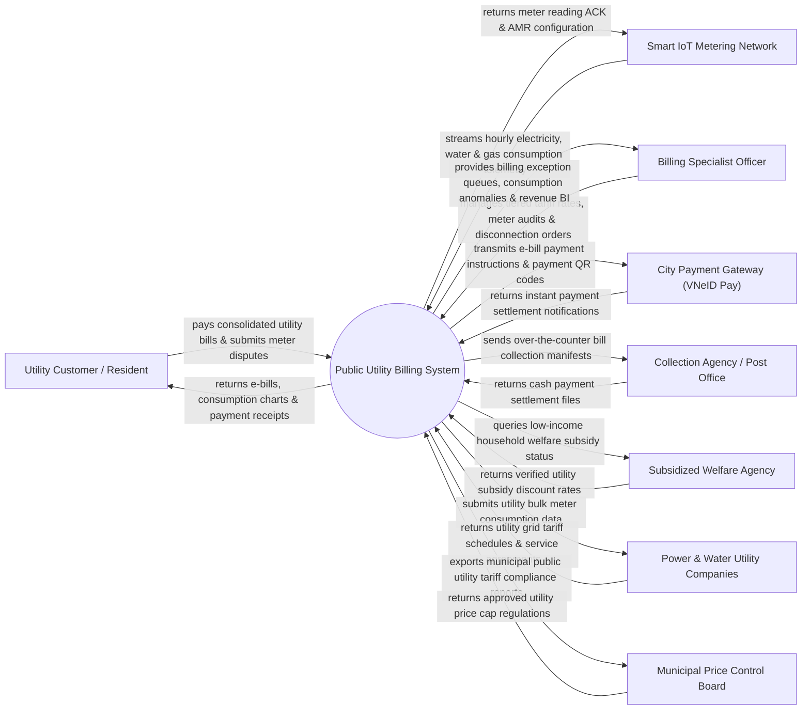

# Context Diagram — Public Utility Billing System

## Mermaid Code

## Actor & Interaction Table | Bảng Actor & Tương tác

| # | Actor | Actor Type | Data Sent TO System | Data Received FROM System | Notes |
|---|-------|------------|---------------------|---------------------------|-------|
| 1 | Utility Customer / Resident | Primary | Bill payments, meter reading disputes, subsidy applications | Consolidated e-bills, consumption breakdown charts, receipts | Hộ gia đình và doanh nghiệp sử dụng điện, nước, gas, vệ sinh |
| 2 | Billing Specialist Officer | Primary | Tariff schedules, meter audit sign-offs, service disconnection orders | Billing exception queues, consumption anomaly alerts, revenue BI | Cán bộ Công ty Điện lực / Cấp nước / Dịch vụ Đô thị |
| 3 | Smart IoT Metering Network | Supporting | Hourly electricity, water & gas AMR meter telemetry, tamper alarms | Meter reading ACK, AMR firmware configuration | Mạng lưới đồng hồ đo đếm thông minh IoT (AMR/AMI) |
| 4 | City Payment Gateway (VNeID Pay) | Supporting | Instant payment settlement notifications, transaction IDs | E-bill payment instruction details, QR payment codes | Cổng thanh toán trực tiện ích công cộng của thành phố |
| 5 | Power & Water Utility Companies | Supporting | Utility grid tariff schedules, wholesale bulk supply agreements | Utility bulk meter consumption data, net revenue reconciliation | Các tổng công ty điện lực, cấp nước và quản lý chất thải |
| 6 | Subsidized Welfare Agency | Supporting | Verified utility subsidy discount rates, poor household list | Utility subsidy usage reports, discount credit manifests | Cơ quan Bảo trợ Xã hội hỗ trợ tiền điện/nước cho hộ nghèo |
| 7 | Collection Agency / Post Office | Supporting | Cash payment settlement files, counter transaction logs | Over-the-counter bill collection manifests, barcode rules | Bưu điện và chuỗi điểm thu hộ tiền điện nước |
| 8 | Municipal Price Control Board | Regulatory | Approved utility price cap regulations, tiered tariff guidelines | Municipal public utility tariff compliance reports | Ủy ban Quản lý Giá và Sở Tài chính thành phố |

## System Boundary Description | Mô tả Phạm vi Hệ thống

Hệ thống Public Utility Billing System (Hệ thống Lập Hóa đơn và Thanh toán Dịch vụ Công cộng Đô thị) chịu trách nhiệm tự động hóa quy trình thu gom chỉ số và tính hóa đơn điện, nước, gas, thu gom rác thải cho đô thị: Thu thập chỉ số đồng hồ thông minh IoT (AMR/AMI), tính toán tiền điện nước theo bậc thang định mức quy định, phát hành hóa đơn điện tử hợp nhất (Consolidated e-Bill), hỗ trợ thanh toán trực tuyến qua VNeID Pay / Ngân hàng, tự động trừ tiền hỗ trợ hộ nghèo, phát lệnh tạm ngưng cấp dịch vụ (Disconnection) đối với các trường hợp nợ tiền quá hạn và khôi phục cấp điện nước khi đã thanh toán. Tuy nhiên, hệ thống KHÔNG trực tiếp vận hành nhà máy điện/nước và KHÔNG thay thế việc lắp đặt đồng hồ vật lý ngoài hiện trường.
