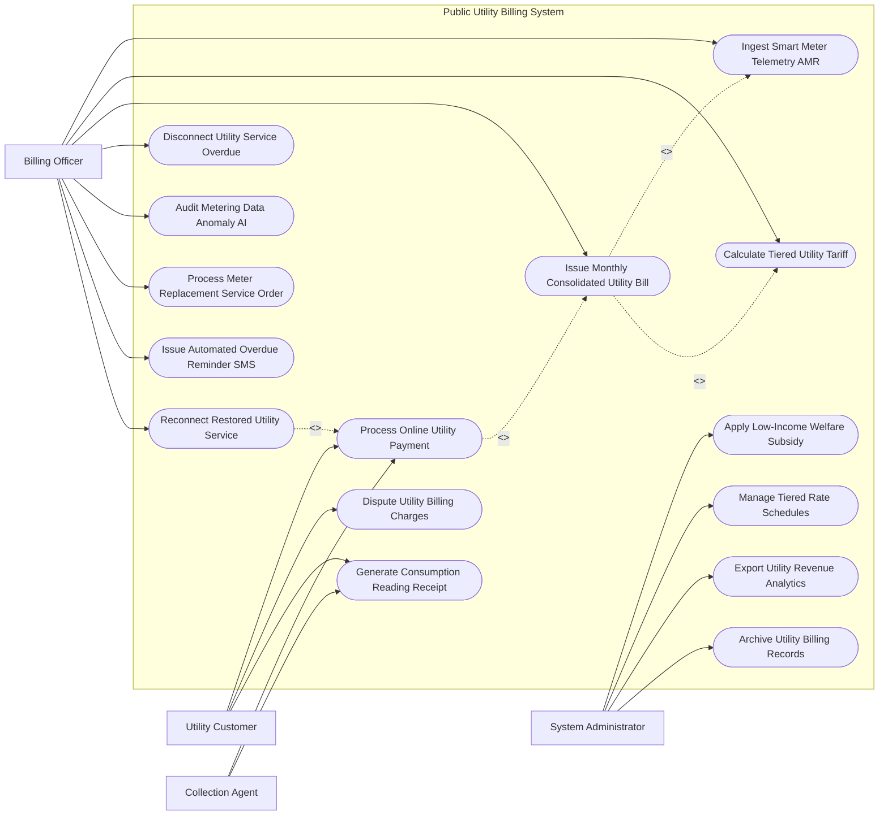

# Use Case Diagram — Public Utility Billing System

## Mermaid Code

## Actor Table | Bảng Actor

| # | Actor | Actor Type | Role Description | Related Use Cases |
|---|-------|------------|------------------|-------------------|
| 1 | Utility Customer | Primary | Phụ huynh/Cư dân thanh toán tiền điện nước trực tuyến, khiếu nại chỉ số và nhận hóa đơn | UC04, UC09, UC10 |
| 2 | Billing Officer | Primary | Cán bộ ghi chỉ số, phát hành hóa đơn hợp nhất, xử lý bất thường và cắt/mở điện nước | UC01, UC02, UC03, UC05, UC07, UC08, UC11, UC13 |
| 3 | Collection Agent | Supporting | Nhân viên thu hộ tiền điện nước tại đại lý, bưu điện hoặc cổng thanh toán | UC04, UC10 |
| 4 | System Administrator | System | Quản trị viên quản lý biểu giá bậc thang, trợ cấp hộ nghèo và báo cáo doanh thu | UC06, UC12, UC14, UC15 |

## Use Case Table | Bảng Use Case

| # | UC ID | Use Case Name | Primary Actor | Secondary Actor | Description | Priority |
|---|-------|---------------|---------------|-----------------|-------------|----------|
| 1 | UC01 | Ingest Smart Meter Telemetry AMR | Officer | SmartMeter | Tự động thu thập chỉ số đồng hồ điện/nước/gas thông minh qua mạng không dây AMR/AMI | High |
| 2 | UC02 | Calculate Tiered Utility Tariff | Officer | System | Tự động tính tiền điện nước theo các bậc thang định mức (Bậc 1 đến Bậc 6) | High |
| 3 | UC03 | Issue Monthly Consolidated Utility Bill | Officer | Customer | Phát hành Hóa đơn điện tử hợp nhất (Consolidated e-Bill) bao gồm tiền điện, nước, rác | High |
| 4 | UC04 | Process Online Utility Payment | Customer, Collector | PaymentGateway | Khách hàng nộp tiền điện nước trực tuyến qua VNeID Pay / Ví điện tử / Trích nợ tự động | High |
| 5 | UC05 | Disconnect Utility Service Overdue | Officer | FieldTech | Tự động ngắt điện/nước từ xa đối với các hộ gia đình nợ tiền quá hạn quá 30 ngày | High |
| 6 | UC06 | Apply Low-Income Welfare Subsidy | Admin | WelfareAgency | Tự động trừ tiền giảm giá hỗ trợ tiền điện nước cho hộ nghèo, gia đình chính sách | High |
| 7 | UC07 | Audit Metering Data Anomaly AI | Officer | AI Engine | Thuật toán AI phát hiện đồng hồ hỏng, rò rỉ nước hoặc gian lận trộm cắp điện | High |
| 8 | UC08 | Process Meter Replacement Service Order | Officer | FieldTech | Lập lệnh dịch vụ thay thế đồng hồ định kỳ hoặc kiểm định lại độ chính xác đồng hồ | Medium |
| 9 | UC09 | Dispute Utility Billing Charges | Customer | Officer | Tiếp nhận và xử lý khiếu nại của khách hàng khi hóa đơn tăng đột biến bất thường | Medium |
| 10 | UC10 | Generate Consumption Reading Receipt | Customer, Collector | - | Xuất phiếu báo chỉ số điện nước và bảng so sánh biểu đồ tiêu thụ hàng tháng | Medium |
| 11 | UC11 | Issue Automated Overdue Reminder SMS | Officer | Telecom | Tự động gửi SMS/Email nhắc nợ tiền điện nước trước khi thực hiện cắt dịch vụ | High |
| 12 | UC12 | Manage Tiered Rate Schedules | Admin | PriceControl | Cấu hình khung biểu giá dịch vụ công cộng bậc thang theo quyết định của thành phố | Medium |
| 13 | UC13 | Reconnect Restored Utility Service | Officer | SmartMeter | Tự động đóng điện/mở nước từ xa trong 15 phút ngay sau khi khách hàng nộp đủ tiền nợ | High |
| 14 | UC14 | Export Utility Revenue Analytics | Admin | Executive | Trích xuất báo cáo tổng doanh thu, tỷ lệ thu hồi nợ và nợ xấu nộp UBND Thành phố | Low |
| 15 | UC15 | Archive Utility Billing Records | System | Archives | Đóng gói và lưu trữ vĩnh viễn dữ liệu hóa đơn điện tử phục vụ kiểm toán thuế | Low |

## Use Case Specification | Đặc tả Use Case

---

### UC01 — Ingest Smart Meter Telemetry AMR

| Field | Detail |
|-------|--------|
| **UC ID** | UC01 |
| **Use Case Name** | Ingest Smart Meter Telemetry AMR |
| **Actor(s)** | Primary: Billing Specialist Officer / Secondary: Smart IoT Metering Network |
| **Description** | Thu thập tự động chỉ số tiêu thụ điện, nước, gas từ các đồng hồ thông minh IoT (AMR/AMI) về CSDL trung tâm. |
| **Precondition** | 1. Đồng hồ đo đếm thông minh đã được đăng ký và kết nối mạng không dây (NB-IoT/LoRaWAN/RF). |
| **Main Flow** | 1. SmartMeterNetwork truyền thông điệp chỉ số định kỳ (Hàng giờ/Hàng ngày) về Hệ thống Thu thập Chỉ số (MDMS).   2. System trích xuất: Mã đồng hồ (Meter ID), Mã khách hàng, Chỉ số chốt điện/nước ($kWh$, $m^3$), Thời gian chốt, Trạng thái pin và Cảnh báo vi phạm (Tamper Alert).   3. System đối soát chỉ số chốt kỳ này vs Chỉ số kỳ trước để tính lượng tiêu thụ thực tế ($Volume = Reading_{current} - Reading_{previous}$).   4. System kiểm tra tính hợp lý của lượng tiêu thụ: If $Volume < 0$ (Đồng hồ quay ngược) hoặc $Volume > 300\%$ bình thường $\rightarrow$ Bật cảnh báo bất thường (UC07).   5. System ghi nhận sản lượng tiêu thụ hợp lệ vào Sổ chỉ số dịch vụ công cộng.   6. System gửi thông điệp ACK xác nhận đã nhận chỉ số về đồng hồ thông minh. |
| **Alternative Flow** | **AF1** — Thu thập chỉ số bằng thiết bị quét cầm tay (HHU/Handheld Unit): Cán bộ di chuyển qua tuyến đường, máy thu tự động đọc chỉ số đồng hồ sóng RF trong bán kính 100m. |
| **Exception Flow** | **EX1** — Mất kết nối sóng với đồng hồ thông minh quá 03 ngày: System tạo Lệnh kiểm tra kỹ thuật (UC08), giao kỹ thuật viên xuống hiện trường đọc chỉ số thủ công. |
| **Postcondition** | Chỉ số tiêu thụ được ghi nhận chính xác thời gian thực, loại bỏ hoàn toàn sai sót do ghi chỉ số thủ công bằng tay. |
| **Business Rule** | **BR1**: Tỷ lệ thu thập chỉ số tự động từ xa (AMR) phải đạt tối thiểu $99.5\%$ tổng số đồng hồ trên toàn hệ thống. |

---

### UC02 — Calculate Tiered Utility Tariff

| Field | Detail |
|-------|--------|
| **UC ID** | UC02 |
| **Use Case Name** | Calculate Tiered Utility Tariff |
| **Actor(s)** | Primary: Billing Specialist Officer / Secondary: System |
| **Description** | Tự động tính toán tiền điện, tiền nước theo các bậc thang định mức và áp thuế VAT, phí bảo vệ môi trường. |
| **Precondition** | 1. Đã có lượng sản lượng tiêu thụ trong kỳ của khách hàng (UC01).   2. Khung biểu giá bậc thang (UC12) đã được cấu hình chuẩn. |
| **Main Flow** | 1. System trích xuất Tổng sản lượng tiêu thụ ($V$) của khách hàng trong kỳ billing (30 ngày).   2. System tra cứu Mục đích sử dụng (Sinh hoạt hộ gia đình, Sản xuất, Kinh doanh dịch vụ, Cơ quan hành chính).   3. Nếu là Sinh hoạt hộ gia đình: System áp dụng công thức tính lũy tiến bậc thang 6 bậc (Ví dụ tiền điện):   - Bậc 1 ($0-50\,kWh$): $V_1 \times 1,806\,VND$.   - Bậc 2 ($51-100\,kWh$): $V_2 \times 1,866\,VND$.   - ...   - Bậc 6 ($>401\,kWh$): $V_6 \times 3,151\,VND$.   4. System kiểm tra và trừ khoản Tiền hỗ trợ hộ nghèo (UC06) nếu khách hàng thuộc đối tượng chính sách.   5. System tính Tiền thuế GTGT (VAT 8-10%) và Phí bảo vệ môi trường đối với nước thải (10%).   6. System tính Tổng tiền thanh toán: $Total = Tiền\_tiêu\_thụ - Trợ\_cấp + VAT + Phí\_môi\_trường$.   7. System ghi nhận kết quả tính tiền vào Dự thảo Hóa đơn dịch vụ công cộng. |
| **Alternative Flow** | **AF1** — Tính tiền theo khung giờ cao điểm / thấp điểm (ToU Tariff - Time of Use): Dành cho khách hàng sản xuất, System tính tiền theo 3 giá (Giờ bình thường, Giờ cao điểm, Giờ thấp điểm). |
| **Exception Flow** | **EX1** — Khách hàng có nhiều hộ gia đình chung 01 đồng hồ: System nhân định mức bậc thang theo số hộ đăng ký thực tế trước khi tính tiền. |
| **Postcondition** | Tiền dịch vụ công cộng được tính toán chính xác 100% theo đúng biểu giá nhà nước ban hành. |
| **Business Rule** | **BR1**: Việc tính tiền điện/nước sinh hoạt hộ gia đình phải tuân thủ nghiêm ngặt khung giá bậc thang do Bộ Công Thương / UBND Tỉnh ban hành. |

---

### UC03 — Issue Monthly Consolidated Utility Bill

| Field | Detail |
|-------|--------|
| **UC ID** | UC03 |
| **Use Case Name** | Issue Monthly Consolidated Utility Bill |
| **Actor(s)** | Primary: Billing Specialist Officer / Secondary: Utility Customer |
| **Description** | Phát hành Hóa đơn điện tử hợp nhất (Consolidated e-Bill) bao gồm tiền điện, nước, gas, phí rác thải trên cùng một hóa đơn và gửi cho khách hàng. |
| **Precondition** | 1. Đã tính toán xong chi tiết các khoản tiền dịch vụ trong kỳ (UC02). |
| **Main Flow** | 1. Officer kích hoạt Tiến trình Phát hành Hóa đơn Điện tử Hàng tháng.   2. System tự động gom các khoản chi phí của cùng 01 Mã định danh căn hộ/hộ gia đình: Tiền điện, Tiền nước sạch, Tiền gas, Phí thu gom rác thải đô thị.   3. System phát hành Hóa đơn điện tử hợp nhất (Consolidated e-Bill PDF) có chữ ký số PKI của Công ty Dịch vụ Đô thị.   4. System tự động tạo Mã QR nộp phạt/thanh toán duy nhất (VietQR / VNeID Pay QR) tích hợp trên hóa đơn.   5. System đăng ký hóa đơn lên CSDL Hóa đơn điện tử của Tổng cục Thuế và nhận Mã cơ quan thuế.   6. System gửi thông báo Hóa đơn điện tử qua Tin nhắn SMS, Zalo OA, Email và ứng dụng di động cho Customer.   7. System cập nhật trạng thái hóa đơn thành "Đã phát hành - Chờ thanh toán" và đếm ngược hạn thanh toán (15 ngày). |
| **Alternative Flow** | **AF1** — Gửi hóa đơn bản giấy cho người cao tuổi: System in Phiếu báo tiền điện nước gửi qua đường Bưu điện cho các hộ chưa đăng ký ứng dụng di động. |
| **Exception Flow** | **EX1** — Lỗi ký số hóa đơn điện tử hàng loạt: System phát thông báo cảnh báo cho Officer, tạm dừng gửi thông báo để ký số lại. |
| **Postcondition** | Khách hàng nhận được 01 hóa đơn duy nhất gộp tất cả các dịch vụ công cộng, tiết kiệm chi phí in ấn và thuận tiện thanh toán. |
| **Business Rule** | **BR1**: Hóa đơn điện tử dịch vụ công cộng bắt buộc phải tuân thủ đúng định dạng chuẩn Nghị định 123/2020/NĐ-CP của Chính phủ. |

---

### UC04 — Process Online Utility Payment

| Field | Detail |
|-------|--------|
| **UC ID** | UC04 |
| **Use Case Name** | Process Online Utility Payment |
| **Actor(s)** | Primary: Utility Customer, Collection Agent / Secondary: City Payment Gateway |
| **Description** | Khách hàng thực hiện thanh toán tiền hóa đơn dịch vụ công cộng trực tuyến qua VNeID Pay, trích nợ tự động ngân hàng hoặc nộp tại điểm thu hộ. |
| **Precondition** | 1. Hóa đơn điện tử hợp nhất đã được phát hành (UC03) và đang trong trạng thái "Chờ thanh toán". |
| **Main Flow** | 1. Customer mở ứng dụng VNeID Pay / Banking App / Ví điện tử.   2. Customer quét Mã QR trên Hóa đơn hoặc nhập Mã khách hàng (Ví dụ: PE0100028388).   3. System hiển thị thông tin hóa đơn: Họ tên chủ hộ, Địa chỉ, Kỳ hóa đơn, Chi tiết tiền điện/nước/rác và Tổng tiền thanh toán.   4. Customer chọn thanh toán và xác thực giao dịch bằng OTP / FaceID.   5. PaymentGateway chuyển tiền vào Tài khoản Thu Ngân sách Dịch vụ Đô thị và trả về Tín hiệu gạch nợ tức thì (Real-time Settlement Notification).   6. System tự động gạch nợ hóa đơn, chuyển trạng thái thành "Đã thanh toán thành công".   7. System phát hành Biên lai thu tiền điện tử (E-Payment Receipt) gửi vào tài khoản Customer.   8. If Khách hàng đang bị tạm ngưng dịch vụ do nợ tiền (UC05): System tự động kích hoạt Use Case Khôi phục cấp điện nước (UC13) trong 15 phút. |
| **Alternative Flow** | **AF1** — Trích nợ tự động hàng tháng (Auto-Debit Service): Khách hàng đăng ký trích nợ tự động với Ngân hàng, đến kỳ hóa đơn System tự động trừ tiền trong tài khoản và gạch nợ. |
| **Exception Flow** | **EX1** — Khách hàng thanh toán thừa tiền: System tự động treo số tiền thừa thành "Khoản nợ có" và trừ dần vào hóa đơn của kỳ tiếp theo. |
| **Postcondition** | Hóa đơn được gạch nợ tức thì thời gian thực, dòng tiền được quyết toán sòng phẳng vào tài khoản công ty dịch vụ. |
| **Business Rule** | **BR1**: Tốc độ gạch nợ hóa đơn thời gian thực sau khi khách hàng nộp tiền thành công không được vượt quá 30 giây. |

---

### UC05 — Disconnect Utility Service Overdue

| Field | Detail |
|-------|--------|
| **UC ID** | UC05 |
| **Use Case Name** | Disconnect Utility Service Overdue |
| **Actor(s)** | Primary: Billing Specialist Officer / Secondary: Field Technician |
| **Description** | Tự động phát lệnh ngắt điện/nước từ xa đối với các hộ gia đình nợ tiền quá hạn quá 30 ngày sau khi đã phát thông báo nhắc nợ 3 lần. |
| **Precondition** | 1. Hóa đơn đã hết hạn thanh toán $> 30$ ngày và khách hàng đã nhận đủ 3 thông báo nhắc nợ (UC11) nhưng không nộp tiền. |
| **Main Flow** | 1. System chạy tiến trình rà soát nợ xấu (Overdue Bill Monitoring Daemon) hàng ngày.   2. System trích xuất danh sách các Mã khách hàng nợ tiền quá hạn quá 30 ngày.   3. Officer rà soát danh sách, kiểm tra các trường hợp đặc biệt (Hộ nghèo, Bệnh viện, Cơ quan an ninh) để loại trừ.   4. Officer ký số phê duyệt Lệnh tạm ngưng cung cấp dịch vụ (Disconnection Order).   5. System truyền Lệnh ngắt dịch vụ từ xa qua mạng AMR/AMI tới Rơ-le công tơ điện thông minh / Van từ đồng hồ nước thông minh (UC01).   6. Rơ-le/Van từ tự động ngắt nguồn cấp điện/nước của hộ gia đình.   7. System tự động gửi SMS/VNeID thông báo: "Dịch vụ điện/nước tại địa chỉ X đã bị tạm ngưng do nợ tiền quá hạn. Vui lòng thanh toán hóa đơn để được khôi phục tự động". |
| **Alternative Flow** | **AF1** — Đồng hồ cơ truyền thống không có van từ ngắt từ xa: System xuất Lệnh ngắt dịch vụ hiện trường, giao Kỹ thuật viên xuống kẹp chì/cắt dây tại công tơ. |
| **Exception Flow** | **EX1** — Khách hàng nộp tiền ngay khi kỹ thuật viên đang đến cắt: System hủy lệnh ngắt dịch vụ trên thiết bị di động của kỹ thuật viên. |
| **Postcondition** | Nguồn cấp điện/nước bị tạm dừng hợp pháp, cưỡng chế khách hàng phải chấp hành nghĩa vụ nộp tiền dịch vụ. |
| **Business Rule** | **BR1**: Không được thực hiện ngắt điện/nước vào các ngày Lễ, Tết hoặc cuối tuần (Thứ 7, Chủ nhật). |
