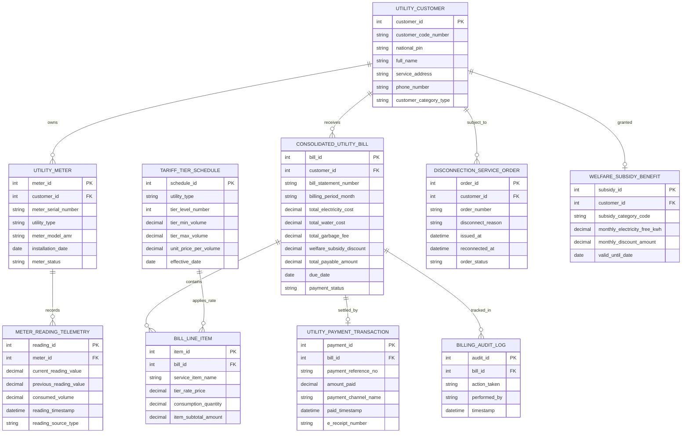

# Conceptual ERD — Public Utility Billing System

## Mermaid Code

## Entity Description Table | Bảng mô tả Entity

| # | Entity Name | Vietnamese Name | Description | Key Attributes | Main Relationships |
|---|-------------|-----------------|-------------|----------------|-------------------|
| 1 | UTILITY_CUSTOMER | Khách hàng Sử dụng Dịch vụ | Thông tin chủ hộ gia đình hoặc doanh nghiệp đăng ký sử dụng điện, nước, rác | customer_id, customer_code_number, full_name, service_address, customer_category_type | Owns UTILITY_METER, receives CONSOLIDATED_BILL |
| 2 | UTILITY_METER | Đồng hồ Đo đếm Thông minh | Quản lý đồng hồ điện, đồng hồ nước thông minh IoT (AMR/AMI) lắp đặt tại nhà | meter_id, meter_serial_number, utility_type, meter_model_amr, meter_status | Belongs to CUSTOMER, records TELEMETRY |
| 3 | METER_READING_TELEMETRY | Chỉ số Tiêu thụ Điện Nước | Bản ghi chỉ số chốt điện/nước hàng tháng, sản lượng tiêu thụ $kWh/m^3$ từ xa | reading_id, current_reading_value, consumed_volume, reading_timestamp | Belongs to UTILITY_METER |
| 4 | CONSOLIDATED_UTILITY_BILL | Hóa đơn Điện tử Hợp nhất | Hóa đơn tổng hợp hàng tháng bao gồm tiền điện, tiền nước, phí thu gom rác thải | bill_id, bill_statement_number, total_payable_amount, due_date, payment_status | Belongs to CUSTOMER, contains LINE_ITEM, settled by PAYMENT |
| 5 | BILL_LINE_ITEM | Chi tiết Khoản tiền Hóa đơn | Bảng kê tính tiền chi tiết theo từng bậc thang tiêu thụ và tiền thuế/phí | item_id, service_item_name, tier_rate_price, consumption_quantity, item_subtotal_amount | Belongs to CONSOLIDATED_UTILITY_BILL |
| 6 | UTILITY_PAYMENT_TRANSACTION | Giao dịch Thanh toán Tiền | Nhật ký thanh toán tiền điện nước qua cổng VNeID Pay, ví điện tử hoặc bưu điện | payment_id, payment_reference_no, amount_paid, payment_channel_name, paid_timestamp | Settles CONSOLIDATED_UTILITY_BILL |
| 7 | TARIFF_TIER_SCHEDULE | Biểu giá Dịch vụ Bậc thang | Khung biểu giá dịch vụ công cộng bậc thang do UBND Tỉnh / Bộ Công Thương ban hành | schedule_id, utility_type, tier_level_number, tier_min_volume, unit_price_per_volume | Applies rate to BILL_LINE_ITEM |
| 8 | DISCONNECTION_SERVICE_ORDER | Lệnh Cắt / Khôi phục Dịch vụ | Lệnh tạm ngưng hoặc mở lại nguồn cấp điện/nước đối với khách hàng nợ tiền | order_id, order_number, disconnect_reason, reconnected_at, order_status | Subject to UTILITY_CUSTOMER |
| 9 | WELFARE_SUBSIDY_BENEFIT | Mức Hỗ trợ Hộ chính sách | Thông tin miễn giảm tiền điện nước cho hộ nghèo, hộ chính sách xã hội | subsidy_id, subsidy_category_code, monthly_electricity_free_kwh, monthly_discount_amount | Granted to UTILITY_CUSTOMER |
| 10 | BILLING_AUDIT_LOG | Nhật ký Kiểm toán Hóa đơn | Lưu toàn bộ vết thu chỉ số AMR, tính hóa đơn, nộp tiền gạch nợ và ngắt mở điện nước | audit_id, action_taken, performed_by, timestamp | Belongs to CONSOLIDATED_UTILITY_BILL |

## Relationship Description | Mô tả Quan hệ

| # | From Entity | Cardinality | To Entity | Relationship Label | Business Explanation |
|---|-------------|-------------|-----------|-------------------|----------------------|
| 1 | UTILITY_CUSTOMER | one-to-many | UTILITY_METER | owns | Một khách hàng sở hữu nhiều đồng hồ đo đếm (Đồng hồ điện, Đồng hồ nước) |
| 2 | UTILITY_METER | one-to-many | METER_READING_TELEMETRY | records | Một đồng hồ ghi nhận nhiều bản ghi chỉ số tiêu thụ điện nước hàng tháng |
| 3 | UTILITY_CUSTOMER | one-to-many | CONSOLIDATED_UTILITY_BILL | receives | Một khách hàng nhận các Hóa đơn điện tử hợp nhất hàng tháng |
| 4 | CONSOLIDATED_UTILITY_BILL | one-to-many | BILL_LINE_ITEM | contains | Một hóa đơn hợp nhất chứa chi tiết các dòng tính tiền điện, nước, rác |
| 5 | CONSOLIDATED_UTILITY_BILL | one-to-one | UTILITY_PAYMENT_TRANSACTION | settled_by | Mỗi hóa đơn được gạch nợ hoàn tất bằng duy nhất một giao dịch thanh toán |
| 6 | UTILITY_CUSTOMER | one-to-one | WELFARE_SUBSIDY_BENEFIT | granted | Hộ nghèo/chính sách được hưởng duy nhất một gói hỗ trợ trợ cấp điện nước |
| 7 | UTILITY_CUSTOMER | one-to-many | DISCONNECTION_SERVICE_ORDER | subject_to | Khách hàng nợ tiền quá hạn có thể chịu các Lệnh tạm ngưng ngắt dịch vụ |
| 8 | CONSOLIDATED_UTILITY_BILL | one-to-many | BILLING_AUDIT_LOG | tracked_in | Mọi thao tác trên hóa đơn điện tử được ghi lại nhật ký kiểm toán bất biến |
| 9 | TARIFF_TIER_SCHEDULE | one-to-many | BILL_LINE_ITEM | applies_rate | Khung biểu giá bậc thang được áp đơn giá tính tiền cho các dòng hóa đơn |
