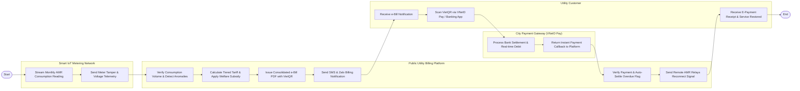

# Swimlane Diagram — Public Utility Billing System

## Mermaid Code

## Flow Description | Mô tả luồng

| Lane | Actor | Role in Flow |
|------|-------|-------------|
| 1 | Smart IoT Metering Network | Tự động đọc và truyền chỉ số chốt điện/nước hàng tháng từ xa (AMR) về hệ thống trung tâm qua vệ tinh/sóng vô tuyến. |
| 2 | Public Utility Billing Platform | Kiểm tra tính hợp lệ của sản lượng, tính tiền điện nước theo bậc thang, trừ tiền trợ cấp hộ nghèo và phát hành e-Bill. |
| 3 | Utility Customer | Nhận thông báo hóa đơn qua tin nhắn, quét mã VietQR/VNeID Pay để nộp tiền điện nước và nhận biên lai điện tử. |
| 4 | City Payment Gateway (VNeID Pay) | Xử lý quyết toán giao dịch trực tuyến với ngân hàng và gửi tín hiệu gạch nợ tức thì về cho hệ thống hóa đơn. |
