# Action Tree — Public Utility Billing System

## Mermaid Code

```mermaid
graph TD
    Root["Public Utility Billing System"]

    Root --> M1["Smart IoT Metering & Telemetry Ingestion"]
    Root --> M2["Tiered Tariff & Consolidated Billing"]
    Root --> M3["Online Payment & Collection Gateway"]
    Root --> M4["Welfare Subsidy & Overdue Disconnection"]
    Root --> M5["Dispute Resolution & Meter Replacement"]
    Root --> M6["Revenue Analytics & Tariff Audit"]

    M1 --> A11["Ingest Smart Meter Telemetry AMR"]
    M1 --> A12["Generate Consumption Reading Receipts"]
    M1 --> A13["Detect Meter Tampering Voltage Anomalies"]
    M1 --> A14["Manage Smart Meter Hardware Inventory"]

    M2 --> A21["Calculate Tiered Utility Tariffs"]
    M2 --> A22["Issue Monthly Consolidated Utility Bills"]
    M2 --> A23["Manage Tiered Rate Schedules"]
    M2 --> A24["Calculate Time-of-Use ToU Peak Rates"]

    M3 --> A31["Process Online Utility Payments VNeID"]
    M3 --> A32["Manage Auto-Debit Bank Agreement Links"]
    M3 --> A33["Generate E-Payment Tax Receipts PDF"]
    M3 --> A34["Reconcile Collection Agency Statements"]

    M4 --> A41["Apply Low-Income Welfare Subsidies"]
    M4 --> A42["Issue Automated Overdue Reminder SMS"]
    M4 --> A43["Disconnect Utility Service Overdue AMR"]
    M4 --> A44["Reconnect Restored Utility Services"]

    M5 --> A51["Dispute Utility Billing Charges"]
    M5 --> A52["Audit Metering Data Anomaly AI"]
    M5 --> A53["Process Meter Replacement Service Orders"]
    M5 --> A54["Recalculate Disputed Bill Adjustments"]

    M6 --> A61["Export Utility Revenue Analytics BI"]
    M6 --> A62["Track Municipal Water Electricity Losses"]
    M6 --> A63["Log System Immutable Audit Trails"]
    M6 --> A64["Archive Utility Billing Tax Records"]
```

## Module Description | Mô tả Module

| # | Module | Description | Actions |
|---|--------|-------------|---------|
| 1 | Smart IoT Metering & Telemetry Ingestion | Thu thập tự động chỉ số đồng hồ thông minh từ xa (AMR/AMI), phát hiện can thiệp đồng hồ và quản lý danh mục thiết bị | Ingest Smart Meter Telemetry AMR, Generate Consumption Reading Receipts, Detect Meter Tampering Voltage Anomalies, Manage Smart Meter Hardware Inventory |
| 2 | Tiered Tariff & Consolidated Billing | Tính tiền điện nước theo các bậc thang định mức, tính giá ToU giờ cao điểm và phát hành Hóa đơn điện tử hợp nhất | Calculate Tiered Utility Tariffs, Issue Monthly Consolidated Utility Bills, Manage Tiered Rate Schedules, Calculate Time-of-Use ToU Peak Rates |
| 3 | Online Payment & Collection Gateway | Xử lý nộp tiền điện nước trực tuyến qua VNeID Pay, trích nợ ngân hàng tự động, gạch nợ tức thì và xuất biên lai thuế | Process Online Utility Payments VNeID, Manage Auto-Debit Bank Agreement Links, Generate E-Payment Tax Receipts PDF, Reconcile Collection Agency Statements |
| 4 | Welfare Subsidy & Overdue Disconnection | Trừ tiền hỗ trợ hộ nghèo chính sách, gửi SMS nhắc nợ, tự động ngắt điện/nước từ xa đối với nợ quá hạn và khôi phục khi nộp tiền | Apply Low-Income Welfare Subsidies, Issue Automated Overdue Reminder SMS, Disconnect Utility Service Overdue AMR, Reconnect Restored Utility Services |
| 5 | Dispute Resolution & Meter Replacement | Tiếp nhận khiếu nại hóa đơn tăng bất thường, xử lý nghi vấn đồng hồ hỏng AI, thay thế đồng hồ và tính lại tiền điều chỉnh | Dispute Utility Billing Charges, Audit Metering Data Anomaly AI, Process Meter Replacement Service Orders, Recalculate Disputed Bill Adjustments |
| 6 | Revenue Analytics & Tariff Audit | Trích xuất báo cáo phân tích tổng doanh thu đô thị, theo dõi tỷ lệ thất thoát điện nước và lưu trữ hóa đơn điện tử | Export Utility Revenue Analytics BI, Track Municipal Water Electricity Losses, Log System Immutable Audit Trails, Archive Utility Billing Tax Records |
