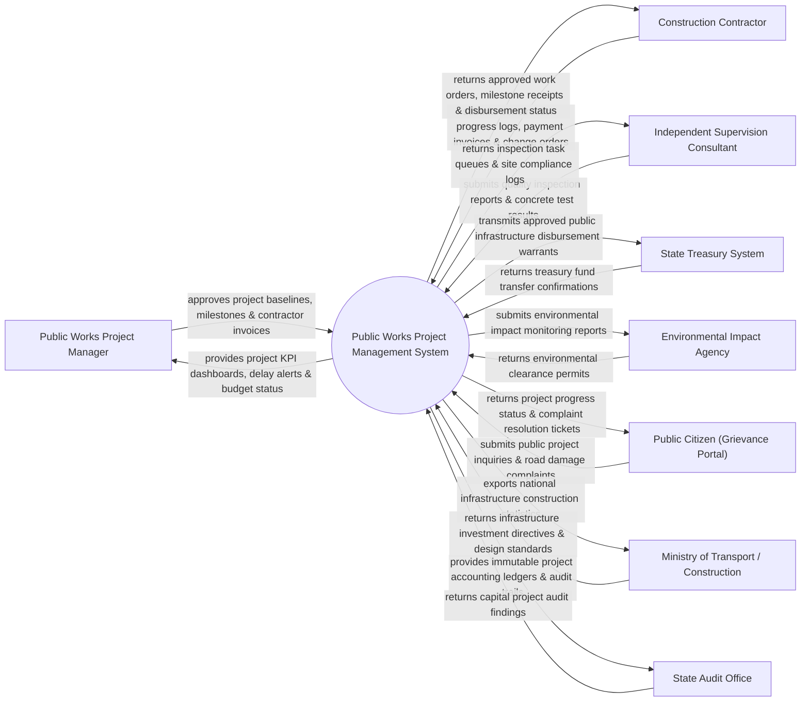

# Context Diagram — Public Works Project Management System

## Mermaid Code

## Actor & Interaction Table | Bảng Actor & Tương tác

| # | Actor | Actor Type | Data Sent TO System | Data Received FROM System | Notes |
|---|-------|------------|---------------------|---------------------------|-------|
| 1 | Public Works Project Manager | Primary | Project baselines, milestone sign-offs, change order approvals | Project KPI dashboards, delay alerts, budget execution status | Ban Quản lý Dự án Đầu tư Xây dựng công trình công cộng |
| 2 | Construction Contractor | Primary | Construction progress logs, payment invoices, scope change requests | Approved work orders, milestone receipts, disbursement status | Nhà thầu thi công xây dựng công trình hạ tầng đô thị |
| 3 | Independent Supervision Consultant | Primary | Quality inspection logs, material test results, site safety reports | Inspection task queues, non-compliance notices, site logs | Đơn vị Tư vấn Giám sát độc lập kiểm tra chất lượng |
| 4 | State Treasury System | Supporting | Treasury fund transfer confirmations, account credit alerts | Approved public works disbursement warrants, payment files | Kho bạc Nhà nước thực hiện kiểm soát chi và giải ngân |
| 5 | Environmental Impact Agency | Supporting | Environmental clearance permits, dust/noise standards | Environmental monitoring reports, EIA compliance logs | Cơ quan Môi trường giám sát tác động môi trường dự án |
| 6 | Public Citizen (Grievance Portal) | Supporting | Road damage complaints, public inquiries, project feedback | Project progress status, grievance ticket resolution updates | Công chúng giám sát tiến độ và phản ánh sự cố công trình |
| 7 | Ministry of Transport / Construction | Regulatory | Infrastructure investment directives, technical design standards | National infrastructure construction stats, project progress | Bộ Giao thông Vận tải / Bộ Xây dựng quản lý ngành |
| 8 | State Audit Office | Regulatory | Capital project audit guidelines, compliance queries | Immutable project accounting ledgers, audit trail records | Kiểm toán Nhà nước kiểm tra công khai quyết toán công trình |

## System Boundary Description | Mô tả Phạm vi Hệ thống

Hệ thống Public Works Project Management System (Hệ thống Quản lý Dự án Công trình Công cộng và Hạ tầng) chịu trách nhiệm tự động hóa quy trình quản lý các dự án đầu tư công xây dựng hạ tầng đô thị (Đường bộ, cầu cảng, bệnh viện, trường học): Khởi tạo dự án, quản lý hợp đồng nhà thầu, theo dõi tiến độ thi công theo mốc (Milestones), giám sát chất lượng công trình của tư vấn giám sát, xử lý thay đổi thiết kế (Change Orders), duyệt lệnh giải ngân vốn đầu tư công qua Kho bạc và nghiệm thu bàn giao công trình. Tuy nhiên, hệ thống KHÔNG trực tiếp điều khiển máy móc thi công tại công trường và KHÔNG thay thế công tác kiểm định thí nghiệm vật liệu thủ công.
