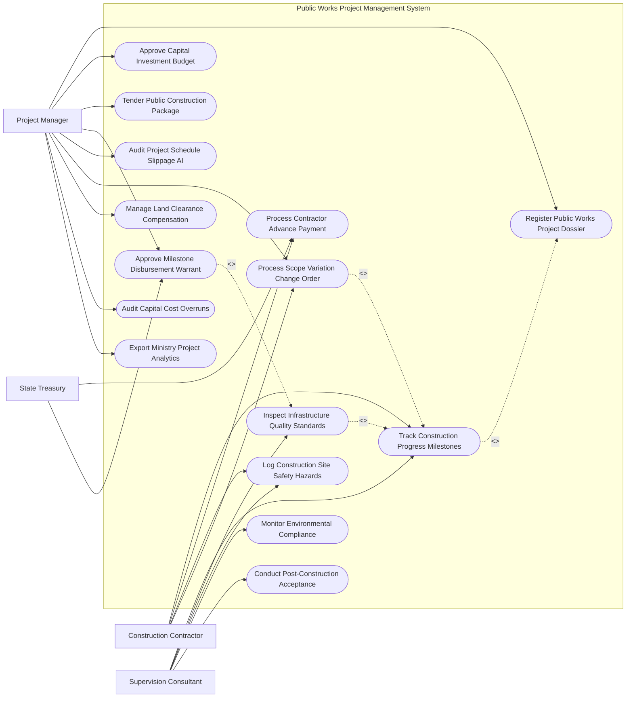

# Use Case Diagram — Public Works Project Management System

## Mermaid Code

## Actor Table | Bảng Actor

| # | Actor | Actor Type | Role Description | Related Use Cases |
|---|-------|------------|------------------|-------------------|
| 1 | Construction Contractor | Primary | Nhà thầu thi công báo cáo tiến độ, lập hóa đơn thanh toán và gửi yêu cầu thay đổi thiết kế | UC04, UC06, UC08, UC10 |
| 2 | Supervision Consultant | Primary | Tư vấn giám sát kiểm tra chất lượng bê tông, an toàn công trường và nghiệm thu mốc | UC04, UC05, UC08, UC11, UC13 |
| 3 | Project Manager | Primary | Giám đốc BQL dự án duyệt dự toán, phê duyệt lệnh thanh toán, quản lý tiến độ và đền bù | UC01, UC02, UC03, UC07, UC09, UC10, UC12, UC14, UC15 |
| 4 | State Treasury | Secondary | Kho bạc Nhà nước thẩm định hồ sơ giải ngân và thực hiện chuyển vốn đầu tư công | UC06, UC07 |

## Use Case Table | Bảng Use Case

| # | UC ID | Use Case Name | Primary Actor | Secondary Actor | Description | Priority |
|---|-------|---------------|---------------|-----------------|-------------|----------|
| 1 | UC01 | Register Public Works Project Dossier | Manager | Ministry | Khởi tạo hồ sơ dự án đầu tư công, chủ trương đầu tư và tổng mức đầu tư được duyệt | High |
| 2 | UC02 | Approve Capital Investment Budget | Manager | Treasury | Phê duyệt kế hoạch vốn đầu tư công trung hạn và phân bổ vốn hàng năm | High |
| 3 | UC03 | Tender Public Construction Package | Manager | Contractor | Tổ chức đấu thầu mạng gói thầu thi công xây lắp và chọn nhà thầu | High |
| 4 | UC04 | Track Construction Progress Milestones | Contractor, Supervision | Manager | Cập nhật và theo dõi tỷ lệ phần trăm hoàn thành theo các cột mốc khối lượng | High |
| 5 | UC05 | Inspect Infrastructure Quality Standards | Supervision | Contractor | Kiểm tra thí nghiệm nén bê tông, độ chặt mặt đường và nghiệm thu chất lượng | High |
| 6 | UC06 | Process Contractor Advance Payment | Contractor | Treasury | Lập và phê duyệt Lệnh tạm ứng vốn cho nhà thầu sau khi ký hợp đồng | High |
| 7 | UC07 | Approve Milestone Disbursement Warrant | Manager | Treasury | Phê duyệt Giấy thanh toán khối lượng hoàn thành gửi Kho bạc giải ngân | High |
| 8 | UC08 | Log Construction Site Safety Hazards | Contractor, Supervision | - | Ghi nhận và xử lý các nguy cơ mất an toàn lao động tại công trường | Medium |
| 9 | UC09 | Audit Project Schedule Slippage AI | Manager | AI Engine | Thuật toán AI phân tích nguy cơ chậm tiến độ (Slippage) dựa trên dữ liệu thi công | High |
| 10 | UC10 | Process Scope Variation Change Order | Contractor, Manager | Supervision | Thẩm định và phê duyệt các yêu cầu phát sinh khối lượng hoặc thay đổi thiết kế | High |
| 11 | UC11 | Monitor Environmental Compliance | Supervision | EnvironmentAgency | Giám sát mật độ bụi, tiếng ồn và xử lý nước thải thi công tại công trường | Medium |
| 12 | UC12 | Manage Land Clearance Compensation | Manager | LandDept | Theo dõi tiến độ giải phóng mặt bằng và chi trả tiền bồi thường hỗ trợ tái định cư | High |
| 13 | UC13 | Conduct Post-Construction Acceptance | Supervision, Manager | Ministry | Tổ chức nghiệm thu hoàn thành công trình và bàn giao đưa vào sử dụng | High |
| 14 | UC14 | Audit Capital Cost Overruns | Manager | StateAudit | Kiểm toán chi phí đầu tư, phân tích nguyên nhân vượt tổng mức đầu tư | Medium |
| 15 | UC15 | Export Ministry Project Analytics | Manager | Ministry | Trích xuất báo cáo tiến độ giải ngân vốn đầu tư công nộp Bộ GTVT / Bộ Xây dựng | Low |

## Use Case Specification | Đặc tả Use Case

---

### UC01 — Register Public Works Project Dossier

| Field | Detail |
|-------|--------|
| **UC ID** | UC01 |
| **Use Case Name** | Register Public Works Project Dossier |
| **Actor(s)** | Primary: Public Works Project Manager / Secondary: Ministry of Transport / Construction |
| **Description** | Khởi tạo hồ sơ dự án công trình công cộng, cập nhật Quyết định phê duyệt chủ trương đầu tư và Tổng mức đầu tư. |
| **Precondition** | 1. Dự án đã được HĐND hoặc Thủ tướng Chính phủ phê duyệt chủ trương đầu tư. |
| **Main Flow** | 1. Manager truy cập Phân hệ Khởi tạo Dự án Đầu tư Công.   2. Manager nhập thông tin cơ bản: Tên dự án, Mã dự án quốc gia, Chủ đầu tư, Địa điểm xây dựng, Quy mô kỹ thuật.   3. Manager nhập Tổng mức đầu tư được duyệt (Chia theo: Chi phí xây lắp, Chi phí thiết bị, Chi phí GPMB, Chi phí dự phòng).   4. Manager chọn Nguồn vốn đầu tư (Ngân sách Trung ương, Ngân sách Địa phương, Vốn ODA).   5. Manager tải lên các tệp pháp lý đính kèm: Quyết định phê duyệt dự án, Bản vẽ thiết kế cơ sở, Báo cáo ĐTM.   6. System tự động kiểm tra mã số dự án trên CSDL Đầu tư Công Quốc gia.   7. Manager ký số khởi tạo dự án, System cấp Mã định danh dự án công cộng (Public Works Project Code) duy nhất. |
| **Alternative Flow** | **AF1** — Dự án nhóm A (Dự án quan trọng quốc gia): System tự động chuyển hồ sơ sang luồng giám sát đặc biệt của Bộ Kế hoạch & Đầu tư. |
| **Exception Flow** | **EX1** — Mã dự án bị trùng lặp: System báo lỗi, yêu cầu tra cứu lại danh mục dự toán ngân sách trước khi cấp mã. |
| **Postcondition** | Hồ sơ dự án được thiết lập chính thức, sẵn sàng cho khâu giao kế hoạch vốn (UC02) và đấu thầu (UC03). |
| **Business Rule** | **BR1**: Tổng mức đầu tư nhập vào hệ thống bắt buộc phải khớp 100% với Quyết định phê duyệt dự án đầu tư của cấp có thẩm quyền. |

---

### UC04 — Track Construction Progress Milestones

| Field | Detail |
|-------|--------|
| **UC ID** | UC04 |
| **Use Case Name** | Track Construction Progress Milestones |
| **Actor(s)** | Primary: Construction Contractor, Supervision Consultant / Secondary: Project Manager |
| **Description** | Cập nhật nhật ký thi công hàng ngày, tỷ lệ phần trăm hoàn thành theo các mốc khối lượng và so sánh với đường găng tiến độ. |
| **Precondition** | 1. Hợp đồng thi công xây lắp đã được ký kết và đường găng tiến độ (Baseline Schedule) đã được nạp lên hệ thống. |
| **Main Flow** | 1. Contractor đăng nhập ứng dụng Quản lý Công trường di động.   2. Contractor chọn Mốc công việc (Milestone) đang thi công (Ví dụ: Thi công cọc khoan nhồi trụ T1, Đổ bê tông dầm mố M2).   3. Contractor nhập số liệu khối lượng hoàn thành thực tế ($m^3$ bê tông, tấn thép, $m^2$ thảm nhựa) và tỷ lệ % hoàn thành.   4. Contractor tải lên Nhật ký thi công điện tử đính kèm ảnh chụp có gắn tọa độ GPS và dấu thời gian.   5. SupervisionConsultant kiểm tra thực địa, đối soát khối lượng và bấm "Xác nhận nghiệm thu mốc khối lượng".   6. System tự động tính toán Chỉ số hiệu quả tiến độ SPI (Schedule Performance Index) và Chỉ số hiệu quả chi phí CPI.   7. If $SPI < 0.9$ (Chậm tiến độ $> 10\%$): System phát Cảnh báo trễ hạn (UC09) tới Manager. |
| **Alternative Flow** | **AF1** — Cập nhật tiến độ bằng máy bay quét 3D (Drone LiDAR): System bóc tách mô hình 3D thực tế so sánh với mô hình BIM thiết kế để tự động tính % khối lượng hoàn thành. |
| **Exception Flow** | **EX1** — Tư vấn giám sát từ chối nghiệm thu do chất lượng không đạt: System chuyển mốc công việc sang trạng thái "Yêu cầu sửa chữa/thi công lại", tạm dừng tính khối lượng thanh toán. |
| **Postcondition** | Tiến độ thi công được cập nhật minh bạch, làm căn cứ lập hồ sơ thanh toán khối lượng hoàn thành (UC07). |
| **Business Rule** | **BR1**: Khối lượng thi công hoàn thành chỉ được công nhận trên hệ thống sau khi có xác nhận ký số của Tư vấn giám sát trưởng. |

---

### UC05 — Inspect Infrastructure Quality Standards

| Field | Detail |
|-------|--------|
| **UC ID** | UC05 |
| **Use Case Name** | Inspect Infrastructure Quality Standards |
| **Actor(s)** | Primary: Supervision Consultant / Secondary: Construction Contractor |
| **Description** | Kiểm tra, lấy mẫu và kiểm định chất lượng vật liệu đầu vào (thép, xi măng, nhựa đường) và thí nghiệm chịu lực công trình. |
| **Precondition** | 1. Mốc thi công đã hoàn thành và nhà thầu nộp Yêu cầu nghiệm thu chất lượng (UC04). |
| **Main Flow** | 1. SupervisionConsultant mở Phân hệ Kiểm định Chất lượng Công trình.   2. SupervisionConsultant lập Biên bản lấy mẫu thí nghiệm tại hiện trường (Mẫu bê tông, mẫu nhựa đường, mẫu đất nền).   3. Phòng thí nghiệm hợp chuẩn (LAS-XD) tiến hành ép mẫu nén bê tông và đo độ chặt K.   4. SupervisionConsultant nhập Kết quả thí nghiệm (Cường độ bê tông R28, độ đầm nén, kích thước hình học) vào hệ thống.   5. System tự động so sánh kết quả thí nghiệm vs Tiêu chuẩn kỹ thuật dự án (Technical Specifications).   6. If Kết quả $\ge$ Tiêu chuẩn: System đánh giá "Đạt tiêu chuẩn chất lượng" và xuất Phiếu kết quả kiểm định điện tử.   7. SupervisionConsultant ký số phê duyệt Biên bản nghiệm thu chất lượng hạng mục công trình. |
| **Alternative Flow** | **AF1** — Kiểm tra phi phá hủy (Non-Destructive Testing): Sử dụng siêu âm dò khuyết tật mối hàn dầm thép, System lưu bản vẽ siêu âm vào hồ sơ chất lượng. |
| **Exception Flow** | **EX1** — Cường độ bê tông không đạt mác thiết kế: System báo động Đỏ "Không đạt chất lượng", lập tức phong tỏa mốc công việc và phát lệnh yêu cầu khoan mẫu kiểm định lại độc lập. |
| **Postcondition** | Hồ sơ chất lượng công trình được lưu trữ đầy đủ, đảm bảo an toàn chịu lực trước khi cho phép giải ngân tiền (UC07). |
| **Business Rule** | **BR1**: 100% các hạng mục kết cấu chịu lực bắt buộc phải có Phiếu kết quả thí nghiệm đạt tiêu chuẩn mới được nghiệm thu. |

---

### UC07 — Approve Milestone Disbursement Warrant

| Field | Detail |
|-------|--------|
| **UC ID** | UC07 |
| **Use Case Name** | Approve Milestone Disbursement Warrant |
| **Actor(s)** | Primary: Public Works Project Manager / Secondary: State Treasury |
| **Description** | Phê duyệt Giấy đề nghị thanh toán khối lượng hoàn thành và phát hành Lệnh rút vốn đầu tư công gửi Kho bạc Nhà nước giải ngân. |
| **Precondition** | 1. Khối lượng thi công đã được nghiệm thu chất lượng đạt chuẩn (UC04, UC05).   2. Dự án còn đủ hạn mức kế hoạch vốn đầu tư công được giao (UC02). |
| **Main Flow** | 1. Contractor lập Bảng xác định giá trị khối lượng công việc hoàn thành theo hợp đồng (Mẫu 03a/TTr hoặc 03b/TTr).   2. SupervisionConsultant xác nhận khối lượng và đơn giá hợp đồng.   3. Manager kiểm tra hồ sơ: Bảng tính giá trị thanh toán, Giấy giảm trừ tạm ứng, Tiền giữ lại bảo hành (5%).   4. System tự động kiểm tra: Giá trị đề nghị thanh toán $\le$ Giá trị hợp đồng và $\le$ Hạn mức vốn còn lại.   5. Manager ký số Lệnh thanh toán vốn đầu tư công điện tử.   6. System tự động đóng gói hồ sơ và truyền mã hóa sang Hệ thống Kho bạc Nhà nước (State Treasury).   7. State Treasury thực hiện kiểm soát chi, chuyển tiền cho Contractor và trả về Chứng từ giải ngân thành công.   8. System gạch trừ kế hoạch vốn và cập nhật tỷ lệ giải ngân dự án (Disbursement Rate %). |
| **Alternative Flow** | **AF1** — Thanh toán quyết toán hoàn thành dự án: Manager thẩm định hồ sơ quyết toán A-B, thu hồi toàn bộ tiền tạm ứng và giữ lại 3-5% tiền bảo hành công trình. |
| **Exception Flow** | **EX1** — Kho bạc từ chối thanh toán do sai mục lục ngân sách: System báo trạng thái "Kho bạc trả lại", gửi email thông báo cho Manager điều chỉnh định khoản. |
| **Postcondition** | Vốn đầu tư công được giải ngân chính xác cho nhà thầu, tiến độ giải ngân ngân sách được cập nhật thời gian thực. |
| **Business Rule** | **BR1**: Thời gian xử lý duyệt lệnh thanh toán vốn đầu tư công tại BQL dự án không quá 03 ngày làm việc kể từ khi nhận đủ hồ sơ. |

---

### UC10 — Process Scope Variation Change Order

| Field | Detail |
|-------|--------|
| **UC ID** | UC10 |
| **Use Case Name** | Process Scope Variation Change Order |
| **Actor(s)** | Primary: Construction Contractor, Public Works Project Manager / Secondary: Supervision Consultant |
| **Description** | Thẩm định và phê duyệt các yêu cầu điều chỉnh thiết kế, bổ sung khối lượng phát sinh (Change Order) trong quá trình thi công. |
| **Precondition** | 1. Phát sinh địa chất yếu bất thường, điều chỉnh quy hoạch hoặc thay đổi giải pháp kỹ thuật tại hiện trường. |
| **Main Flow** | 1. Contractor lập Đề xuất thay đổi/phát sinh khối lượng thi công (Variation Request).   2. Contractor nhập lý do thay đổi, bản vẽ điều chỉnh thiết kế và bảng tính chi phí phát sinh tăng/giảm.   3. SupervisionConsultant kiểm tra hiện trường, xác nhận sự cần thiết kỹ thuật và tính hợp lý của đơn giá phát sinh.   4. System kiểm tra: Tổng chi phí sau điều chỉnh vs Tổng mức đầu tư dự án được duyệt.   5. If Chi phí phát sinh nằm trong Dự phòng phí của dự án: Manager tổ chức hội đồng thẩm định và ký số Phụ lục hợp đồng điều chỉnh.   6. System cập nhật Dự toán gói thầu mới, dự toán chi tiết các mốc thi công và điều chỉnh đường găng tiến độ.   7. Contractor triển khai thi công theo bản vẽ thiết kế điều chỉnh mới. |
| **Alternative Flow** | **AF1** — Chi phí phát sinh vượt Tổng mức đầu tư được duyệt: Manager lập Tờ trình điều chỉnh dự án trình Người quyết định đầu tư (Bộ trưởng/Chủ tịch UBND) phê duyệt trước khi ký phụ lục. |
| **Exception Flow** | **EX1** — Yêu cầu phát sinh không có cơ sở kỹ thuật: Manager ra thông báo từ chối phê duyệt, yêu cầu nhà thầu thi công đúng bản vẽ thiết kế ban đầu. |
| **Postcondition** | Phụ lục hợp đồng điều chỉnh có hiệu lực pháp lý, làm căn cứ nghiệm thu và thanh toán khối lượng phát sinh. |
| **Business Rule** | **BR1**: Mọi chi phí phát sinh tăng vượt dự phòng gói thầu bắt buộc phải được Người quyết định đầu tư phê duyệt bằng văn bản. |
