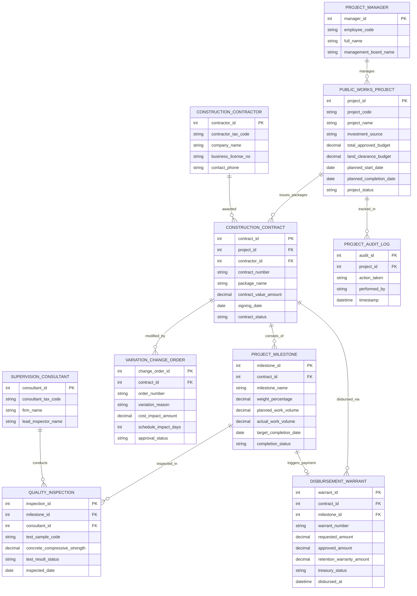

# Conceptual ERD — Public Works Project Management System

## Mermaid Code

## Entity Description Table | Bảng mô tả Entity

| # | Entity Name | Vietnamese Name | Description | Key Attributes | Main Relationships |
|---|-------------|-----------------|-------------|----------------|-------------------|
| 1 | PUBLIC_WORKS_PROJECT | Dự án Công trình Công cộng | Thông tin dự án đầu tư công xây dựng hạ tầng (tổng mức đầu tư, nguồn vốn, tiến độ) | project_id, project_code, project_name, total_approved_budget, project_status | Issues packages CONSTRUCTION_CONTRACT, managed by MANAGER |
| 2 | CONSTRUCTION_CONTRACT | Hợp đồng Thi công Xây lắp | Thông tin hợp đồng kinh tế ký kết giữa Ban quản lý dự án và Nhà thầu thi công | contract_id, contract_number, package_name, contract_value_amount, contract_status | Belongs to PUBLIC_WORKS_PROJECT, CONTRACTOR, consists of MILESTONE |
| 3 | PROJECT_MILESTONE | Mốc Khối lượng Thi công | Các mốc tiến độ thi công công trình và tỷ lệ phần trăm khối lượng hoàn thành | milestone_id, milestone_name, weight_percentage, actual_work_volume, completion_status | Belongs to CONSTRUCTION_CONTRACT, inspected in QUALITY_INSPECTION |
| 4 | QUALITY_INSPECTION | Biên bản Kiểm định Chất lượng | Kết quả thí nghiệm cường độ bê tông, độ đầm nén và nghiệm thu chất lượng | inspection_id, test_sample_code, concrete_compressive_strength, test_result_status | Belongs to PROJECT_MILESTONE, conducted by CONSULTANT |
| 5 | DISBURSEMENT_WARRANT | Lệnh Giải ngân Vốn Đầu tư | Chứng từ đề nghị Kho bạc Nhà nước giải ngân tiền cho nhà thầu theo mốc | warrant_id, warrant_number, requested_amount, approved_amount, treasury_status | Belongs to CONSTRUCTION_CONTRACT, PROJECT_MILESTONE |
| 6 | VARIATION_CHANGE_ORDER | Phụ lục Điều chỉnh Thiết kế | Hồ sơ đề xuất phát sinh khối lượng hoặc thay đổi giải pháp kỹ thuật công trình | change_order_id, order_number, variation_reason, cost_impact_amount, approval_status | Modifies CONSTRUCTION_CONTRACT |
| 7 | CONSTRUCTION_CONTRACTOR | Nhà thầu Thi công Xây dựng | Thông tin doanh nghiệp xây dựng trúng thầu thi công gói thầu | contractor_id, contractor_tax_code, company_name, business_license_no | Awarded CONSTRUCTION_CONTRACT |
| 8 | SUPERVISION_CONSULTANT | Đơn vị Tư vấn Giám sát | Thông tin công ty tư vấn giám sát độc lập kiểm tra chất lượng công trình | consultant_id, consultant_tax_code, firm_name, lead_inspector_name | Conducts QUALITY_INSPECTION |
| 9 | PROJECT_MANAGER | Giám đốc Ban QLDA | Thông tin đại diện chủ đầu tư chịu trách nhiệm điều hành toàn bộ dự án | manager_id, employee_code, full_name, management_board_name | Manages PUBLIC_WORKS_PROJECT |
| 10 | PROJECT_AUDIT_LOG | Nhật ký Kiểm toán Dự án | Lưu toàn bộ lịch sử nạp kế hoạch vốn, nghiệm thu chất lượng, giải ngân và điều chỉnh | audit_id, action_taken, performed_by, timestamp | Belongs to PUBLIC_WORKS_PROJECT |

## Relationship Description | Mô tả Quan hệ

| # | From Entity | Cardinality | To Entity | Relationship Label | Business Explanation |
|---|-------------|-------------|-----------|-------------------|----------------------|
| 1 | PUBLIC_WORKS_PROJECT | one-to-many | CONSTRUCTION_CONTRACT | issues_packages | Một dự án hạ tầng công cộng chia thành nhiều gói thầu thi công xây lắp |
| 2 | CONSTRUCTION_CONTRACTOR | one-to-many | CONSTRUCTION_CONTRACT | awarded | Một nhà thầu thi công có thể trúng thầu và thực hiện nhiều hợp đồng xây dựng |
| 3 | CONSTRUCTION_CONTRACT | one-to-many | PROJECT_MILESTONE | consists_of | Một hợp đồng thi công bao gồm nhiều mốc khối lượng hoàn thành theo tiến độ |
| 4 | PROJECT_MILESTONE | one-to-many | QUALITY_INSPECTION | inspected_in | Một mốc thi công trải qua các đợt kiểm tra thí nghiệm chất lượng vật liệu |
| 5 | SUPERVISION_CONSULTANT | one-to-many | QUALITY_INSPECTION | conducts | Một tư vấn giám sát thực hiện kiểm tra nghiệm thu chất lượng cho nhiều mốc |
| 6 | CONSTRUCTION_CONTRACT | one-to-many | DISBURSEMENT_WARRANT | disbursed_via | Một hợp đồng được giải ngân vốn đầu tư công qua nhiều lệnh thanh toán |
| 7 | PROJECT_MILESTONE | one-to-one | DISBURSEMENT_WARRANT | triggers_payment | Mỗi mốc khối lượng nghiệm thu đạt chuẩn kích hoạt một lệnh đề nghị giải ngân |
| 8 | CONSTRUCTION_CONTRACT | one-to-many | VARIATION_CHANGE_ORDER | modified_by | Một hợp đồng xây dựng có thể được điều chỉnh bởi các phụ lục phát sinh |
| 9 | PROJECT_MANAGER | one-to-many | PUBLIC_WORKS_PROJECT | manages | Một Giám đốc Ban QLDA điều hành và chịu trách nhiệm quản lý nhiều dự án |
| 10 | PUBLIC_WORKS_PROJECT | one-to-many | PROJECT_AUDIT_LOG | tracked_in | Mọi thao tác trên dự án đầu tư công đều được ghi lại nhật ký kiểm toán bất biến |
