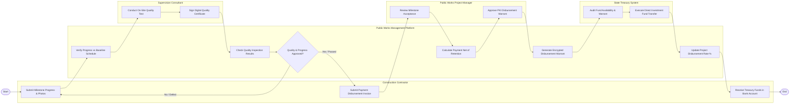

# Swimlane Diagram — Public Works Project Management System

## Mermaid Code

## Flow Description | Mô tả luồng

| Lane | Actor | Role in Flow |
|------|-------|-------------|
| 1 | Construction Contractor | Cập nhật tiến độ mốc thi công đính kèm ảnh GPS, nộp hồ sơ đề nghị thanh toán khối lượng hoàn thành và nhận tiền giải ngân. |
| 2 | Public Works Management Platform | Kiểm tra tiến độ so với đường găng, kiểm tra phiếu kiểm định chất lượng, tính tiền giảm trừ tạm ứng và xuất lệnh thanh toán. |
| 3 | Supervision Consultant | Khảo sát kiểm tra chất lượng thực địa công trường, thí nghiệm mẫu bê tông và ký số giấy chứng nhận chất lượng. |
| 4 | Public Works Project Manager | Rà soát hồ sơ nghiệm thu mốc khối lượng và ký số phê duyệt Lệnh thanh toán vốn đầu tư công gửi Kho bạc. |
| 5 | State Treasury System | Kiểm soát chi đầu tư công và thực hiện lệnh chuyển tiền giải ngân trực tiếp vào tài khoản ngân hàng của nhà thầu. |
