# Action Tree — Public Works Project Management System

## Mermaid Code

```mermaid
graph TD
    Root["Public Works Project Management System"]

    Root --> M1["Project Initiation & Capital Budgeting"]
    Root --> M2["Tendering & Contractor Management"]
    Root --> M3["Milestone Tracking & Site Supervision"]
    Root --> M4["Quality Inspection & Change Orders"]
    Root --> M5["Treasury Disbursement & Cost Control"]
    Root --> M6["Post-Construction & Ministry Analytics"]

    M1 --> A11["Register Public Works Project Dossier"]
    M1 --> A12["Approve Capital Investment Budget"]
    M1 --> A13["Manage Land Clearance Compensation"]
    M1 --> A14["Overlay City Infrastructure Master Plan"]

    M2 --> A21["Tender Public Construction Packages"]
    M2 --> A22["Evaluate Bidder Technical Financial Qualifications"]
    M2 --> A23["Sign Digital Construction Contracts"]
    M2 --> A24["Track Contractor Performance Ratings"]

    M3 --> A31["Track Construction Progress Milestones"]
    M3 --> A32["Audit Project Schedule Slippage AI"]
    M3 --> A33["Log Construction Site Safety Hazards"]
    M3 --> A34["Monitor Environmental EIA Compliance"]

    M4 --> A41["Inspect Infrastructure Quality Standards"]
    M4 --> A42["Log Concrete Compressive Test Results"]
    M4 --> A43["Process Scope Variation Change Orders"]
    M4 --> A44["Issue Non-Compliance Correction Orders"]

    M5 --> A51["Process Contractor Advance Payments"]
    M5 --> A52["Approve Milestone Disbursement Warrants"]
    M5 --> A53["Transmit Warrants to State Treasury"]
    M5 --> A54["Audit Capital Cost Overruns"]

    M6 --> A61["Conduct Post-Construction Acceptance"]
    M6 --> A62["Transfer Infrastructure Assets Operation"]
    M6 --> A63["Log System Immutable Audit Trails"]
    M6 --> A64["Export Ministry Transport Analytics"]
```

## Module Description | Mô tả Module

| # | Module | Description | Actions |
|---|--------|-------------|---------|
| 1 | Project Initiation & Capital Budgeting | Khởi tạo hồ sơ dự án đầu tư công, phê duyệt kế hoạch vốn trung hạn/hàng năm và theo dõi đền bù GPMB | Register Public Works Project Dossier, Approve Capital Investment Budget, Manage Land Clearance Compensation, Overlay City Infrastructure Master Plan |
| 2 | Tendering & Contractor Management | Tổ chức đấu thầu mạng gói thầu xây lắp, chấm thầu kỹ thuật tài chính, ký hợp đồng điện tử và xếp hạng nhà thầu | Tender Public Construction Packages, Evaluate Bidder Technical Financial Qualifications, Sign Digital Construction Contracts, Track Contractor Performance Ratings |
| 3 | Milestone Tracking & Site Supervision | Theo dõi tiến độ khối lượng mốc thi công, phân tích AI chậm tiến độ đường găng, ghi nhận an toàn và môi trường | Track Construction Progress Milestones, Audit Project Schedule Slippage AI, Log Construction Site Safety Hazards, Monitor Environmental EIA Compliance |
| 4 | Quality Inspection & Change Orders | Thí nghiệm kiểm định chất lượng bê tông/nhựa đường, nghiệm thu chất lượng công trình và xử lý phát sinh thay đổi thiết kế | Inspect Infrastructure Quality Standards, Log Concrete Compressive Test Results, Process Scope Variation Change Orders, Issue Non-Compliance Correction Orders |
| 5 | Treasury Disbursement & Cost Control | Duyệt lệnh giải ngân vốn đầu tư công gửi Kho bạc, quản lý thu hồi tạm ứng, giữ lại tiền bảo hành và kiểm soát vượt trần | Process Contractor Advance Payments, Approve Milestone Disbursement Warrants, Transmit Warrants to State Treasury, Audit Capital Cost Overruns |
| 6 | Post-Construction & Ministry Analytics | Tổ chức nghiệm thu bàn giao đưa vào sử dụng, chuyển giao tài sản hạ tầng và trích xuất báo cáo Bộ GTVT/Xây dựng | Conduct Post-Construction Acceptance, Transfer Infrastructure Assets Operation, Log System Immutable Audit Trails, Export Ministry Transport Analytics |
