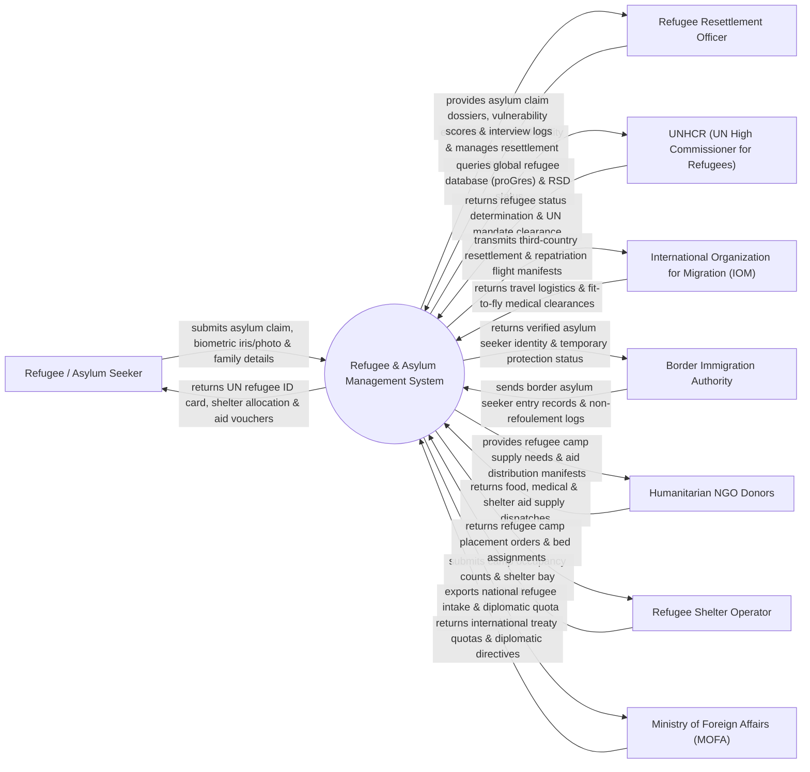

# Context Diagram — Refugee & Asylum Management System

## Mermaid Code

## Actor & Interaction Table | Bảng Actor & Tương tác

| # | Actor | Actor Type | Data Sent TO System | Data Received FROM System | Notes |
|---|-------|------------|---------------------|---------------------------|-------|
| 1 | Refugee / Asylum Seeker | Primary | Asylum claim forms, iris/facial biometrics, family details, persecution proof | UN refugee ID cards, shelter allocations, aid vouchers | Người tị nạn và người nộp đơn xin tị nạn chính trị/nhân đạo |
| 2 | Refugee Resettlement Officer | Primary | Asylum eligibility evaluations, vulnerability ratings, interview logs | Asylum claim dossiers, vulnerability scores, resettlement queues | Cán bộ Tị nạn thuộc Bộ Ngoại giao / Cơ quan Tị nạn Quốc gia |
| 3 | UNHCR (UN High Commissioner for Refugees) | Primary | Refugee status determination (RSD) rulings, UN mandate clearances | Global refugee proGres database queries, RSD status reports | Cao ủy Liên Hợp Quốc về Người tị nạn (UNHCR) |
| 4 | International Organization for Migration (IOM) | Supporting | Travel logistics, fit-to-fly medical clearances, flight manifests | Third-country resettlement rosters, repatriation flight manifests | Tổ chức Di cư Quốc tế (IOM) hỗ trợ di chuyển tị nạn |
| 5 | Border Immigration Authority | Supporting | Border asylum seeker entry records, non-refoulement logs | Verified asylum seeker identity, temporary protection status | Cục Quản lý Xuất nhập cảnh kiểm soát người tị nạn tại biên giới |
| 6 | Humanitarian NGO Donors | Supporting | Food rations, medical kits, shelter aid supply dispatches | Refugee camp supply needs, aid distribution manifests | Các tổ chức phi chính phủ nhân đạo (Hội Chữ thập đỏ, UNICEF) |
| 7 | Refugee Shelter Operator | Supporting | Camp occupancy counts, shelter bay availability, bed logs | Refugee camp placement orders, bed assignments | Đơn vị vận hành các Trại tị nạn và Trung tâm tạm cư nhân đạo |
| 8 | Ministry of Foreign Affairs (MOFA) | Regulatory | International treaty quotas, diplomatic directives, bilateral rules | National refugee intake analytics, diplomatic quota BI dashboards | Bộ Ngoại giao quản lý chính sách tị nạn quốc tế |

## System Boundary Description | Mô tả Phạm vi Hệ thống

Hệ thống Refugee & Asylum Management System (Hệ thống Quản lý Người Tị nạn và Trú ẩn Nhân đạo) chịu trách nhiệm tự động hóa quy trình tiếp nhận và bảo hộ người tị nạn theo Công ước Liên Hợp Quốc 1951: Thu thập sinh trắc học mống mắt/khuôn mặt, thẩm định đơn xin tị nạn (Refugee Status Determination - RSD), cấp Thẻ định danh người tị nạn Liên Hợp Quốc (UNHCR ID Card), nguyên tắc không trục xuất người tị nạn về nơi nguy hiểm (Non-Refoulement), quản lý trại tạm cư nhân đạo, phân phối hàng cứu trợ (lương thực, y tế), đoàn tụ gia đình và tổ chức tái định cư sang nước thứ ba (hoặc hồi hương tự nguyện). Tuy nhiên, hệ thống KHÔNG trực tiếp vận hành máy bay di tản và KHÔNG thay thế quyết định ngoại giao của Chính phủ.
