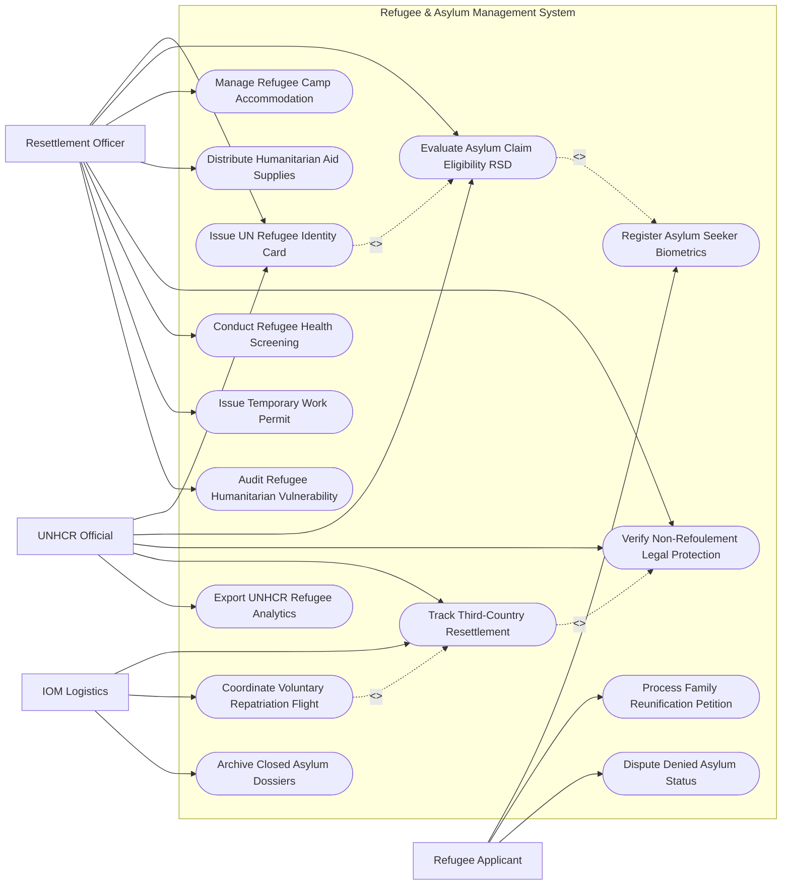

# Use Case Diagram — Refugee & Asylum Management System

## Mermaid Code

## Actor Table | Bảng Actor

| # | Actor | Actor Type | Role Description | Related Use Cases |
|---|-------|------------|------------------|-------------------|
| 1 | Refugee Applicant | Primary | Người xin tị nạn thu thập sinh trắc học, nộp đơn đoàn tụ gia đình và khiếu nại bác bỏ đơn | UC01, UC07, UC13 |
| 2 | Resettlement Officer | Primary | Cán bộ quản lý tị nạn thẩm định tư cách tị nạn, cấp thẻ tị nạn, bố trí trại tạm cư và phát viện trợ | UC02, UC03, UC04, UC05, UC06, UC09, UC10, UC11 |
| 3 | UNHCR Official | Regulatory | Quan chức Cao ủy Liên Hợp Quốc về Người tị nạn duyệt tư cách RSD, bảo hộ không trục xuất | UC02, UC03, UC06, UC08, UC14 |
| 4 | IOM Logistics | Supporting | Tổ chức di cư quốc tế sắp xếp di chuyển tái định cơ nước thứ 3 và các chuyến bay hồi hương | UC08, UC12, UC15 |

## Use Case Table | Bảng Use Case

| # | UC ID | Use Case Name | Primary Actor | Secondary Actor | Description | Priority |
|---|-------|---------------|---------------|-----------------|-------------|----------|
| 1 | UC01 | Register Asylum Seeker Biometrics | Refugee | Officer | Tiếp nhận người xin tị nạn, thu thập ảnh khuôn mặt 3D, mống mắt và 10 dấu vân tay | High |
| 2 | UC02 | Issue UN Refugee Identity Card | Officer, UNHCR | Refugee | Cấp Thẻ định danh người tị nạn Liên Hợp Quốc (UNHCR Card) có mã QR sinh trắc học | High |
| 3 | UC03 | Evaluate Asylum Claim Eligibility RSD | Officer, UNHCR | - | Thẩm định và quyết định Tư cách Người Tị nạn (Refugee Status Determination - RSD) | High |
| 4 | UC04 | Manage Refugee Camp Accommodation | Officer | ShelterOps | Bố trí chỗ ở, lều bạt trong Trại tạm cư tị nạn nhân đạo và quản lý mật độ dân cư | High |
| 5 | UC05 | Distribute Humanitarian Aid Supplies | Officer | NGO | Cấp phát lương thực, nước sạch, kít y tế và nhu yếu phẩm theo định mức hàng ngày | High |
| 6 | UC06 | Verify Non-Refoulement Legal Protection | Officer, UNHCR | Immigration | Kiểm soát áp dụng Nguyên tắc Không trục xuất người tị nạn về quốc gia đang có nguy cơ bị bức hại | High |
| 7 | UC07 | Process Family Reunification Petition | Refugee, Officer | RedCross | Xử lý đơn xin đoàn tụ gia đình người tị nạn bị thất lạc do chiến tranh/thiên tai | Medium |
| 8 | UC08 | Track Third-Country Resettlement | UNHCR, IOM | MOFA | Theo dõi hồ sơ và tổ chức đưa người tị nạn đi tái định cư tại nước thứ ba (Mỹ, Úc, Châu Âu) | High |
| 9 | UC09 | Conduct Refugee Health Screening | Officer | WHO | Khám sức khỏe ban đầu, tiêm chủng phòng dịch và điều trị vết thương cho người tị nạn | High |
| 10 | UC10 | Issue Temporary Work Permit | Officer | MOFA | Cấp Giấy phép lao động tạm thời cho người tị nạn trong thời gian chờ tái định cư | Medium |
| 11 | UC11 | Audit Refugee Humanitarian Vulnerability | Officer | AI Engine | Thuật toán AI phân tích chỉ số rủi ro nhân đạo (Phụ nữ mang thai, trẻ em không người thân) | High |
| 12 | UC12 | Coordinate Voluntary Repatriation Flight | IOM | MOFA | Sắp xếp chuyến bay hồi hương tự nguyện cho người tị nạn khi quốc gia gốc đã an toàn | Medium |
| 13 | UC13 | Dispute Denied Asylum Status | Refugee | UNHCR | Tiếp nhận và giải quyết đơn phúc khảo đối với các đơn xin tị nạn bị bác bỏ | Medium |
| 14 | UC14 | Export UNHCR Refugee Analytics | UNHCR | Executive | Trích xuất báo cáo tổng số lượng người tị nạn nộp Hội đồng Bảo an Liên Hợp Quốc | Low |
| 15 | UC15 | Archive Closed Asylum Dossiers | System | Archives | Lưu trữ vĩnh viễn hồ sơ người tị nạn đã hoàn tất tái định cư hoặc hồi hương | Low |

## Use Case Specification | Đặc tả Use Case

---

### UC01 — Register Asylum Seeker Biometrics

| Field | Detail |
|-------|--------|
| **UC ID** | UC01 |
| **Use Case Name** | Register Asylum Seeker Biometrics |
| **Actor(s)** | Primary: Refugee Applicant / Secondary: Refugee Resettlement Officer |
| **Description** | Tiếp nhận người xin tị nạn tại biên giới/trại tạm cư, thu thập dữ liệu sinh trắc học mống mắt, khuôn mặt, 10 dấu vân tay. |
| **Precondition** | 1. Người nộp đơn có mặt tại Trại tiếp nhận tị nạn hoặc Trạm kiểm soát biên giới. |
| **Main Flow** | 1. Officer mở Phân hệ Tiếp nhận Người Xin Tị nạn Mới (Asylum Intake).   2. Officer thu thập dữ liệu sinh trắc học của người nộp đơn: Chụp ảnh chân dung 3D, lấy 10 dấu vân tay và quét mống mắt (Iris Scan).   3. Officer nhập thông tin nhân thân (Họ tên, Ngày sinh, Quốc tịch gốc, Ngôn ngữ sử dụng, Tôn giáo/Dân tộc).   4. Officer nhập Lý do xin tị nạn (Bị ngược đãi chính trị, Chiến tranh xung đột, Bức hại tôn giáo).   5. System kết nối CSDL Tị nạn Toàn cầu (UNHCR proGres) kiểm tra trùng lặp: Xác nhận người nộp đơn chưa được đăng ký tị nạn tại quốc gia khác.   6. System tự động khởi tạo Mã số Người tị nạn (UNHCR Individual ID) duy nhất.   7. Officer phát Giấy xác nhận Đã đăng ký xin tị nạn tạm thời cho người nộp đơn và chuyển sang khâu Khám sức khỏe (UC09). |
| **Alternative Flow** | **AF1** — Trẻ em tị nạn không có cha mẹ đi cùng (Unaccompanied Minors): System tự động gán nhãn "Nhóm đặc biệt dễ bị tổn thương" và phân bổ người giám hộ pháp lý. |
| **Exception Flow** | **EX1** — Phát hiện đối tượng nghi vấn tội phạm chiến tranh/khủng bố: System bật cảnh báo Đỏ, gửi thông tin cho Cục Xuất nhập cảnh và Interpol xác minh. |
| **Postcondition** | Hồ sơ người xin tị nạn được số hóa chính xác, chống mạo danh và được bảo hộ pháp lý ban đầu. |
| **Business Rule** | **BR1**: 100% người xin tị nạn bắt buộc phải thu thập đủ sinh trắc học mống mắt và dấu vân tay trước khi vào trại tạm cư. |

---

### UC02 — Issue UN Refugee Identity Card

| Field | Detail |
|-------|--------|
| **UC ID** | UC02 |
| **Use Case Name** | Issue UN Refugee Identity Card |
| **Actor(s)** | Primary: Refugee Resettlement Officer, UNHCR Official / Secondary: Refugee Applicant |
| **Description** | Phát hành Thẻ định danh người tị nạn Liên Hợp Quốc (UNHCR Refugee Card) có mã QR sinh trắc học mã hóa cho người được công nhận tị nạn. |
| **Precondition** | 1. Người nộp đơn đã được Thẩm định công nhận Tư cách Người Tị nạn (RSD) hợp lệ (UC03). |
| **Main Flow** | 1. Officer chọn hồ sơ người tị nạn đã được phê duyệt RSD.   2. System tự động bóc tách dữ liệu: Mã số UNHCR ID, Họ tên, Ảnh 3D, Ngày sinh, Quốc tịch gốc, Mã QR sinh trắc học mã hóa.   3. Officer nhập Thời hạn hiệu lực của Thẻ tị nạn (Thường có giá trị 02-05 năm).   4. Quan chức UNHCR ký số PKI xác nhận Thẻ định danh tị nạn quốc tế.   5. System phát lệnh in thẻ tới Máy in Thẻ bảo mật chuyên dụng.   6. Thẻ định danh UNHCR được in trên chất liệu phôi nhựa cao cấp có phôi bảo an chống làm giả.   7. Officer trao Thẻ UNHCR cho người tị nạn: Thẻ có giá trị pháp lý thay thế Hộ chiếu quốc gia, bảo vệ người tị nạn khỏi bị bắt giữ trái phép. |
| **Alternative Flow** | **AF1** — Cấp lại Thẻ tị nạn bị mất/hỏng: Người tị nạn thực hiện quét mống mắt xác thực lại tại quầy, System in cấp lại thẻ mới. |
| **Exception Flow** | **EX1** — Thẻ tị nạn bị nghi ngờ giả mạo: Cảnh sát quét mã QR mã hóa trên thẻ, System đối soát mống mắt từ CSDL trung tâm xác thực thật/giả trong 5 giây. |
| **Postcondition** | Người tị nạn có giấy tờ nhân thân hợp pháp quốc tế, được quyền cư trú tạm thời và được hưởng các chính sách trợ giúp. |
| **Business Rule** | **BR1**: Thẻ định danh người tị nạn Liên Hợp Quốc có giá trị pháp lý bảo hộ pháp lý trên toàn bộ các quốc gia tham gia Công ước 1951. |

---

### UC03 — Evaluate Asylum Claim Eligibility RSD

| Field | Detail |
|-------|--------|
| **UC ID** | UC03 |
| **Use Case Name** | Evaluate Asylum Claim Eligibility RSD |
| **Actor(s)** | Primary: Refugee Resettlement Officer, UNHCR Official / Secondary: None |
| **Description** | Phỏng vấn chuyên sâu, xác minh lý do bức hại và ra Quyết định Công nhận Tư cách Người Tị nạn (RSD Ruling) theo tiêu chuẩn Liên Hợp Quốc. |
| **Precondition** | 1. Người xin tị nạn đã đăng ký sinh trắc học (UC01) và nộp đầy đủ đơn xin tị nạn. |
| **Main Flow** | 1. Officer mở Phân hệ Thẩm định Tư cách Người Tị nạn (RSD Evaluation Module).   2. Officer xếp lịch và tiến hành Phỏng vấn chuyên sâu (RSD Interview) đối với người xin tị nạn (có sự tham gia của Phiên dịch viên).   3. Officer ghi nhận chi tiết bằng chứng bị bức hại (Chính trị, Tôn giáo, Chủng tộc, Xung đột vũ trang).   4. System tra cứu CSDL Tình hình Đất nước Gốc (COI - Country of Origin Information) để kiểm tra tính xác thực của lý do bức hại.   5. Officer đánh giá theo tiêu chuẩn Công ước 1951: Xác định có "Nỗi sợ hãi có căn cứ bị bức hại" (Well-founded fear of persecution).   6. If Đủ điều kiện: Officer lập Báo cáo Đề xuất Công nhận Tư cách Người Tị nạn.   7. Quan chức UNHCR phê duyệt và ký số Quyết định RSD chính thức.   8. System cập nhật trạng thái hồ sơ thành "Đã công nhận Người Tị nạn hợp pháp" và chuyển sang cấp Thẻ UNHCR (UC02). |
| **Alternative Flow** | **AF1** — Không đủ điều kiện tị nạn: Officer ban hành Thông báo Từ chối Đơn xin Tị nạn, chuyển hồ sơ cho người nộp đơn thực hiện quyền Khiếu nại (UC13). |
| **Exception Flow** | **EX1** — Phát hiện gian dối bằng chứng tị nạn: Officer lập biên bản từ chối vĩnh viễn, loại khỏi chương trình bảo hộ nhân đạo. |
| **Postcondition** | Tư cách tị nạn được xác định minh bạch, công bằng, đúng theo luật pháp quốc tế. |
| **Business Rule** | **BR1**: Quá trình phỏng vấn thẩm định RSD phải được ghi âm, ghi hình và được giữ bí mật tuyệt đối với quốc gia gốc của người xin tị nạn. |

---

### UC06 — Verify Non-Refoulement Legal Protection

| Field | Detail |
|-------|--------|
| **UC ID** | UC06 |
| **Use Case Name** | Verify Non-Refoulement Legal Protection |
| **Actor(s)** | Primary: Refugee Resettlement Officer, UNHCR Official / Secondary: Border Immigration Authority |
| **Description** | Kiểm soát và áp dụng nghiêm ngặt Nguyên tắc Không trục xuất (Non-Refoulement) cấm cưỡng chế người tị nạn về quốc gia đang bị nguy hiểm. |
| **Precondition** | 1. Đăng ký người xin tị nạn hoặc người tị nạn đang có mặt trên lãnh thổ quốc gia tiếp nhận. |
| **Main Flow** | 1. BorderImmigration khởi tạo Yêu cầu Trục xuất/Trả về đối với đối tượng nhập cảnh trái phép.   2. BorderImmigration quét mã QR CCCD/Thẻ tị nạn: System tự động kết nối CSDL Người Tị nạn Quốc gia.   3. System phát hiện đối tượng đã nộp Đơn xin Tị nạn (UC01) hoặc đã có Thẻ tị nạn UNHCR (UC02).   4. System tự động kích hoạt Cờ bảo vệ pháp lý "Nguyên tắc Không Trục xuất (Non-Refoulement Protection Active)".   5. System phát thông báo chặn lệnh trục xuất: "Cấm tuyệt đối việc trục xuất/trả về đối tượng về quốc gia gốc do vi phạm Công ước Tị nạn 1951".   6. Officer và Quan chức UNHCR xuất trình Văn bản Bảo hộ Pháp lý cho Cơ quan Quản lý Xuất nhập cảnh.   7. BorderImmigration hủy Lệnh trục xuất và chuyển người tị nạn về Trại tạm cư nhân đạo (UC04). |
| **Alternative Flow** | **AF1** — Người tị nạn phạm tội ác chống lại loài người: UNHCR xem xét ngoại lệ loại trừ quyền Non-Refoulement theo Điều 1F Công ước 1951. |
| **Exception Flow** | **EX1** — Cố tình trục xuất người tị nạn trái phép: System tự động phát báo động Đỏ gửi Cổng Giám sát Nhân quyền Liên Hợp Quốc (UN HRC). |
| **Postcondition** | Tính mạng và sự an toàn của người tị nạn được bảo vệ tuyệt đối trước nguy cơ bị bắt bớ, bức hại khi bị trả về quốc gia gốc. |
| **Business Rule** | **BR1**: Nguyên tắc Non-Refoulement là quy phạm mệnh lệnh tối cao (Jus Cogens) cấm tuyệt đối việc trả người tị nạn về nơi nguy hiểm. |

---

### UC08 — Track Third-Country Resettlement

| Field | Detail |
|-------|--------|
| **UC ID** | UC08 |
| **Use Case Name** | Track Third-Country Resettlement |
| **Actor(s)** | Primary: UNHCR Official, IOM Logistics / Secondary: Ministry of Foreign Affairs |
| **Description** | Theo dõi hồ sơ và tổ chức đưa người tị nạn đi tái định cư sinh sống lâu dài tại các quốc gia nước thứ ba (Mỹ, Canada, Úc, EU). |
| **Precondition** | 1. Người tị nạn đã có Thẻ tị nạn UNHCR (UC02) và thuộc danh sách ưu tiên tái định cư (UC11). |
| **Main Flow** | 1. UNHCR Official mở Phân hệ Quản lý Tái định cư Nước thứ ba (Resettlement Roster).   2. System tra cứu Danh ngạch Tái định cư (Resettlement Quota) do các quốc gia nhận tị nạn cung cấp (Ví dụ: Mỹ nhận 5,000 người, Canada nhận 3,000 người).   3. UNHCR Official chọn các hồ sơ người tị nạn yếu thế (Trẻ em, phụ nữ, người bệnh) nộp cho Đái sứ quán nước thứ ba.   4. Đại sứ quán nước thứ ba phỏng vấn và chấp thuận cấp Visa Tái định cư (Resettlement Visa).   5. IOM Logistics tổ chức Khám sức khỏe xuất cảnh (Fit-to-Fly Clearance) và làm thủ tục vé máy bay di chuyển.   6. System tự động tạo Danh sách hành khách di chuyển (Passenger Manifest) và cập nhật trạng thái "Đang di chuyển tái định cư".   7. When người tị nạn hạ cánh an toàn tại nước thứ ba: IOM xác nhận hoàn tất, System đóng hồ sơ tị nạn tạm thời (UC15). |
| **Alternative Flow** | **AF1** — Quốc gia thứ ba từ chối hồ sơ: UNHCR Official chuyển hồ sơ người tị nạn sang đăng ký với quốc gia thứ ba khác trong danh sách. |
| **Exception Flow** | **EX1** — Người tị nạn không đủ sức khỏe đi máy bay: IOM tạm dừng chuyến bay, đưa vào trung tâm y tế điều trị cho đến khi hồi phục. |
| **Postcondition** | Người tị nạn có cuộc sống mới ổn định lâu dài tại quốc gia tái định cư, chấm dứt hoàn toàn tình trạng tị nạn. |
| **Business Rule** | **BR1**: Việc phân bổ suất tái định cư phải ưu tiên 100% cho các nhóm đối tượng dễ bị tổn thương nhất. |
