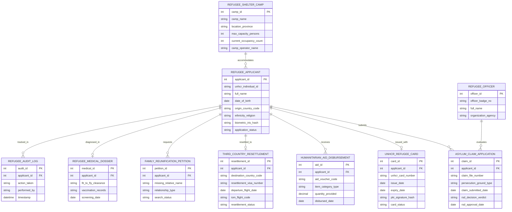

# Conceptual ERD — Refugee & Asylum Management System

## Mermaid Code

## Entity Description Table | Bảng mô tả Entity

| # | Entity Name | Vietnamese Name | Description | Key Attributes | Main Relationships |
|---|-------------|-----------------|-------------|----------------|-------------------|
| 1 | REFUGEE_APPLICANT | Người Tị nạn / Xin Tị nạn | Thông tin cá nhân, mã UNHCR ID, sinh trắc học mống mắt và quốc tịch gốc | applicant_id, unhcr_individual_id, full_name, origin_country_code, application_status | Submits CLAIM, issued CARD, resettled |
| 2 | ASYLUM_CLAIM_APPLICATION | Đơn Xin Tị nạn Nhân đạo | Hồ sơ đơn xin tị nạn, lý do bị bức hại và kết quả thẩm định tư cách tị nạn (RSD) | claim_id, claim_file_number, persecution_ground_type, rsd_decision_verdict | Belongs to REFUGEE_APPLICANT |
| 3 | UNHCR_REFUGEE_CARD | Thẻ Tị nạn Liên Hợp Quốc | Thẻ định danh tị nạn UNHCR điện tử có mã QR bảo mật thay thế hộ chiếu | card_id, unhcr_card_number, issue_date, expiry_date, card_status | Issued for REFUGEE_APPLICANT |
| 4 | REFUGEE_SHELTER_CAMP | Trại Tạm cư Tị nạn | Thông tin trại tạm cư nhân đạo, sức chứa tối đa và số lượng người đang cư trú | camp_id, camp_name, location_province, max_capacity_persons, current_occupancy_count | Accommodates REFUGEE_APPLICANT |
| 5 | HUMANITARIAN_AID_DISBURSEMENT | Nhật ký Cấp phát Cứu trợ | Chứng từ phát lương thực, nước sạch, kít y tế và nhu yếu phẩm cứu trợ | aid_id, aid_voucher_code, item_category_type, quantity_provided, disbursed_date | Received by REFUGEE_APPLICANT |
| 6 | THIRD_COUNTRY_RESETTLEMENT | Tái Định cư Nước thứ ba | Hồ sơ đưa người tị nạn đi tái định cư tại nước thứ ba (Visa, chuyến bay IOM) | resettlement_id, destination_country_code, resettlement_visa_number, departure_flight_date | Resettled for REFUGEE_APPLICANT |
| 7 | FAMILY_REUNIFICATION_PETITION | Đơn Đoàn tụ Gia đình | Đơn yêu cầu tìm kiếm người thân gia đình thất lạc trong chiến tranh/thiên tai | petition_id, missing_relative_name, relationship_type, search_status | Requested by REFUGEE_APPLICANT |
| 8 | REFUGEE_OFFICER | Cán bộ Quản lý Tị nạn | Thông tin cán bộ thẩm định tị nạn thuộc Bộ Ngoại giao hoặc tổ chức UNHCR | officer_id, officer_badge_no, full_name, organization_agency | Evaluates ASYLUM_CLAIM_APPLICATION |
| 9 | REFUGEE_MEDICAL_DOSSIER | Bệnh án Y tế Tị nạn | Hồ sơ kiểm tra sức khỏe ban đầu, tiêm chủng và chứng nhận Fit-to-Fly di chuyển | medical_id, fit_to_fly_clearance, vaccination_records, screening_date | Diagnosed for REFUGEE_APPLICANT |
| 10 | REFUGEE_AUDIT_LOG | Nhật ký Kiểm toán Tị nạn | Lưu toàn bộ vết tiếp nhận, thẩm định RSD, cấp thẻ, phân phát viện trợ và tái định cư | audit_id, action_taken, performed_by, timestamp | Belongs to REFUGEE_APPLICANT |

## Relationship Description | Mô tả Quan hệ

| # | From Entity | Cardinality | To Entity | Relationship Label | Business Explanation |
|---|-------------|-------------|-----------|-------------------|----------------------|
| 1 | REFUGEE_APPLICANT | one-to-many | ASYLUM_CLAIM_APPLICATION | submits | Một người xin tị nạn có thể nộp các đợt đơn xin tị nạn nhân đạo |
| 2 | REFUGEE_APPLICANT | one-to-one | UNHCR_REFUGEE_CARD | issued_with | Người tị nạn được cấp duy nhất một Thẻ định danh tị nạn Liên Hợp Quốc |
| 3 | REFUGEE_SHELTER_CAMP | one-to-many | REFUGEE_APPLICANT | accommodates | Một trại tạm cư tị nạn bố trí chỗ ở cho hàng ngàn người tị nạn nhân đạo |
| 4 | REFUGEE_APPLICANT | one-to-many | HUMANITARIAN_AID_DISBURSEMENT | receives | Một người tị nạn nhận được các gói viện trợ lương thực, y tế hàng tháng |
| 5 | REFUGEE_APPLICANT | one-to-one | THIRD_COUNTRY_RESETTLEMENT | resettled_to | Mỗi người tị nạn đủ điều kiện được tổ chức đi Tái định cư tại một nước thứ ba |
| 6 | REFUGEE_APPLICANT | one-to-many | FAMILY_REUNIFICATION_PETITION | requests | Một người tị nạn gửi các đơn xin tìm kiếm người thân gia đình thất lạc |
| 7 | REFUGEE_APPLICANT | one-to-one | REFUGEE_MEDICAL_DOSSIER | diagnosed_in | Mỗi người tị nạn sở hữu duy nhất một Hồ sơ khám theo dõi y tế |
| 8 | REFUGEE_OFFICER | one-to-many | ASYLUM_CLAIM_APPLICATION | evaluates | Một cán bộ tị nạn phỏng vấn và thẩm định nhiều đơn xin tị nạn |
| 9 | REFUGEE_APPLICANT | one-to-many | REFUGEE_AUDIT_LOG | tracked_in | Mọi thao tác trên hồ sơ người tị nạn được ghi lại nhật ký kiểm toán bất biến |
