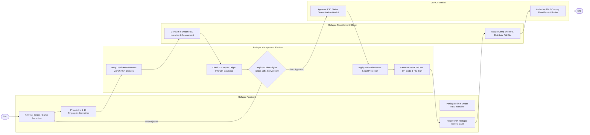

# Swimlane Diagram — Refugee & Asylum Management System

## Mermaid Code

## Flow Description | Mô tả luồng

| Lane | Actor | Role in Flow |
|------|-------|-------------|
| 1 | Refugee Applicant | Đến trạm tiếp nhận biên giới, cung cấp sinh trắc học mống mắt/vân tay, phỏng vấn RSD và nhận Thẻ định danh UNHCR. |
| 2 | Refugee Management Platform | Kiểm tra trùng lặp CSDL proGres toàn cầu, tra cứu dữ liệu đất nước gốc COI, kích hoạt bảo hộ Không trục xuất và in thẻ. |
| 3 | Refugee Resettlement Officer | Phỏng vấn chuyên sâu thẩm định tư cách tị nạn, bố trí chỗ ở tại trại tạm cư và phân phát các gói hàng viện trợ nhân đạo. |
| 4 | UNHCR Official | Duyệt Quyết định tư cách người tị nạn (RSD) và phê duyệt danh sách chuyển người tị nạn đi tái định cư tại nước thứ ba. |
