# Action Tree — Refugee & Asylum Management System

## Mermaid Code

```mermaid
graph TD
    Root["Refugee & Asylum Management System"]

    Root --> M1["Registration & Biometric UN Identity"]
    Root --> M2["Asylum Claim Evaluation & Status Determination"]
    Root --> M3["Camp Accommodation & Aid Distribution"]
    Root --> M4["Family Reunification & Legal Protection"]
    Root --> M5["Third-Country Resettlement & Repatriation"]
    Root --> M6["UNHCR BI & Dossier Archival"]

    M1 --> A11["Register Asylum Seeker Biometrics"]
    M1 --> A12["Issue UN Refugee Identity Cards"]
    M1 --> A13["Verify Biometric Iris ProGres DB"]
    M1 --> A14["Issue Temporary Work Permits"]

    M2 --> A21["Evaluate Asylum Claim Eligibility RSD"]
    M2 --> A22["Dispute Denied Asylum Statuses"]
    M2 --> A23["Query Country of Origin Information COI"]
    M2 --> A24["Conduct RSD In-Depth Interviews"]

    M3 --> A31["Manage Refugee Camp Accommodations"]
    M3 --> A32["Distribute Humanitarian Aid Supplies"]
    M3 --> A33["Conduct Refugee Health Screenings"]
    M3 --> A34["Audit Refugee Vulnerability Ratings AI"]

    M4 --> A41["Verify Non-Refoulement Legal Protection"]
    M4 --> A42["Process Family Reunification Petitions"]
    M4 --> A43["Track Missing Relatives Red Cross"]
    M4 --> A44["Issue Human Rights Protection Orders"]

    M5 --> A51["Track Third-Country Resettlement"]
    M5 --> A52["Coordinate Voluntary Repatriation Flights"]
    M5 --> A53["Process IOM Fit-to-Fly Medical Clearances"]
    M5 --> A54["Issue Resettlement Travel Documents"]

    M6 --> A61["Export UNHCR Refugee Analytics BI"]
    M6 --> A62["Calculate Global Refugee Quotas"]
    M6 --> A63["Log System Immutable Audit Trails"]
    M6 --> A64["Archive Closed Asylum Dossiers"]
```

## Module Description | Mô tả Module

| # | Module | Description | Actions |
|---|--------|-------------|---------|
| 1 | Registration & Biometric UN Identity | Tiếp nhận người xin tị nạn, thu thập sinh trắc học mống mắt/vân tay, đối soát CSDL proGres toàn cầu và cấp Thẻ tị nạn | Register Asylum Seeker Biometrics, Issue UN Refugee Identity Cards, Verify Biometric Iris ProGres DB, Issue Temporary Work Permits |
| 2 | Asylum Claim Evaluation & Status Determination | Phỏng vấn thẩm định tư cách người tị nạn (RSD), tra cứu tình hình đất nước gốc (COI) và giải quyết đơn khiếu nại bác bỏ đơn | Evaluate Asylum Claim Eligibility RSD, Dispute Denied Asylum Statuses, Query Country of Origin Information COI, Conduct RSD In-Depth Interviews |
| 3 | Camp Accommodation & Aid Distribution | Bố trí lều bạt tại trại tạm cư tị nạn, phân phát lương thực y tế cứu trợ và quét AI đánh giá chỉ số dễ bị tổn thương | Manage Refugee Camp Accommodations, Distribute Humanitarian Aid Supplies, Conduct Refugee Health Screenings, Audit Refugee Vulnerability Ratings AI |
| 4 | Family Reunification & Legal Protection | Áp dụng nguyên tắc Không trục xuất (Non-Refoulement) cấm trả người tị nạn về nơi nguy hiểm và đoàn tụ gia đình thất lạc | Verify Non-Refoulement Legal Protection, Process Family Reunification Petitions, Track Missing Relatives Red Cross, Issue Human Rights Protection Orders |
| 5 | Third-Country Resettlement & Repatriation | Tổ chức đưa người tị nạn đi tái định cư tại nước thứ ba (Mỹ, Úc, EU) hoặc sắp xếp các chuyến bay hồi hương tự nguyện IOM | Track Third-Country Resettlement, Coordinate Voluntary Repatriation Flights, Process IOM Fit-to-Fly Medical Clearances, Issue Resettlement Travel Documents |
| 6 | UNHCR BI & Dossier Archival | Trích xuất báo cáo thống kê tình hình người tị nạn nộp Liên Hợp Quốc, kiểm toán bảo mật và lưu trữ hồ sơ tị nạn vĩnh viễn | Export UNHCR Refugee Analytics BI, Calculate Global Refugee Quotas, Log System Immutable Audit Trails, Archive Closed Asylum Dossiers |
