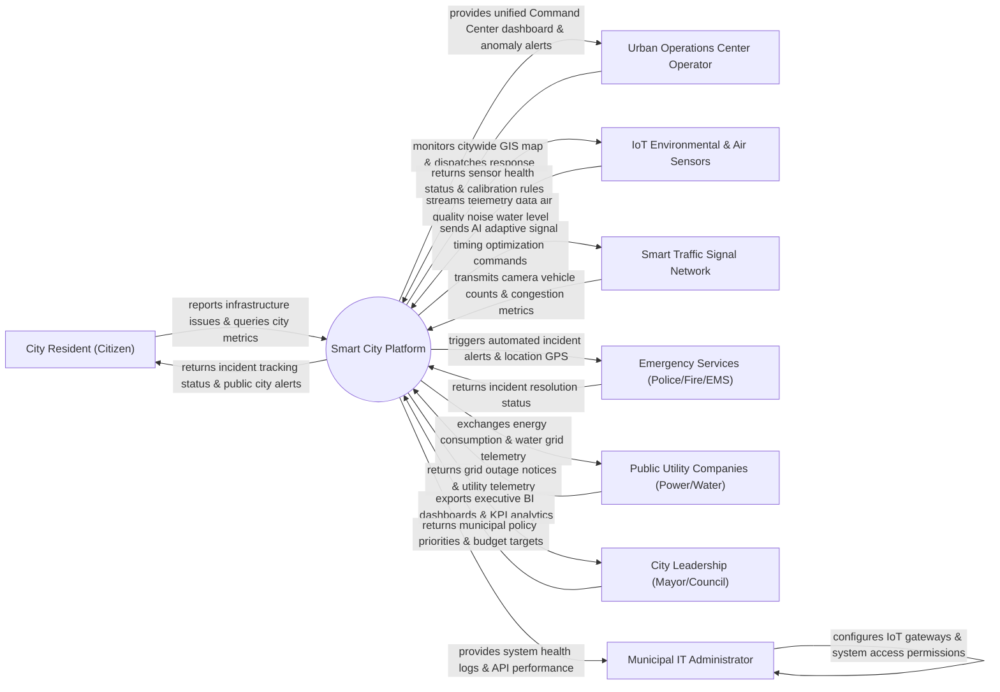

# Context Diagram — Smart City Platform

## Mermaid Code

## Actor & Interaction Table | Bảng Actor & Tương tác

| # | Actor | Actor Type | Data Sent TO System | Data Received FROM System | Notes |
|---|-------|------------|---------------------|---------------------------|-------|
| 1 | City Resident (Citizen) | Primary | Infrastructure issue reports (potholes, streetlights), feedback | Incident resolution tracking, air quality alerts, city notice | Cư dân đô thị tương tác qua ứng dụng di động công dân |
| 2 | Urban Operations Center Operator | Primary | Incident dispatch commands, manual override rules | Unified GIS dashboard, real-time alert notifications, video feeds | Cán bộ vận hành Trung tâm Điều hành Đô thị Thông minh (IOC) |
| 3 | IoT Environmental & Air Sensors | Supporting | Temperature, PM2.5 air quality, noise levels, flood telemetry | Sensor status query, sampling frequency configuration | Mạng lưới cảm biến IoT đo lường môi trường toàn thành phố |
| 4 | Smart Traffic Signal Network | Supporting | Vehicle counts, intersection video analytics, queue length | Adaptive signal timing parameters, green wave commands | Hệ thống đèn giao thông thông minh tự điều chỉnh theo lưu lượng |
| 5 | Emergency Services (Police/Fire/EMS) | Supporting | Emergency unit availability, incident resolution logs | Automated incident dispatch alerts, optimal navigation route | Các lực lượng phản ứng nhanh (Công an, PCCC, Cấp cứu 115) |
| 6 | Public Utility Companies (Power/Water) | Supporting | Smart grid power consumption, water pipe pressure, outage reports | Energy demand forecasts, leak detection alerts | Các công ty điện lực, cấp thoát nước đô thị |
| 7 | City Leadership (Mayor/Council) | Primary | Policy priorities, municipal resource allocation targets | Executive BI dashboards, citywide KPI analytics, trend reports | Lãnh đạo UBND Thành phố giám sát chỉ số điều hành đô thị |
| 8 | Municipal IT Administrator | Supporting | IoT gateway configurations, security rules, user permissions | Platform health metrics, API bandwidth logs, security audits | Quản trị viên hạ tầng CNTT đô thị |

## System Boundary Description | Mô tả Phạm vi Hệ thống

Hệ thống Smart City Platform (Nền tảng Trung tâm Điều hành Đô thị Thông minh - IOC) đóng vai trò là "bộ não" tích hợp dữ liệu tập trung toàn thành phố. Hệ thống kết nối và thu thập dữ liệu từ hàng ngàn thiết bị cảm biến IoT, camera giao thông AI, mạng lưới đèn đường thông minh, hệ thống quan trắc môi trường và ứng dụng phản ánh của cử dân. Hệ thống chịu trách nhiệm phân tích dữ liệu lớn (Big Data Analytics), cảnh báo sự cố tự động, tối ưu hóa giao thông và cung cấp bảng điều khiển trực quan cho Lãnh đạo Thành phố. Tuy nhiên, hệ thống KHÔNG trực tiếp sở hữu hạ tầng phần cứng cáp quang và KHÔNG thay thế công tác sửa chữa cơ khí vật lý của các công nhân đô thị tại hiện trường.
