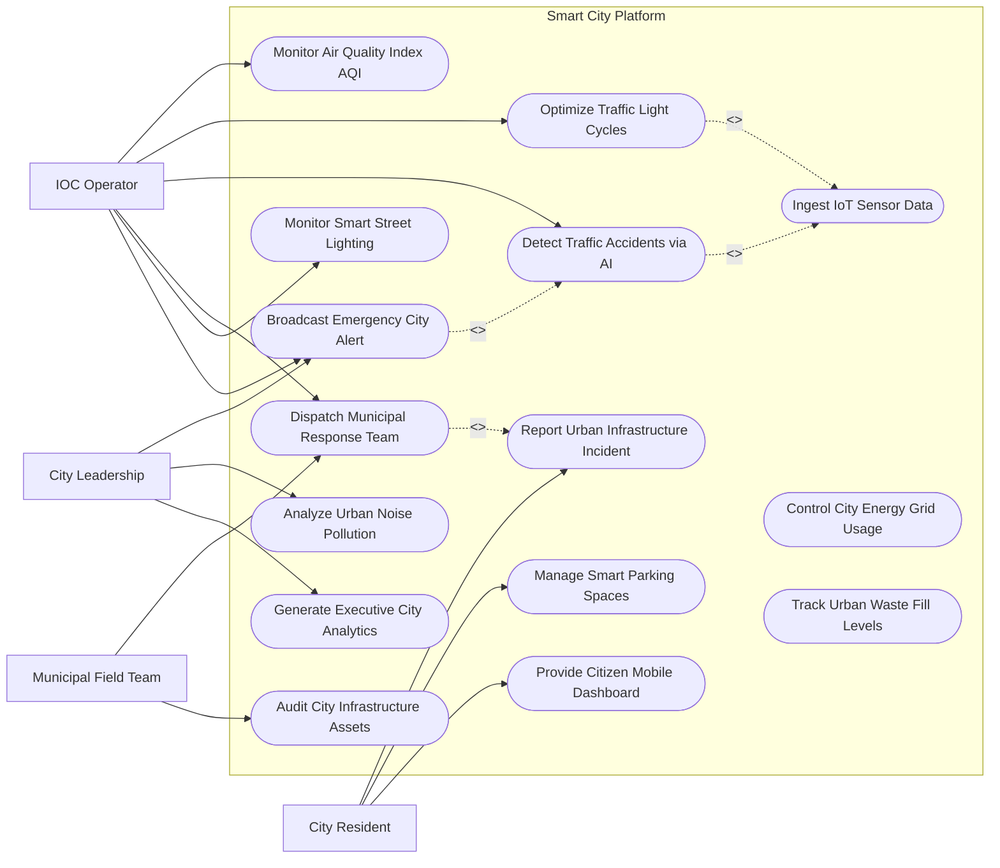

# Use Case Diagram — Smart City Platform

## Mermaid Code

## Actor Table | Bảng Actor

| # | Actor | Actor Type | Role Description | Related Use Cases |
|---|-------|------------|------------------|-------------------|
| 1 | City Resident | Primary | Cư dân đô thị gửi phản ánh sự cố hạ tầng, tra cứu chỗ đỗ xe và chỉ số môi trường | UC05, UC11, UC13 |
| 2 | IOC Operator | Primary | Cán bộ trực trung tâm chỉ huy giám sát bản đồ GIS, điều phối giao thông và sự cố | UC02, UC03, UC04, UC06, UC07, UC10 |
| 3 | Municipal Field Team | Primary | Đội ứng cứu sự cố đô thị (sửa đường, cây xanh, điện chiếu sáng) tại hiện trường | UC06, UC14 |
| 4 | City Leadership | Primary | Lãnh đạo thành phố xem báo cáo chỉ số KPI điều hành và phát lệnh khẩn cấp | UC10, UC12, UC15 |

## Use Case Table | Bảng Use Case

| # | UC ID | Use Case Name | Primary Actor | Secondary Actor | Description | Priority |
|---|-------|---------------|---------------|-----------------|-------------|----------|
| 1 | UC01 | Ingest IoT Sensor Data | System | IoT Devices | Thu nhập dữ liệu cảm biến thời gian thực qua chuẩn MQTT/CoAP | High |
| 2 | UC02 | Monitor Air Quality Index AQI | Operator | Environment Sensor | Giám sát các chỉ số ô nhiễm không khí PM2.5, CO2, NO2 toàn thành phố | High |
| 3 | UC03 | Optimize Traffic Light Cycles | Operator | Traffic System | Tự động điều chỉnh thời gian đèn giao thông thông minh dựa trên lưu lượng xe AI | High |
| 4 | UC04 | Detect Traffic Accidents via AI | System | Camera System | Nhận diện tự động các vụ va chạm giao thông, ùn tắc qua camera AI | High |
| 5 | UC05 | Report Urban Infrastructure Incident | Resident | - | Cư dân chụp ảnh, gửi tọa độ phản ánh ổ gà, hỏng đèn, cây đổ | High |
| 6 | UC06 | Dispatch Municipal Response Team | Operator | FieldTeam | Điều động đội xử lý sự cố hạ tầng đô thị đến địa điểm khắc phục | High |
| 7 | UC07 | Monitor Smart Street Lighting | Operator | Light System | Tự động tăng giảm độ sáng đèn đường thông minh theo thời tiết và giờ | Medium |
| 8 | UC08 | Control City Energy Grid Usage | Operator | Utility System | Giám sát và cân bằng phụ tải tiêu thụ điện tại các khu vực công cộng | Medium |
| 9 | UC09 | Track Urban Waste Fill Levels | FieldTeam | Waste Sensor | Giám sát mức độ đầy của thùng rác thông minh để tối ưu luồng xe gom rác | Medium |
| 10 | UC10 | Broadcast Emergency City Alert | Leadership | Operator | Phát thông báo cảnh báo thảm họa, ngập lụt, ngắt điện tới toàn cư dân | High |
| 11 | UC11 | Manage Smart Parking Spaces | Resident | Parking Sensor | Tra cứu và đặt chỗ trước tại các điểm đỗ xe ô tô công cộng | Medium |
| 12 | UC12 | Analyze Urban Noise Pollution | Leadership | Noise Sensor | Thống kê và phân tích mức độ ô nhiễm tiếng ồn tại các khu dân cư | Low |
| 13 | UC13 | Provide Citizen Mobile Dashboard | Resident | - | Cung cấp ứng dụng di động công dân xem chỉ số đô thị và tiện ích công | High |
| 14 | UC14 | Audit City Infrastructure Assets | FieldTeam | GIS System | Kiểm kê và theo dõi vòng đời bảo trì các tài sản hạ tầng đô thị | Medium |
| 15 | UC15 | Generate Executive City Analytics | Leadership | BI Engine | Tổng hợp bảng điều khiển KPI điều hành kinh tế xã hội thành phố | High |

## Use Case Specification | Đặc tả Use Case

---

### UC01 — Ingest IoT Sensor Data

| Field | Detail |
|-------|--------|
| **UC ID** | UC01 |
| **Use Case Name** | Ingest IoT Sensor Data |
| **Actor(s)** | Primary: System / Secondary: IoT Environmental & Air Sensors |
| **Description** | Tiếp nhận và xử lý luồng dữ liệu tự động từ hàng triệu thiết bị cảm biến IoT toàn thành phố với tần suất thời gian thực. |
| **Precondition** | 1. Các thiết bị cảm biến IoT đã được đăng ký và xác thực trên IoT Gateway.   2. Mạng kết nối không dây (LoRaWAN/5G/NB-IoT) hoạt động bình thường. |
| **Main Flow** | 1. IoT Sensors gửi gói tin dữ liệu telemetry (nhiệt độ, PM2.5, mực nước, xe cộ) qua giao thức MQTT.   2. System tại IoT Gateway xác thực mã thiết bị và khóa bảo mật.   3. System chuẩn hóa dữ liệu định dạng JSON/Protobuf.   4. System lọc bỏ các dữ liệu rác hoặc dữ liệu trùng lặp.   5. System đẩy dữ liệu vào Kho dữ liệu thời gian thực (Time-series Database).   6. System kiểm tra các ngưỡng cảnh báo (Cảnh báo vượt mức PM2.5, ngập lụt).   7. Nếu vượt ngưỡng: System lập tức phát tín hiệu sự cố cho Trung tâm điều hành (UC02, UC04). |
| **Alternative Flow** | **AF1** — Thiết bị mất kết nối tạm thời: IoT Gateway lưu dữ liệu tạm tại bộ nhớ đệm Edge Buffer, tự động đẩy dữ liệu về hệ thống central khi mạng khôi phục. |
| **Exception Flow** | **EX1** — Dữ liệu cảm biến bị sai lệch bất thường (Cảm biến hỏng): System phát hiện giá trị bất thường (Outlier), đánh dấu thiết bị "Cần hiệu chỉnh" và loại bỏ khỏi tính toán trung bình. |
| **Postcondition** | Dữ liệu môi trường đô thị thời gian thực được lưu trữ an toàn, phục vụ phân tích trực quan trên bản đồ GIS. |
| **Business Rule** | **BR1**: Tốc độ xử lý thu thập dữ liệu IoT phải đạt tối thiểu 50,000 sự kiện/giây (events/sec) với độ trễ < 50ms. |

---

### UC03 — Optimize Traffic Light Cycles

| Field | Detail |
|-------|--------|
| **UC ID** | UC03 |
| **Use Case Name** | Optimize Traffic Light Cycles |
| **Actor(s)** | Primary: IOC Operator / Secondary: Smart Traffic Signal Network |
| **Description** | Thuật toán AI phân tích luồng giao thông từ camera, tự động điều chỉnh chu kỳ đèn xanh/đèn đỏ tại các nút giao để giảm ùn tắc. |
| **Precondition** | 1. Camera AI giao thông tại nút giao đang truyền luồng video ổn định.   2. Tủ điều khiển đèn giao thông kết nối trực tuyến với hệ thống IOC. |
| **Main Flow** | 1. Camera AI đếm số lượng phương tiện và đo độ dài hàng chờ (queue length) tại các hướng của nút giao.   2. System tính toán mật độ giao thông và chỉ số ùn tắc theo thời gian thực.   3. Thuật toán AI Adaptive Traffic Control đưa ra chu kỳ đèn tối ưu (Ví dụ: Tăng thời lượng đèn xanh hướng đông-tây thêm 15 giây).   4. System truyền lệnh thay đổi chu kỳ đèn xuống tủ điều khiển đèn giao thông tại nút giao.   5. Tủ điều khiển đèn thực hiện chuyển đổi chu kỳ đèn mượt mà.   6. System kiểm tra lại độ dài hàng chờ sau 2 chu kỳ để đánh giá hiệu quả giải tỏa ùn tắc. |
| **Alternative Flow** | **AF1** — Kích hoạt làn sóng xanh ưu tiên xe cấp cứu/PCCC: Khi có xe khẩn cấp tiếp cận, System ghi đè chu kỳ AI, bật liên tục đèn xanh trên lộ trình xe ưu tiên (Green Wave). |
| **Exception Flow** | **EX1** — Mất kết nối tủ điều khiển đèn: Tủ điều khiển tự động chuyển sang chế độ chạy chu kỳ cố định cục bộ (Fallback Mode) để đảm bảo an toàn giao thông. |
| **Postcondition** | Thời lượng chờ tại ngã tư được tối ưu hóa, giảm từ 15-30% nguy cơ ùn tắc giao thông giờ cao điểm. |
| **Business Rule** | **BR1**: Thời lượng đèn xanh tối thiểu cho người đi bộ qua đường tại mọi nút giao bắt buộc phải đảm bảo từ 15 đến 25 giây. |

---

### UC05 — Report Urban Infrastructure Incident

| Field | Detail |
|-------|--------|
| **UC ID** | UC05 |
| **Use Case Name** | Report Urban Infrastructure Incident |
| **Actor(s)** | Primary: City Resident / Secondary: None |
| **Description** | Cư dân chụp ảnh, đính kèm vị trí GPS gửi phản ánh các sự cố hạ tầng đô thị (ổ gà, ngập nước, đứt dây điện, hỏng đèn đường). |
| **Precondition** | 1. Cư dân đã cài đặt ứng dụng di động Công dân Thông minh và đăng nhập VNeID. |
| **Main Flow** | 1. Resident mở ứng dụng, chọn mục "Phản ánh Hạ tầng Đô thị".   2. Resident chụp ảnh hoặc quay video sự cố thực tế tại hiện trường.   3. System tự động lấy vị trí tọa độ GPS chính xác từ thiết bị di động.   4. Resident chọn nhóm sự cố (Đường xá, Cây xanh, Chiếu sáng, Trợ giúp ngập lụt) và nhập mô tả ngắn.   5. Resident nhấn "Gửi phản ánh".   6. System tự động AI phân tích hình ảnh để xác minh sơ bộ sự cố thật.   7. System sinh Mã phản ánh (Ticket ID), gửi thông báo xác nhận cho Resident và đẩy sự cố lên bản đồ chỉ huy IOC. |
| **Alternative Flow** | **AF1** — Phản ánh trùng lặp: System phát hiện đã có người dân khác báo sự cố tại cùng tọa độ bán kính 20m, tự động gộp phản ánh và cho phép Resident nhấn "Theo dõi sự cố này". |
| **Exception Flow** | **EX1** — Tọa độ GPS không chính xác: System gợi ý Resident chọn lại mốc địa chỉ trên bản đồ tương tác trước khi nộp. |
| **Postcondition** | Sự cố được ghi nhận trên hệ thống chỉ huy, chuyển sang luồng phân công đội xử lý (UC06). |
| **Business Rule** | **BR1**: Mọi phản ánh của người dân bắt buộc phải được hệ thống tự động phân loại và chuyển đến đơn vị xử lý trong vòng 15 phút. |

---

### UC06 — Dispatch Municipal Response Team

| Field | Detail |
|-------|--------|
| **UC ID** | UC06 |
| **Use Case Name** | Dispatch Municipal Response Team |
| **Actor(s)** | Primary: IOC Operator / Secondary: Municipal Field Team |
| **Description** | Điều hành viên tại IOC phân công công việc và điều động đội ứng cứu hiện trường đến khắc phục sự cố hạ tầng đô thị. |
| **Precondition** | 1. Sự cố hạ tầng đã được ghi nhận trên hệ thống (UC05 hoặc UC04). |
| **Main Flow** | 1. Operator mở vé sự cố trên bản đồ GIS chỉ huy.   2. System hiển thị danh sách các Đội ứng cứu chuyên trách (Công ty Cây xanh, Công ty Điện lực, Đơn vị Sửa đường) đang ở gần hiện trường.   3. Operator xem thông tin hình ảnh sự cố và vị trí chính xác.   4. Operator chọn Đội ứng cứu phù hợp và gán thời hạn khắc phục SLA (Ví dụ: Cây đổ = 2 giờ, Ổ gà = 24 giờ).   5. System gửi thông báo điều động và lộ trình dẫn đường đến ứng dụng di động của FieldTeam.   6. FieldTeam xác nhận "Đã nhận lệnh - Đang di chuyển".   7. Khi hoàn thành: FieldTeam chụp ảnh kết quả đã khắc phục và bấm "Hoàn thành nhiệm vụ".   8. System kiểm tra ảnh hoàn thành và tự động gửi thông báo kết quả cho công dân đã phản ánh (UC05). |
| **Alternative Flow** | **AF1** — Sự cố nghiêm trọng cần phối hợp liên ngành: Operator kích hoạt chế độ "Sự cố Phức hợp", gán đồng thời Đội Điện lực, Công an Giao thông và Cây xanh cùng xử lý. |
| **Exception Flow** | **EX1** — Đội ứng cứu quá hạn SLA chưa xử lý: System tự động bật cảnh báo đỏ trên màn hình Chánh Văn phòng UBND Thành phố để đôn đốc. |
| **Postcondition** | Sự cố được khắc phục hoàn toàn tại hiện trường, dữ liệu bảo trì tài sản được cập nhật vào CSDL đô thị. |
| **Business Rule** | **BR1**: Đội ứng cứu phải có mặt tại hiện trường xử lý sự cố nguy hiểm (dây điện đứt, ngập sâu) trong vòng tối đa 30 phút. |

---

### UC10 — Broadcast Emergency City Alert

| Field | Detail |
|-------|--------|
| **UC ID** | UC10 |
| **Use Case Name** | Broadcast Emergency City Alert |
| **Actor(s)** | Primary: City Leadership / Secondary: IOC Operator |
| **Description** | Phát thông báo cảnh báo khẩn cấp (thảm họa thiên tai, xả lũ, chất lượng không khí nguy hại) tới toàn bộ cư dân đô thị qua ứng dụng và bảng điện tử. |
| **Precondition** | 1. Phát sinh sự kiện khẩn cấp đô thị mức độ nghiêm trọng.   2. Quyết định phát cảnh báo đã được Chủ tịch UBND Thành phố duyệt. |
| **Main Flow** | 1. Leadership duyệt nội dung thông báo khẩn cấp và phạm vi ảnh hưởng (Toàn thành phố hoặc theo Quận/Huyện).   2. Operator kích hoạt tính năng "Phát Cảnh báo Khẩn cấp Đô thị".   3. System gửi thông báo Push Notification tới 100% ứng dụng di động công dân trong khu vực.   4. System hiển thị thông điệp cảnh báo trên tất cả các Bảng thông tin điện tử (VMS Display) trên các tuyến đường.   5. System tự động gửi nội dung thông báo đến các cơ quan báo chí và mạng xã hội chính thức của thành phố.   6. System thống kê tỷ lệ cư dân đã nhận được thông báo theo thời gian thực. |
| **Alternative Flow** | **AF1** — Cảnh báo ngập lụt tự động theo cảm biến mực nước: Khi cảm biến đo mực nước sông/đường ngập > 0.5m, System tự động sinh thông báo cảnh báo tuyến đường ngập cho tài xế lái xe tránh. |
| **Exception Flow** | **EX1** — Nghẽn mạng ứng dụng di động: System tự động bổ sung kênh gửi tin nhắn SMS ưu tiên cho các khu vực bị ảnh hưởng nặng nhất. |
| **Postcondition** | Toàn bộ cư dân trong vùng nguy hiểm nhận được thông tin hướng dẫn phòng tránh kịp thời, giảm thiểu thiệt hại. |
| **Business Rule** | **BR1**: Tin nhắn cảnh báo khẩn cấp thảm họa phải được phát đi đến thiết bị công dân trong thời gian tối đa 60 giây kể từ khi duyệt lệnh. |
