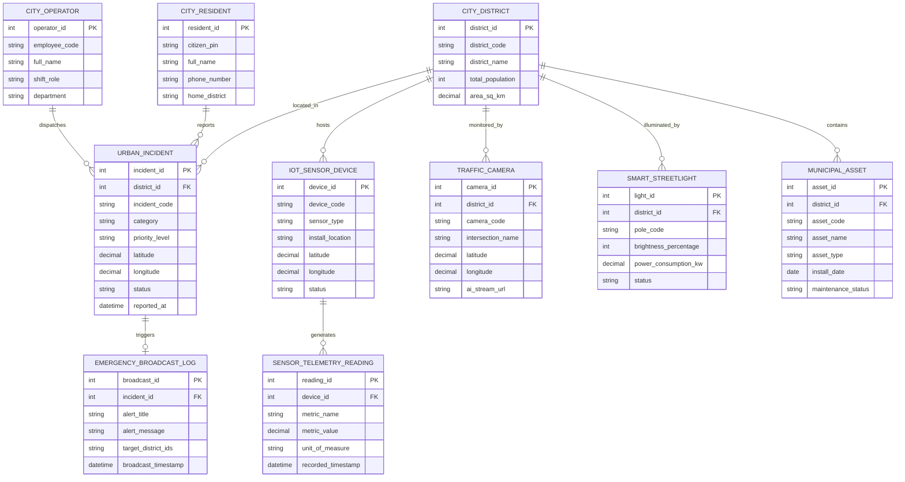

# Conceptual ERD — Smart City Platform

## Mermaid Code

## Entity Description Table | Bảng mô tả Entity

| # | Entity Name | Vietnamese Name | Description | Key Attributes | Main Relationships |
|---|-------------|-----------------|-------------|----------------|-------------------|
| 1 | IOT_SENSOR_DEVICE | Thiết bị Cảm biến IoT | Quản lý thông tin thiết bị cảm biến không khí, nước, tiếng ồn | device_id, device_code, sensor_type, status | Generates SENSOR_TELEMETRY_READING, hosted in CITY_DISTRICT |
| 2 | SENSOR_TELEMETRY_READING | Chuỗi Dữ liệu Cảm biến | Lưu trữ các chỉ số telemetry đo lường thời gian thực từ cảm biến | reading_id, metric_name, metric_value, recorded_timestamp | Belongs to IOT_SENSOR_DEVICE |
| 3 | CITY_DISTRICT | Quận / Huyện Đô thị | Đơn vị hành chính địa lý phân vùng quản lý hạ tầng thành phố | district_id, district_code, district_name, area_sq_km | Hosts IOT_SENSOR_DEVICE, URBAN_INCIDENT, MUNICIPAL_ASSET |
| 4 | URBAN_INCIDENT | Sự cố Hạ tầng Đô thị | Hồ sơ ghi nhận các sự cố (ổ gà, cây đổ, ngập nước, va chạm giao thông) | incident_id, incident_code, category, priority_level, status | Belongs to CITY_DISTRICT, reported by RESIDENT |
| 5 | TRAFFIC_CAMERA | Camera Giao thông AI | Hệ thống camera quan sát nút giao tích hợp nhận diện hình ảnh AI | camera_id, camera_code, intersection_name, ai_stream_url | Belongs to CITY_DISTRICT |
| 6 | SMART_STREETLIGHT | Đèn đường Thông minh | Hệ thống cột đèn chiếu sáng đô thị tự động điều chỉnh công suất | light_id, pole_code, brightness_percentage, status | Belongs to CITY_DISTRICT |
| 7 | MUNICIPAL_ASSET | Tài sản Hạ tầng Đô thị | Danh mục tài sản công cộng (cầu, cống, bến xe, công viên) | asset_id, asset_code, asset_name, asset_type, maintenance_status | Belongs to CITY_DISTRICT |
| 8 | CITY_RESIDENT | Cư dân Đô thị | Thông tin tài khoản người dân sử dụng ứng dụng di động công dân | resident_id, citizen_pin, full_name, phone_number | Reports URBAN_INCIDENT |
| 9 | CITY_OPERATOR | Điều hành viên Trung tâm IOC | Cán bộ trực chỉ huy điều phối sự cố tại trung tâm điều hành | operator_id, employee_code, full_name, shift_role | Dispatches URBAN_INCIDENT |
| 10 | EMERGENCY_BROADCAST_LOG | Nhật ký Cảnh báo Khẩn cấp | Ghi nhận các đợt phát tin nhắn cảnh báo diện rộng tới cư dân | broadcast_id, alert_title, alert_message, broadcast_timestamp | Belongs to URBAN_INCIDENT |

## Relationship Description | Mô tả Quan hệ

| # | From Entity | Cardinality | To Entity | Relationship Label | Business Explanation |
|---|-------------|-------------|-----------|-------------------|----------------------|
| 1 | IOT_SENSOR_DEVICE | one-to-many | SENSOR_TELEMETRY_READING | generates | Một thiết bị cảm biến phát ra chuỗi nhiều bản ghi telemetry thời gian thực |
| 2 | CITY_DISTRICT | one-to-many | IOT_SENSOR_DEVICE | hosts | Một quận/huyện lắp đặt mạng lưới nhiều thiết bị cảm biến IoT |
| 3 | CITY_DISTRICT | one-to-many | URBAN_INCIDENT | located_in | Mot quận/huyện ghi nhận nhiều sự cố hạ tầng đô thị xảy ra |
| 4 | CITY_DISTRICT | one-to-many | TRAFFIC_CAMERA | monitored_by | Một quận/huyện được giám sát bởi nhiều camera giao thông nút giao |
| 5 | CITY_DISTRICT | one-to-many | SMART_STREETLIGHT | illuminated_by | Một quận/huyện quản lý hệ thống nhiều cột đèn chiếu sáng thông minh |
| 6 | CITY_DISTRICT | one-to-many | MUNICIPAL_ASSET | contains | Một quận/huyện chứa các tài sản hạ tầng công cộng |
| 7 | CITY_RESIDENT | one-to-many | URBAN_INCIDENT | reports | Một cư dân có thể gửi nhiều phản ánh sự cố hạ tầng đô thị |
| 8 | CITY_OPERATOR | one-to-many | URBAN_INCIDENT | dispatches | Một điều hành viên IOC phân công xử lý cho nhiều vụ việc sự cố |
| 9 | URBAN_INCIDENT | one-to-one | EMERGENCY_BROADCAST_LOG | triggers | Một sự cố thảm họa nghiêm trọng kích hoạt một thông báo cảnh báo khẩn cấp |
