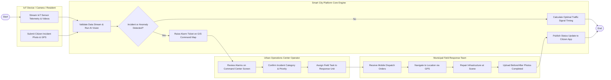

# Swimlane Diagram — Smart City Platform

## Mermaid Code

## Flow Description | Mô tả luồng

| Lane | Actor | Role in Flow |
|------|-------|-------------|
| 1 | IoT Device / Camera / Resident | Truyền dữ liệu cảm biến thời gian thực, luồng video AI hoặc gửi ảnh phản ánh sự cố kèm tọa độ GPS. |
| 2 | Smart City Platform Core Engine | Chuẩn hóa luồng dữ liệu, chạy thuật toán AI nhận diện bất thường, sinh vé cảnh báo trên bản đồ GIS và tính toán chu kỳ đèn. |
| 3 | Urban Operations Center Operator | Rà soát cảnh báo trên màn hình trung tâm IOC, xác nhận phân loại sự cố và phát lệnh điều động đội ứng cứu. |
| 4 | Municipal Field Response Team | Nhận lệnh điều động trên ứng dụng di động, di chuyển tới hiện trường sửa chữa hạ tầng và tải ảnh hoàn thành. |
