# Action Tree — Smart City Platform

## Mermaid Code

```mermaid
graph TD
    Root["Smart City Platform"]

    Root --> M1["IoT Telemetry & Device Management"]
    Root --> M2["Traffic & Mobility Optimization"]
    Root --> M3["Environmental & Air Quality Monitoring"]
    Root --> M4["Urban Incident & Citizen Reporting"]
    Root --> M5["Smart Utilities & Energy Grid"]
    Root --> M6["Command Center & Executive Analytics"]

    M1 --> A11["Register IoT Gateways Devices"]
    M1 --> A12["Ingest Real-time MQTT Telemetry"]
    M1 --> A13["Detect Hardware Sensor Outliers"]
    M1 --> A14["Manage Firmware OTA Updates"]

    M2 --> A21["Detect Intersection Queue via AI"]
    M2 --> A22["Optimize Adaptive Traffic Signals"]
    M2 --> A23["Trigger Emergency Green Waves"]
    M2 --> A24["Manage Smart Public Parking"]

    M3 --> A31["Calculate Citywide AQI Index"]
    M3 --> A32["Monitor Flood Sensors Water Levels"]
    M3 --> A33["Track Urban Noise Pollution Levels"]
    M3 --> A34["Trigger Hazardous Air Quality Alerts"]

    M4 --> A41["Receive Citizen Incident App Reports"]
    M4 --> A42["AI Verify Incident Image Evidence"]
    M4 --> A43["Dispatch Municipal Field Teams"]
    M4 --> A44["Track Infrastructure Repair SLAs"]

    M5 --> A51["Monitor Smart Streetlight Dimming"]
    M5 --> A52["Track Public Grid Power Consumption"]
    M5 --> A53["Detect Water Pipe Leaks Pressure"]
    M5 --> A54["Track Smart Waste Bin Fill Status"]

    M6 --> A61["Render Unified GIS Command Map"]
    M6 --> A62["Broadcast City Emergency Alerts"]
    M6 --> A63["Display Executive Leadership KPIs"]
    M6 --> A64["Export Municipal Open Data Sets"]
```

## Module Description | Mô tả Module

| # | Module | Description | Actions |
|---|--------|-------------|---------|
| 1 | IoT Telemetry & Device Management | Quản lý vòng đời kết nối các thiết bị cảm biến IoT, nhận luồng MQTT và phát hiện dữ liệu bất thường | Register IoT Gateways Devices, Ingest Real-time MQTT Telemetry, Detect Hardware Sensor Outliers, Manage Firmware OTA Updates |
| 2 | Traffic & Mobility Optimization | Động cơ AI phân tích camera giao thông, điều chỉnh chu kỳ đèn thông minh, mở làn ưu tiên và quản lý đỗ xe | Detect Intersection Queue via AI, Optimize Adaptive Traffic Signals, Trigger Emergency Green Waves, Manage Smart Public Parking |
| 3 | Environmental & Air Quality Monitoring | Quan trắc chỉ số không khí AQI, theo dõi mực nước sông hồ gây ngập và đo đạc mức ô nhiễm tiếng ồn | Calculate Citywide AQI Index, Monitor Flood Sensors Water Levels, Track Urban Noise Pollution Levels, Trigger Hazardous Air Quality Alerts |
| 4 | Urban Incident & Citizen Reporting | Tiếp nhận phản ánh sự cố của người dân qua ứng dụng công dân, xác minh ảnh AI và điều động đội sửa chữa | Receive Citizen Incident App Reports, AI Verify Incident Image Evidence, Dispatch Municipal Field Teams, Track Infrastructure Repair SLAs |
| 5 | Smart Utilities & Energy Grid | Quản lý hệ thống đèn đường thông minh, giám sát tiêu thụ điện lưới công cộng và phát hiện rò rỉ nước | Monitor Smart Streetlight Dimming, Track Public Grid Power Consumption, Detect Water Pipe Leaks Pressure, Track Smart Waste Bin Fill Status |
| 6 | Command Center & Executive Analytics | Hiển thị bản đồ tổng thể GIS tại trung tâm chỉ huy IOC, phát cảnh báo khẩn cấp và cung cấp KPI cho lãnh đạo | Render Unified GIS Command Map, Broadcast City Emergency Alerts, Display Executive Leadership KPIs, Export Municipal Open Data Sets |
