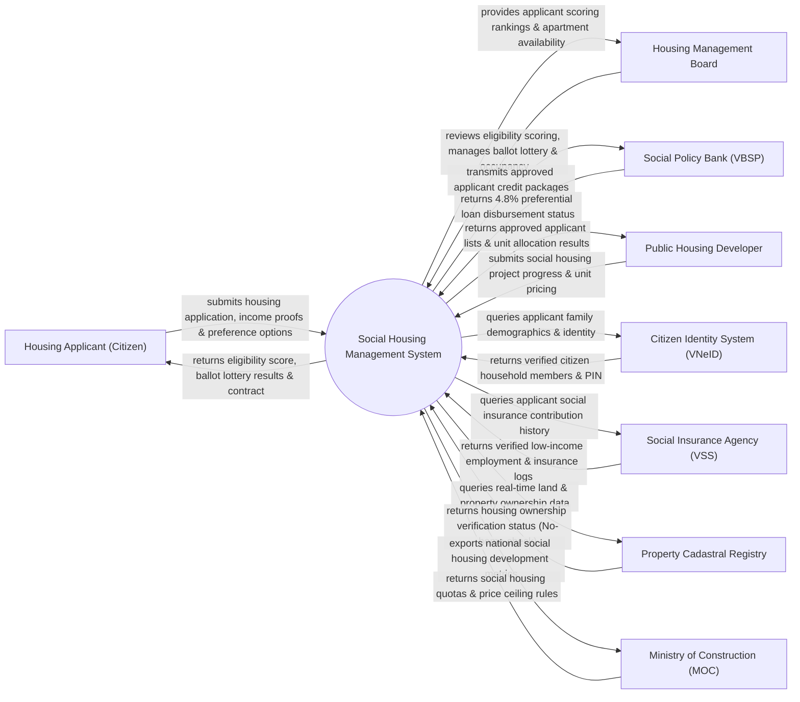

# Context Diagram — Social Housing Management System

## Mermaid Code

## Actor & Interaction Table | Bảng Actor & Tương tác

| # | Actor | Actor Type | Data Sent TO System | Data Received FROM System | Notes |
|---|-------|------------|---------------------|---------------------------|-------|
| 1 | Housing Applicant (Citizen) | Primary | Housing registration form, income declarations, priority points proof | Eligibility score, lottery code, apartment unit contract | Công dân đối tượng thu nhập thấp nộp đơn xin mua/thuê nhà ở xã hội |
| 2 | Housing Management Board | Primary | Review approvals, lottery settings, occupancy violation notices | Applicant scoring rankings, unit allocation lists, inspection logs | Hội đồng thẩm định và quản lý Nhà ở xã hội Tỉnh/Thành phố |
| 3 | Social Policy Bank (VBSP) | Supporting | Preferential loan approval, monthly interest payment confirmation | Approved applicant credit dossiers, loan repayment schedules | Ngân hàng Chính sách Xã hội cho vay ưu đãi lãi suất 4.8% |
| 4 | Public Housing Developer | Supporting | Project apartment blueprints, selling prices, delivery milestones | Qualified buyer list, unit allocation contracts | Chủ đầu tư các dự án nhà ở xã hội |
| 5 | Citizen Identity System (VNeID) | Supporting | Family household members, national 12-digit PIN details | Household query parameters | Cơ sở dữ liệu quốc gia về dân cư xác thực quan hệ nhân thân |
| 6 | Social Insurance Agency (VSS) | Supporting | Monthly social insurance contribution history, salary grade | Low-income employment verification query | Bảo hiểm Xã hội Việt Nam xác minh mức thu nhập thực tế |
| 7 | Property Cadastral Registry | Supporting | Property ownership status (GCN QSDĐ), real estate holdings | Property ownership verification query | Văn phòng Đăng ký Đất đai xác nhận công dân chưa có nhà ở |
| 8 | Ministry of Construction (MOC) | Regulatory | Social housing quotas, price ceiling policy rules | National social housing analytics, 1-million apartment program stats | Bộ Xây dựng chỉ đạo phát triển 1 triệu căn nhà ở xã hội |

## System Boundary Description | Mô tả Phạm vi Hệ thống

Hệ thống Social Housing Management System (Hệ thống Quản lý và Phân phối Nhà ở Xã hội) chịu trách nhiệm tự động hóa toàn bộ quy trình xét duyệt và phân phối nhà ở xã hội: Tiếp nhận đơn đăng ký, tự động xác minh điều kiện "Chưa có nhà ở" (qua CSDL Đất đai) và "Thu nhập thấp" (qua BHXH VSS), tự động chấm điểm ưu tiên (Scoring Engine), bốc thăm quyền mua/thuê tự động, quản lý hợp đồng thuê mua, cho vay vốn ưu đãi Ngân hàng Chính sách Xã hội và giám sát hậu kiểm chống đầu cơ/cho thuê lại trái phép. Tuy nhiên, hệ thống KHÔNG trực tiếp thi công xây dựng dự án và KHÔNG thay thế hợp đồng tín dụng thương mại cá nhân.
