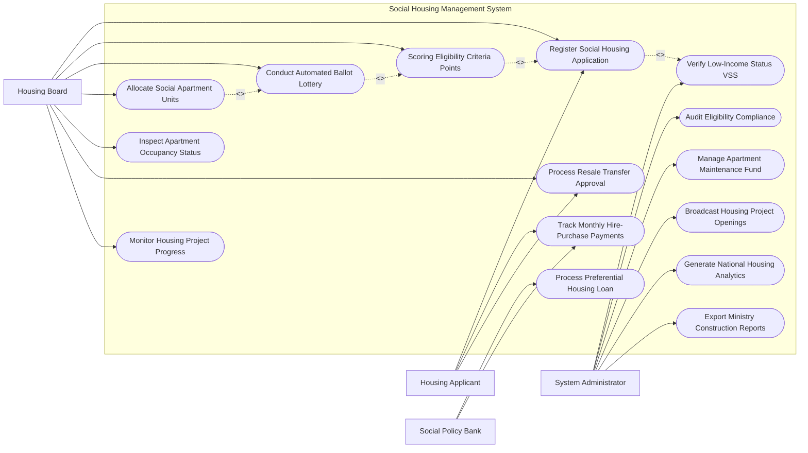

# Use Case Diagram — Social Housing Management System

## Mermaid Code

## Actor Table | Bảng Actor

| # | Actor | Actor Type | Role Description | Related Use Cases |
|---|-------|------------|------------------|-------------------|
| 1 | Housing Applicant | Primary | Công dân nộp đơn đăng ký mua/thuê nhà ở xã hội, theo dõi điểm và trả góp | UC01, UC07, UC09 |
| 2 | Housing Board | Primary | Hội đồng thẩm định xét duyệt hồ sơ, chấm điểm, tổ chức bốc thăm và hậu kiểm | UC01, UC02, UC04, UC05, UC08, UC09, UC10 |
| 3 | Social Policy Bank | Secondary | Ngân hàng Chính sách Xã hội thẩm định gói vay 4.8% và thu tiền trả góp | UC06, UC07 |
| 4 | System Administrator | System | Quản trị viên đối soát CSDL BHXH/Đất đai, giám sát quỹ bảo trì và xuất báo cáo | UC03, UC11, UC12, UC13, UC14, UC15 |

## Use Case Table | Bảng Use Case

| # | UC ID | Use Case Name | Primary Actor | Secondary Actor | Description | Priority |
|---|-------|---------------|---------------|-----------------|-------------|----------|
| 1 | UC01 | Register Social Housing Application | Applicant | Board, VNeID | Nộp đơn đăng ký mua/thuê mua nhà ở xã hội trực tuyến kèm tài liệu chứng minh | High |
| 2 | UC02 | Scoring Eligibility Criteria Points | Board | System | Tự động tính điểm ưu tiên (thương binh, hộ nghèo, công nhân, chưa có nhà) | High |
| 3 | UC03 | Verify Low-Income Status VSS | System | VSS, Cadastral | Tự động kết nối BHXH và CSDL Đất đai để xác minh thu nhập và tình trạng nhà ở | High |
| 4 | UC04 | Conduct Automated Ballot Lottery | Board | Applicant | Tổ chức bốc thăm quyền mua và bốc thăm vị trí căn hộ công khai bằng phần mềm | High |
| 5 | UC05 | Allocate Social Apartment Units | Board | Developer | Phê duyệt danh sách và gán căn hộ cho các công dân trúng bốc thăm | High |
| 6 | UC06 | Process Preferential Housing Loan | Bank | Applicant | Thẩm định và giải ngân gói tín dụng ưu đãi lãi suất 4.8%/năm của Ngân hàng VBSP | High |
| 7 | UC07 | Track Monthly Hire-Purchase Payments | Applicant | Bank | Theo dõi tiến độ nộp tiền trả góp mua nhà hoặc tiền thuê nhà hàng tháng | High |
| 8 | UC08 | Inspect Apartment Occupancy Status | Board | Local Gov | Hậu kiểm định kỳ chống cho thuê lại, chuyển nhượng trái phép hoặc bỏ trống | High |
| 9 | UC09 | Process Resale Transfer Approval | Applicant | Board | Thẩm định điều kiện chuyển nhượng lại nhà ở xã hội sau 05 năm sở hữu | Medium |
| 10 | UC10 | Monitor Housing Project Progress | Board | Developer | Giám sát tiến độ xây dựng và giá bán duyệt chính thức của các dự án NƠXH | Medium |
| 11 | UC11 | Audit Eligibility Compliance | Admin | StateAudit | Kiểm toán tính công khai minh bạch của danh sách trúng mua nhà ở xã hội | High |
| 12 | UC12 | Manage Apartment Maintenance Fund | Admin | ManagementCo | Quản lý và giải ngân Quỹ bảo trì 2% của chung cư nhà ở xã hội | Medium |
| 13 | UC13 | Broadcast Housing Project Openings | Admin | PublicPress | Đăng tải công khai các dự án NƠXH sắp mở bán trên cổng thông tin | High |
| 14 | UC14 | Generate National Housing Analytics | Admin | MOC | Phân tích chỉ tiêu phát triển nhà ở xã hội theo Đề án 1 triệu căn hộ | Low |
| 15 | UC15 | Export Ministry Construction Reports | System | MOC | Trích xuất báo cáo định kỳ về tình hình phân phối NƠXH nộp Bộ Xây dựng | Low |

## Use Case Specification | Đặc tả Use Case

---

### UC01 — Register Social Housing Application

| Field | Detail |
|-------|--------|
| **UC ID** | UC01 |
| **Use Case Name** | Register Social Housing Application |
| **Actor(s)** | Primary: Housing Applicant / Secondary: Housing Board, VNeID |
| **Description** | Công dân thuộc đối tượng thụ hưởng nộp hồ sơ đăng ký mua hoặc thuê mua nhà ở xã hội trực tuyến. |
| **Precondition** | 1. Công dân có tài khoản VNeID mức 2.   2. Dự án nhà ở xã hội đang trong giai đoạn tiếp nhận hồ sơ (UC13). |
| **Main Flow** | 1. Applicant đăng nhập Cổng Dịch vụ Nhà ở Xã hội.   2. Applicant chọn Dự án NƠXH muốn đăng ký và chọn loại hình (Mua hoặc Thuê mua).   3. System kết nối VNeID tự động điền thông tin nhân thân và các thành viên trong hộ gia đình.   4. Applicant tích chọn Đối tượng ưu tiên (Công nhân, Hộ nghèo, Người có công, Cán bộ công chức).   5. Applicant tải lên các tài liệu chứng minh: Giấy xác nhận thu nhập, Đơn cam kết chưa có nhà ở.   6. System tự động gửi yêu cầu xác minh không có nhà ở sang CSDL Đất đai và xác minh thu nhập sang VSS (UC03).   7. System cấp Mã hồ sơ đăng ký (Application ID) và gửi biên nhận điện tử cho Applicant. |
| **Alternative Flow** | **AF1** — Đăng ký thuê nhà ở xã hội: Applicant chọn "Thuê nhà", System chuyển sang biểu mẫu đăng ký thuê ngắn hạn 05 năm. |
| **Exception Flow** | **EX1** — CSDL Đất đai phát hiện Applicant đã đứng tên sở hữu nhà ở khác: System lập tức chặn hồ sơ, thông báo lý do "Không đủ điều kiện do đã có nhà ở". |
| **Postcondition** | Hồ sơ được ghi nhận vào danh sách chờ xét duyệt và chấm điểm ưu tiên (UC02). |
| **Business Rule** | **BR1**: Mỗi hộ gia đình chỉ được nộp 01 hồ sơ đăng ký mua/thuê mua nhà ở xã hội tại cùng một thời điểm. |

---

### UC02 — Scoring Eligibility Criteria Points

| Field | Detail |
|-------|--------|
| **UC ID** | UC02 |
| **Use Case Name** | Scoring Eligibility Criteria Points |
| **Actor(s)** | Primary: Housing Board / Secondary: System Scoring Engine |
| **Description** | Hệ thống tự động tính toán và xếp hạng điểm ưu tiên của các hồ sơ đăng ký theo Tiêu chí chấm điểm của Bộ Xây dựng. |
| **Precondition** | 1. Hồ sơ đăng ký (UC01) đã được xác minh điều kiện pháp lý hợp lệ (UC03). |
| **Main Flow** | 1. System chạy thuật toán chấm điểm tự động (Auto-Scoring Engine).   2. System áp dụng Thang điểm tiêu chí (Tổng 100 điểm):   - Tiêu chí thực trạng nhà ở (Tối đa 40 điểm): Chưa có nhà ở (40đ), Nhà ở chật hẹp $<10m^2/người$ (30đ).   - Tiêu chí đối tượng (Tối đa 30 điểm): Người có công cách mạng (30đ), Hộ nghèo/cận nghèo (20đ), Công nhân/Công chức (10đ).   - Tiêu chí hộ khẩu/thường trú (Tối đa 20 điểm): Thường trú trên 01 năm tại địa phương (20đ).   - Tiêu chí hộ gia đình (Tối đa 10 điểm): Hộ gia đình đông con/bệnh hiểm nghèo (10đ).   3. System tự động tổng hợp Tổng điểm số ưu tiên cho từng Applicant.   4. HousingBoard rà soát danh sách điểm số và bấm "Phê duyệt Bảng điểm".   5. System công khai Bảng điểm xét duyệt lên Cổng thông tin trong 15 ngày để độc giả kiểm tra phản hồi. |
| **Alternative Flow** | **AF1** — Người dân khiếu nại điểm số: Board thẩm định lại tài liệu bổ sung, System điều chỉnh điểm số và cập nhật Bảng xếp hạng. |
| **Exception Flow** | **EX1** — Hai hồ sơ có tổng điểm bằng nhau: System tự động xếp vào nhóm phải thực hiện Bốc thăm công khai (UC04). |
| **Postcondition** | Danh sách công dân đủ điều kiện và thứ tự điểm số được chốt, chuẩn bị cho khâu bốc thăm căn hộ (UC04). |
| **Business Rule** | **BR1**: Bảng điểm ưu tiên phải được công khai minh bạch tối thiểu 15 ngày trước khi tổ chức bốc thăm căn hộ. |

---

### UC04 — Conduct Automated Ballot Lottery

| Field | Detail |
|-------|--------|
| **UC ID** | UC04 |
| **Use Case Name** | Conduct Automated Ballot Lottery |
| **Actor(s)** | Primary: Housing Board / Secondary: Housing Applicant |
| **Description** | Tổ chức bốc thăm tự động công khai quyền mua và bốc thăm vị trí căn hộ bằng phần mềm dưới sự giám sát của Thanh tra. |
| **Precondition** | 1. Số lượng hồ sơ đủ điều kiện vượt quá số lượng căn hộ mở bán của dự án.   2. Bảng điểm ưu tiên (UC02) đã hết thời hạn niêm yết công khai. |
| **Main Flow** | 1. HousingBoard kích hoạt Phân hệ Bốc thăm Tự động (Ballot Lottery Module) tại hội trường công khai và trực tiếp trực tuyến.   2. System nạp danh sách các Applicant thuộc nhóm điểm phải bốc thăm.   3. Thuật toán sinh số ngẫu nhiên chuẩn quốc tế (PRNG) thực hiện bốc thăm ngẫu nhiên công khai.   4. Lần 1: Bốc thăm danh sách người Trúng quyền mua nhà (Số lượng = Số căn hộ mở bán).   5. Lần 2: Bốc thăm gán Vị trí căn hộ cụ thể (Tòa - Tầng - Số căn) cho từng người trúng quyền mua.   6. System tự động sinh Biên bản kết quả bốc thăm nhà ở xã hội đính kèm mã băm SHA-256 chống làm sai lệch.   7. HousingBoard và đại diện Người dân ký xác nhận vào biên bản bốc thăm.   8. System gửi tin nhắn thông báo kết quả bốc thăm trúng nhà và vị trí căn hộ cho Applicant. |
| **Alternative Flow** | **AF1** — Số căn hộ nhiều hơn số hồ sơ đăng ký: System bỏ qua bước bốc thăm quyền mua, cho phép Applicant chọn căn hộ theo thứ tự điểm từ cao xuống thấp. |
| **Exception Flow** | **EX1** — Người trúng bốc thăm từ bỏ quyền mua: System tự động đôn người thuộc danh sách dự bị (bốc thăm đợt 2) lên thay thế. |
| **Postcondition** | Danh sách trúng mua NƠXH chính thức được chốt, làm căn cứ ký Hợp đồng mua bán/thuê mua (UC05). |
| **Business Rule** | **BR1**: Quá trình bốc thăm phải được livestream công khai và có sự tham gia giám sát của Thanh tra Sở Xây dựng. |

---

### UC05 — Allocate Social Apartment Units

| Field | Detail |
|-------|--------|
| **UC ID** | UC05 |
| **Use Case Name** | Allocate Social Apartment Units |
| **Actor(s)** | Primary: Housing Board / Secondary: Public Housing Developer |
| **Description** | Phê duyệt Quyết định gán căn hộ và khởi tạo Hợp đồng mua bán / Hợp đồng thuê mua nhà ở xã hội chính thức. |
| **Precondition** | 1. Kết quả bốc thăm căn hộ (UC04) đã được ký xác nhận công khai. |
| **Main Flow** | 1. System trích xuất danh sách trúng mua kèm vị trí căn hộ đã bốc thăm.   2. System tự động điền thông tin vào mẫu Hợp đồng mua bán / Hợp đồng thuê mua NƠXH chuẩn của Bộ Xây dựng.   3. Hợp đồng ghi rõ: Tên dự án, Mã căn hộ, Diện tích ($m^2$), Đơn giá được duyệt ($VND/m^2$), Tổng giá trị căn hộ, Tiến độ nộp tiền.   4. HousingDeveloper và Applicant tiến hành ký số/ký tên vào Hợp đồng.   5. HousingBoard ký duyệt xác nhận Hợp đồng mua nhà ở xã hội đúng quy định pháp luật.   6. System cấp Mã Hợp đồng NƠXH duy nhất và gửi thông báo lịch nộp tiền đợt 1 (20% giá trị căn hộ).   7. System tự động chuyển hồ sơ sang Ngân hàng Chính sách Xã hội để hỗ trợ gói vay ưu đãi 4.8% (UC06). |
| **Alternative Flow** | **AF1** — Ký Hợp đồng thuê mua: Applicant thanh toán trước 20% giá trị, số tiền còn lại trả góp hàng tháng trong 15-20 năm (UC07). |
| **Exception Flow** | **EX1** — Applicant không đến ký hợp đồng quá 30 ngày: Board ra quyết định hủy kết quả trúng mua, thu hồi căn hộ để phân phối cho người dự bị. |
| **Postcondition** | Căn hộ NƠXH được phân phối chính thức, thông tin căn hộ được khóa chống bán trùng. |
| **Business Rule** | **BR1**: Đơn giá bán nhà ở xã hội trong hợp đồng không được vượt quá Giá bán tối đa đã được Sở Xây dựng phê duyệt. |

---

### UC06 — Process Preferential Housing Loan

| Field | Detail |
|-------|--------|
| **UC ID** | UC06 |
| **Use Case Name** | Process Preferential Housing Loan |
| **Actor(s)** | Primary: Social Policy Bank (VBSP) / Secondary: Housing Applicant |
| **Description** | Thẩm định và giải ngân gói tín dụng cho vay ưu đãi mua/thuê mua nhà ở xã hội với lãi suất 4.8%/năm tại Ngân hàng VBSP. |
| **Precondition** | 1. Applicant đã ký Hợp đồng mua/thuê mua nhà ở xã hội hợp lệ (UC05).   2. Applicant đáp ứng điều kiện vay vốn của Ngân hàng Chính sách Xã hội. |
| **Main Flow** | 1. System truyền Hồ sơ hợp đồng NƠXH của Applicant sang Phân hệ Tín dụng ưu đãi của Social Policy Bank.   2. Applicant nộp Đề nghị vay vốn ưu đãi nhà ở xã hội trực tuyến.   3. Bank kiểm tra hạn mức vay: Tối đa 80% giá trị căn hộ, thời hạn vay tối đa 25 năm, lãi suất 4.8%/năm.   4. Bank thẩm định khả năng trả nợ dựa trên thu nhập hộ gia đình.   5. Lãnh đạo Ngân hàng Chính sách Xã hội phê duyệt Quyết định cho vay ưu đãi.   6. Bank tiến hành giải ngân tiền vay trực tiếp cho Chủ đầu tư (Developer) theo tiến độ xây dựng dự án.   7. System cập nhật Lịch trả nợ gốc và lãi hàng tháng vào tài khoản của Applicant (UC07). |
| **Alternative Flow** | **AF1** — Vay vốn qua Ngân hàng Thương mại do Nhà nước chỉ định (Vietcombank, BIDV, Agribank, Vietinbank): Hồ sơ được chuyển sang gói hỗ trợ lãi suất ngân hàng thương mại. |
| **Exception Flow** | **EX1** — Applicant bị nợ xấu ngân hàng (CIC Nhóm 3 trở lên): Ngân hàng từ chối cho vay, yêu cầu Applicant tự thu xếp nguồn tiền cá nhân. |
| **Postcondition** | Gói tín dụng ưu đãi được giải ngân, giúp người thu nhập thấp sở hữu căn hộ NƠXH. |
| **Business Rule** | **BR1**: Lãi suất cho vay ưu đãi NƠXH tại Ngân hàng Chính sách Xã hội do Thủ tướng Chính phủ quyết định theo từng thời kỳ. |
