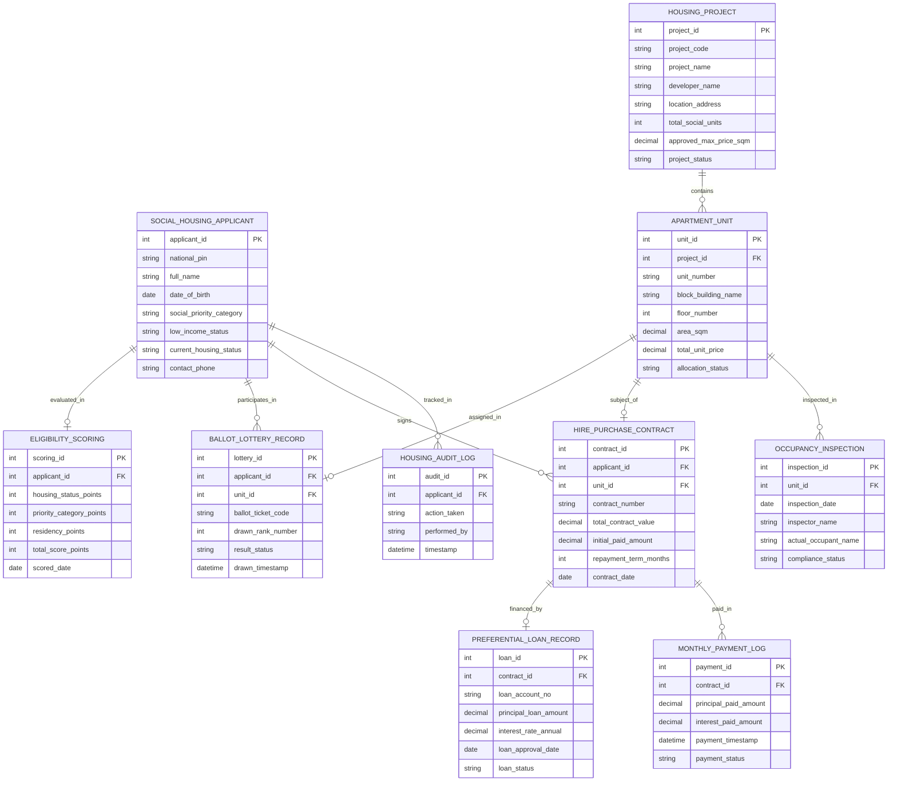

# Conceptual ERD — Social Housing Management System

## Mermaid Code

## Entity Description Table | Bảng mô tả Entity

| # | Entity Name | Vietnamese Name | Description | Key Attributes | Main Relationships |
|---|-------------|-----------------|-------------|----------------|-------------------|
| 1 | SOCIAL_HOUSING_APPLICANT | Hồ sơ Đăng ký NƠXH | Thông tin đối tượng thu nhập thấp nộp đơn xin mua/thuê nhà ở xã hội | applicant_id, national_pin, full_name, social_priority_category, low_income_status | Evaluated in SCORING, signs CONTRACT |
| 2 | HOUSING_PROJECT | Dự án Nhà ở Xã hội | Thông tin dự án NƠXH, chủ đầu tư, số lượng căn hộ và đơn giá duyệt | project_id, project_code, project_name, total_social_units, approved_max_price_sqm | Contains APARTMENT_UNIT |
| 3 | APARTMENT_UNIT | Căn hộ Nhà ở Xã hội | Thông tin mã căn hộ, tầng, diện tích $m^2$ và trạng thái phân phối | unit_id, unit_number, block_building_name, area_sqm, total_unit_price | Belongs to HOUSING_PROJECT, subject of CONTRACT |
| 4 | ELIGIBILITY_SCORING | Điểm số Xét duyệt NƠXH | Chi tiết bảng chấm điểm ưu tiên đối tượng, nhà ở, residency theo quy định | scoring_id, housing_status_points, priority_category_points, total_score_points | Belongs to SOCIAL_HOUSING_APPLICANT |
| 5 | BALLOT_LOTTERY_RECORD | Nhật ký Bốc thăm Căn hộ | Kết quả bốc thăm quyền mua và bốc thăm vị trí căn hộ công khai | lottery_id, ballot_ticket_code, drawn_rank_number, result_status | Belongs to APPLICANT, APARTMENT_UNIT |
| 6 | HIRE_PURCHASE_CONTRACT | Hợp đồng Mua/Thuê mua NƠXH | Hợp đồng mua bán hoặc thuê mua nhà ở xã hội giữa chủ đầu tư và người mua | contract_id, contract_number, total_contract_value, initial_paid_amount | Belongs to APPLICANT, APARTMENT_UNIT |
| 7 | PREFERENTIAL_LOAN_RECORD | Khoản Vay Tín dụng Ưu đãi | Thông tin hợp đồng vay vốn lãi suất 4.8% tại Ngân hàng Chính sách Xã hội | loan_id, loan_account_no, principal_loan_amount, interest_rate_annual | Financed for HIRE_PURCHASE_CONTRACT |
| 8 | MONTHLY_PAYMENT_LOG | Nhật ký Nộp tiền Trả góp | Nhật ký thu tiền trả góp gốc và lãi hàng tháng của người mua NƠXH | payment_id, principal_paid_amount, interest_paid_amount, payment_timestamp | Belongs to HIRE_PURCHASE_CONTRACT |
| 9 | OCCUPANCY_INSPECTION | Biên bản Hậu kiểm Cư trú | Kết quả kiểm tra định kỳ đối tượng thực tế sinh sống chống cho thuê lại | inspection_id, inspection_date, actual_occupant_name, compliance_status | Belongs to APARTMENT_UNIT |
| 10 | HOUSING_AUDIT_LOG | Nhật ký Kiểm toán NƠXH | Lưu lại toàn bộ lịch sử nộp đơn, chấm điểm, bốc thăm và ký hợp đồng | audit_id, action_taken, performed_by, timestamp | Belongs to SOCIAL_HOUSING_APPLICANT |

## Relationship Description | Mô tả Quan hệ

| # | From Entity | Cardinality | To Entity | Relationship Label | Business Explanation |
|---|-------------|-------------|-----------|-------------------|----------------------|
| 1 | SOCIAL_HOUSING_APPLICANT | one-to-one | ELIGIBILITY_SCORING | evaluated_in | Mỗi đơn đăng ký được đánh giá duy nhất một bảng chấm điểm ưu tiên |
| 2 | SOCIAL_HOUSING_APPLICANT | one-to-many | BALLOT_LOTTERY_RECORD | participates_in | Một công dân tham gia các đợt bốc thăm quyền mua và bốc thăm vị trí căn hộ |
| 3 | HOUSING_PROJECT | one-to-many | APARTMENT_UNIT | contains | Một dự án NƠXH bao gồm danh sách nhiều căn hộ chung cư phân phối |
| 4 | APARTMENT_UNIT | one-to-one | BALLOT_LOTTERY_RECORD | assigned_in | Mỗi căn hộ được gán duy nhất cho một kết quả bốc thăm trúng tuyển |
| 5 | SOCIAL_HOUSING_APPLICANT | one-to-many | HIRE_PURCHASE_CONTRACT | signs | Một công dân ký hợp đồng mua hoặc thuê mua căn hộ nhà ở xã hội |
| 6 | APARTMENT_UNIT | one-to-one | HIRE_PURCHASE_CONTRACT | subject_of | Mỗi căn hộ là đối tượng mua bán của duy nhất một Hợp đồng NƠXH |
| 7 | HIRE_PURCHASE_CONTRACT | one-to-one | PREFERENTIAL_LOAN_RECORD | financed_by | Mỗi hợp đồng mua NƠXH được tài trợ bởi một khoản vay ưu đãi VBSP |
| 8 | HIRE_PURCHASE_CONTRACT | one-to-many | MONTHLY_PAYMENT_LOG | paid_in | Một hợp đồng phát sinh nhiều đợt nộp tiền trả góp hàng tháng trong 15-20 năm |
| 9 | APARTMENT_UNIT | one-to-many | OCCUPANCY_INSPECTION | inspected_in | Một căn hộ trải qua các đợt hậu kiểm thực địa kiểm tra chính chủ sinh sống |
| 10 | SOCIAL_HOUSING_APPLICANT | one-to-many | HOUSING_AUDIT_LOG | tracked_in | Mọi thao tác xét duyệt NƠXH được ghi nhật ký kiểm toán bất biến chống tham nhũng |
