# Swimlane Diagram — Social Housing Management System

## Mermaid Code

```mermaid
flowchart LR
    Start(["Start"])

    subgraph Lane1["Housing Applicant (Citizen)"]
        A1["Submit Social Housing Application"]
        A2["Participate Live Automated Ballot"]
        A3["Sign Hire-Purchase Contract"]
        A4["Receive Apartment Keys"]
    end

    subgraph Lane2["Social Housing Management Platform"]
        S1["Verify Identity VNeID & Property Registry"]
        S2["Calculate Auto-Scoring Eligibility"]
        S3["Run Transparent Automated PRNG Ballot"]
        S4["Generate Digital Hire-Purchase Contract"]
        S5["Lock Apartment Unit to Buyer ID"]
    end

    subgraph Lane3["Housing Management Board"]
        O1["Review Low-income Documents"]
        O2["Approve Verified Applicant Score List"]
        O3["Co-sign Official Unit Allocation Order"]
    end

    subgraph Lane4["Social Policy Bank (VBSP)"]
        B1["Assess 4.8% Preferential Credit Loan"]
        B2["Disburse Loan Funds to Developer"]
    end

    Finish(["End"])

    Start --> A1 --> S1 --> S2 --> O1 --> O2 --> S3 --> A2 --> S4 --> O3 --> A3 --> B1 --> B2 --> S5 --> A4 --> Finish
```

## Flow Description | Mô tả luồng

| Lane | Actor | Role in Flow |
|------|-------|-------------|
| 1 | Housing Applicant (Citizen) | Nộp đơn đăng ký mua NƠXH trực tuyến, tham gia theo dõi bốc thăm công khai, ký hợp đồng thuê mua và nhận chìa khóa nhà. |
| 2 | Social Housing Management Platform | Tự động xác minh nhân thân/đất đai, chấm điểm ưu tiên, chạy bốc thăm ngẫu nhiên PRNG, tạo hợp đồng điện tử và khóa căn hộ. |
| 3 | Housing Management Board | Thẩm định tính hợp lệ của hồ sơ thu nhập thấp, duyệt bảng điểm công khai và ký quyết định phân phối căn hộ NƠXH. |
| 4 | Social Policy Bank (VBSP) | Thẩm định gói vay tín dụng ưu đãi lãi suất 4.8%/năm và trực tiếp giải ngân tiền vay cho Chủ đầu tư dự án. |
