# Action Tree — Social Housing Management System

## Mermaid Code

```mermaid
graph TD
    Root["Social Housing Management System"]

    Root --> M1["Applicant Registration & VNeID Verification"]
    Root --> M2["Automated Scoring & Ballot Lottery"]
    Root --> M3["Unit Allocation & Contracts"]
    Root --> M4["Preferential Credit & Monthly Payments"]
    Root --> M5["Occupancy Inspection & Transfer Control"]
    Root --> M6["Project Monitoring & MOC Reporting"]

    M1 --> A11["Register Social Housing Application"]
    M1 --> A12["Verify Identity VNeID Family Members"]
    M1 --> A13["Check Property Ownership Cadastral DB"]
    M1 --> A14["Check Social Insurance Income VSS"]

    M2 --> A21["Calculate Auto-Scoring Priority Points"]
    M2 --> A22["Publish 15-Day Public Scoring Lists"]
    M2 --> A23["Run Automated PRNG Ballot Lottery"]
    M2 --> A24["Generate Audit Ballot Signed Logs"]

    M3 --> A31["Allocate Social Apartment Units"]
    M3 --> A32["Generate Hire-Purchase Contracts"]
    M3 --> A33["Lock Unit Status Anti-Double Selling"]
    M3 --> A34["Collect Initial 20 Percent Down-Payment"]

    M4 --> A41["Process VBSP 4.8 Percent Housing Loans"]
    M4 --> A42["Disburse Credit Funds Developers"]
    M4 --> A43["Track Monthly Installment Repayments"]
    M4 --> A44["Issue E-Invoices Monthly Hire"]

    M5 --> A51["Conduct On-Site Occupancy Inspections"]
    M5 --> A52["Detect Illegal Sub-Leasing Violations"]
    M5 --> A53["Approve 5-Year Resale Transfers"]
    M5 --> A54["Manage Apartment 2 Percent Fund"]

    M6 --> A61["Monitor Developer Construction Progress"]
    M6 --> A62["Broadcast New Project Openings"]
    M6 --> A63["Export MOC 1-Million Unit Metrics"]
    M6 --> A64["Log System Immutable Audit Ledgers"]
```

## Module Description | Mô tả Module

| # | Module | Description | Actions |
|---|--------|-------------|---------|
| 1 | Applicant Registration & VNeID Verification | Tiếp nhận đơn đăng ký NƠXH, tự động xác minh nhân thân qua VNeID, tra cứu tình trạng nhà ở qua Đất đai và thu nhập qua VSS | Register Social Housing Application, Verify Identity VNeID Family Members, Check Property Ownership Cadastral DB, Check Social Insurance Income VSS |
| 2 | Automated Scoring & Ballot Lottery | Tự động chấm điểm ưu tiên, công khai bảng điểm 15 ngày, chạy thuật toán bốc thăm ngẫu nhiên PRNG và lưu nhật ký bốc thăm | Calculate Auto-Scoring Priority Points, Publish 15-Day Public Scoring Lists, Run Automated PRNG Ballot Lottery, Generate Audit Ballot Signed Logs |
| 3 | Unit Allocation & Contracts | Phê duyệt danh sách gán căn hộ trúng mua, khởi tạo hợp đồng mua/thuê mua, khóa trạng thái căn hộ và thu tiền đợt 1 (20%) | Allocate Social Apartment Units, Generate Hire-Purchase Contracts, Lock Unit Status Anti-Double Selling, Collect Initial 20 Percent Down-Payment |
| 4 | Preferential Credit & Monthly Payments | Thẩm định giải ngân gói vay ưu đãi 4.8%/năm của VBSP, giải ngân cho chủ đầu tư và theo dõi tiến độ trả góp hàng tháng | Process VBSP 4.8 Percent Housing Loans, Disburse Credit Funds Developers, Track Monthly Installment Repayments, Issue E-Invoices Monthly Hire |
| 5 | Occupancy Inspection & Transfer Control | Hậu kiểm thực địa chống cho thuê lại trái phép, xét duyệt điều kiện chuyển nhượng lại sau 05 năm và quản lý quỹ bảo trì 2% | Conduct On-Site Occupancy Inspections, Detect Illegal Sub-Leasing Violations, Approve 5-Year Resale Transfers, Manage Apartment 2 Percent Fund |
| 6 | Project Monitoring & MOC Reporting | Giám sát tiến độ xây dựng của chủ đầu tư, công bố thông tin dự án mới và trích xuất báo cáo Đề án 1 triệu căn hộ nộp Bộ Xây dựng | Monitor Developer Construction Progress, Broadcast New Project Openings, Export MOC 1-Million Unit Metrics, Log System Immutable Audit Ledgers |
