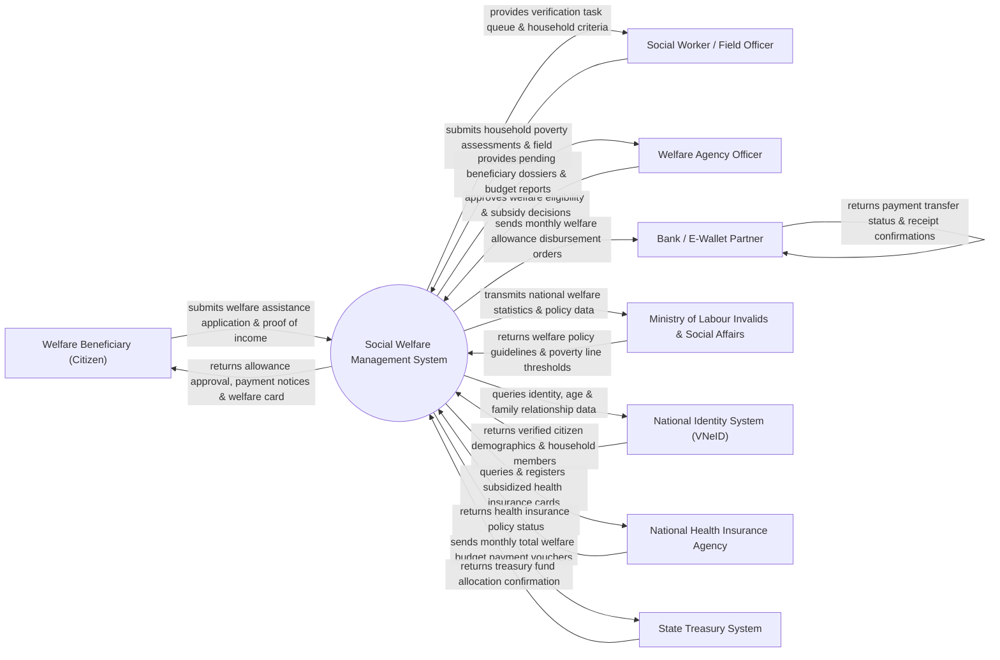

# Context Diagram — Social Welfare Management System

## Mermaid Code

## Actor & Interaction Table | Bảng Actor & Tương tác

| # | Actor | Actor Type | Data Sent TO System | Data Received FROM System | Notes |
|---|-------|------------|---------------------|---------------------------|-------|
| 1 | Welfare Beneficiary (Citizen) | Primary | Personal application, household income status, bank account info | Approval notifications, monthly allowance payments, welfare card | Người dân thuộc đối tượng bảo trợ xã hội / hộ nghèo |
| 2 | Social Worker / Field Officer | Primary | Household survey results, living condition photos, verification score | Assigned field survey list, poverty scoring checklist | Cán bộ xã/phường thực hiện điều tra gia cảnh thực tế |
| 3 | Welfare Agency Officer | Primary | Benefit eligibility decisions, subsidy level approvals | Verified beneficiary queue, budget forecast reports | Cán bộ Phòng Lao động - Thương binh & Xã hội |
| 4 | Bank / E-Wallet Partner | Supporting | Transaction success/failure logs, account balance verifications | Direct welfare disbursement orders, beneficiary bank details | Ngân hàng (ViettinBank, Agribank) / Ví điện tử chi trả trợ cấp |
| 5 | Ministry of Labour Invalids & Social Affairs | Regulatory | Poverty line standards, social protection policy codes | National welfare coverage statistics, budget audit reports | Bộ Lao động - Thương binh và Xã hội ban hành chính sách |
| 6 | National Identity System (VNeID) | Supporting | Citizen demographic profile, family household membership data | Identity query parameters, national ID lookup | Cơ sở dữ liệu quốc gia về dân cư xác thực nhân thân |
| 7 | National Health Insurance Agency | Supporting | Subsidized health insurance policy issuance confirmation | Qualified beneficiary list for free health card | Cơ quan BHXH cấp thẻ BHYT miễn phí cho người nghèo |
| 8 | State Treasury System | Supporting | Budget disbursement confirmations, treasury ledger updates | Monthly welfare funding requests, expenditure statements | Kho bạc Nhà nước thực hiện rút dự toán ngân sách chi trợ cấp |

## System Boundary Description | Mô tả Phạm vi Hệ thống

Hệ thống Social Welfare Management System (Hệ thống Quản lý An sinh Xã hội) chịu trách nhiệm quản lý toàn bộ các chương trình bảo trợ xã hội, trợ cấp thất nghiệp, hỗ trợ hộ nghèo, người khuyết tật, người cao tuổi và trẻ em có hoàn cảnh đặc biệt. Hệ thống tự động hóa từ khâu nộp hồ sơ, điều tra phân loại hộ nghèo/hộ cận nghèo, phê duyệt mức trợ cấp, lập danh sách chi trả hàng tháng qua tài khoản ngân hàng và cấp thẻ BHYT miễn phí. Tuy nhiên, hệ thống KHÔNG trực tiếp tổ chức đào tạo nghề hay dịch vụ giới thiệu việc làm và KHÔNG tự giữ quỹ tiền mặt mặt chi trả mà thực hiện qua ngân hàng đối tác.
