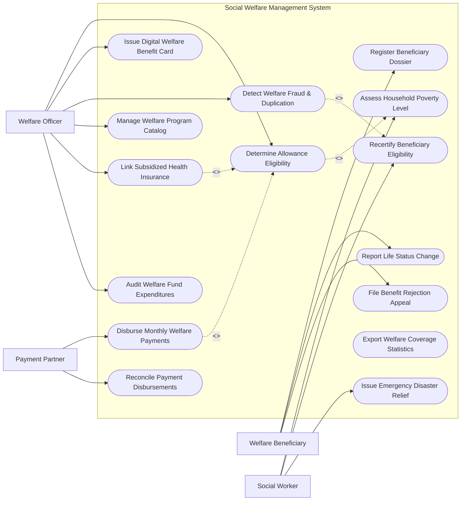

# Use Case Diagram — Social Welfare Management System

## Mermaid Code

## Actor Table | Bảng Actor

| # | Actor | Actor Type | Role Description | Related Use Cases |
|---|-------|------------|------------------|-------------------|
| 1 | Welfare Beneficiary | Primary | Người dân nộp đơn đề nghị trợ cấp, báo cáo biến động và khiếu nại | UC01, UC07, UC09 |
| 2 | Social Worker | Primary | Cán bộ xã/phường thực hiện điều tra gia cảnh, khảo sát hộ nghèo | UC02, UC06, UC13 |
| 3 | Welfare Officer | Primary | Cán bộ quản lý an sinh xã hội cấp quận/huyện thẩm định và duyệt chi | UC03, UC04, UC08, UC10, UC14, UC15 |
| 4 | Payment Partner | Secondary / System | Ngân hàng/Ví điện tử chi trả trợ cấp hàng tháng và gửi đối soát | UC05, UC11 |

## Use Case Table | Bảng Use Case

| # | UC ID | Use Case Name | Primary Actor | Secondary Actor | Description | Priority |
|---|-------|---------------|---------------|-----------------|-------------|----------|
| 1 | UC01 | Register Beneficiary Dossier | Beneficiary | VNeID | Khởi tạo hồ sơ xin trợ cấp an sinh xã hội kèm chứng từ minh chứng | High |
| 2 | UC02 | Assess Household Poverty Level | Social Worker | - | Khảo sát điểm số hộ nghèo/cận nghèo theo tiêu chuẩn đa chiều | High |
| 3 | UC03 | Determine Allowance Eligibility | WelfareOfficer | - | Phê duyệt mức tiền trợ cấp hàng tháng theo loại đối tượng bảo trợ | High |
| 4 | UC04 | Issue Digital Welfare Benefit Card | WelfareOfficer | Beneficiary | Cấp thẻ an sinh xã hội số hóa tích hợp vào ứng dụng VNeID | Medium |
| 5 | UC05 | Disburse Monthly Welfare Payments | PaymentPartner | StateTreasury | Tự động chuyển khoản tiền trợ cấp hàng tháng cho người thụ hưởng | High |
| 6 | UC06 | Recertify Beneficiary Eligibility | Social Worker | - | Rà soát định kỳ hàng năm điều kiện thụ hưởng của hộ gia đình | High |
| 7 | UC07 | Report Life Status Change | Beneficiary | CivilRegistry | Báo cáo biến động nhân khẩu (từ đời, chuyển vùng, có việc làm) | High |
| 8 | UC08 | Detect Welfare Fraud & Duplication | WelfareOfficer | - | Phát hiện hưởng trùng trợ cấp hoặc khai khống thông tin hộ gia đình | High |
| 9 | UC09 | File Benefit Rejection Appeal | Beneficiary | - | Nộp đơn khiếu nại khi bị từ chối đơn xin trợ cấp an sinh | Medium |
| 10 | UC10 | Manage Welfare Program Catalog | SysAdmin | - | Cấu hình danh mục chính sách, định mức tiền và tiêu chí bảo trợ | Medium |
| 11 | UC11 | Reconcile Payment Disbursements | PaymentPartner | WelfareOfficer | Đối soát danh sách tiền đã chi trả thành công và tiền tồn đọng | High |
| 12 | UC12 | Export Welfare Coverage Statistics | SysAdmin | MOLISA | Trích xuất báo cáo tỷ lệ bao phủ an sinh xã hội theo vùng miền | Low |
| 13 | UC13 | Issue Emergency Disaster Relief | Social Worker | Beneficiary | Chi trả trợ cấp khẩn cấp cho người dân bị ảnh hưởng bởi thiên tai | High |
| 14 | UC14 | Link Subsidized Health Insurance | WelfareOfficer | HealthInsurance | Tự động cấp thẻ BHYT miễn phí cho người thụ hưởng trợ cấp nghèo | High |
| 15 | UC15 | Audit Welfare Fund Expenditures | WelfareOfficer | MOLISA | Kiểm toán toàn bộ nhật ký giải ngân quỹ an sinh xã hội | Medium |

## Use Case Specification | Đặc tả Use Case

---

### UC01 — Register Beneficiary Dossier

| Field | Detail |
|-------|--------|
| **UC ID** | UC01 |
| **Use Case Name** | Register Beneficiary Dossier |
| **Actor(s)** | Primary: Welfare Beneficiary / Secondary: VNeID System |
| **Description** | Người dân thuộc diện bảo trợ (người cao tuổi, người khuyết tật, hộ nghèo) nộp hồ sơ xin hưởng trợ cấp an sinh xã hội. |
| **Precondition** | 1. Công dân đã có tài khoản định danh VNeID.   2. Có giấy xác nhận hoàn cảnh (Giấy xác nhận khuyết tật, Giấy chứng tử của người nuôi dưỡng...). |
| **Main Flow** | 1. Beneficiary đăng nhập ứng dụng An sinh xã hội bằng tài khoản VNeID.   2. Select "Nộp hồ sơ trợ cấp an sinh".   3. System tự động điền các thông tin nhân khẩu (Họ tên, ngày sinh, nơi thường trú, các thành viên trong hộ).   4. Beneficiary chọn loại đối tượng trợ cấp (Người khuyết tật, Trẻ em mồ côi, Người cao tuổi độc thân, Hộ nghèo).   5. Beneficiary tải lên các giấy tờ minh chứng dạng hình ảnh/PDF.   6. Beneficiary nhập thông tin tài khoản ngân hàng chính chủ để nhận tiền chi trả.   7. System sinh Mã hồ sơ an sinh duy nhất và chuyển hồ sơ về phân hệ tiếp nhận của cán bộ xã/phường. |
| **Alternative Flow** | **AF1** — Nộp trực tiếp tại UBND Xã/Phường: Beneficiary nộp hồ sơ giấy, cán bộ an sinh xã quét giấy tờ và nhập thay lên hệ thống. |
| **Exception Flow** | **EX1** — Tài khoản ngân hàng không chính chủ: System cảnh báo tên chủ tài khoản ngân hàng không trùng tên công dân nộp hồ sơ, yêu cầu nhập tài khoản khác. |
| **Postcondition** | Hồ sơ được khởi tạo ở trạng thái "Đã tiếp nhận - Chờ khảo sát thực tế". |
| **Business Rule** | **BR1**: Mỗi cá nhân tại một thời điểm chỉ được mở 01 hồ sơ đề nghị trợ cấp chính cho cùng một nhóm đối tượng. |

---

### UC02 — Assess Household Poverty Level

| Field | Detail |
|-------|--------|
| **UC ID** | UC02 |
| **Use Case Name** | Assess Household Poverty Level |
| **Actor(s)** | Primary: Social Worker / Secondary: None |
| **Description** | Cán bộ xã/phường tiến hành khảo sát thực địa, đánh giá điểm số thiếu hụt dịch vụ xã hội cơ bản và thu nhập của hộ gia đình. |
| **Precondition** | 1. Hồ sơ đề nghị an sinh (UC01) đã được tiếp nhận.   2. Cán bộ xã được phân công nhiệm vụ khảo sát thực địa. |
| **Main Flow** | 1. SocialWorker truy cập ứng dụng di động dành cho cán bộ khảo sát.   2. SocialWorker tới tận nhà Beneficiary để thực hiện chấm điểm theo Phiếu khảo sát hộ nghèo đa chiều.   3. SocialWorker nhập các chỉ số thiếu hụt: Nhà ở, Nước sạch, Vệ sinh, Y tế, Giáo dục, Việc làm và Thu nhập trung bình.   4. SocialWorker chụp ảnh thực tế nhà ở, phương tiện và tải lên làm minh chứng.   5. System tự động tính tổng Điểm thiếu hụt đa chiều và xác định phân loại hộ: "Hộ nghèo", "Hộ cận nghèo" hoặc "Hộ mức sống trung bình".   6. SocialWorker và đại diện hộ gia đình ký xác nhận điện tử vào Phiếu khảo sát.   7. System lưu kết quả khảo sát và đẩy hồ sơ lên cấp thẩm định (UC03). |
| **Alternative Flow** | **AF1** — Hộ gia đình không đồng ý với kết quả chấm điểm: SocialWorker ghi nhận ý kiến khiếu nại ngay trên ứng dụng và chuyển hồ sơ sang Hội đồng thẩm định lại cấp xã. |
| **Exception Flow** | **EX1** — Hộ gia đình cố tình khai báo sai thu nhập: SocialWorker đối soát thông tin sở hữu tài sản (xe máy, đất đai) qua CSDL đăng ký và ghi chú nghi vấn gian lận. |
| **Postcondition** | Kết quả phân loại nghèo đa chiều được ghi nhận chính thức, làm căn cứ duyệt mức trợ cấp. |
| **Business Rule** | **BR1**: Chuẩn nghèo đa chiều áp dụng công thức tính điểm và ngưỡng thu nhập theo quy định hiện hành của Chính phủ. |

---

### UC03 — Determine Allowance Eligibility

| Field | Detail |
|-------|--------|
| **UC ID** | UC03 |
| **Use Case Name** | Determine Allowance Eligibility |
| **Actor(s)** | Primary: Welfare Officer / Secondary: None |
| **Description** | Cán bộ quản lý an sinh cấp huyện xem xét kết quả khảo sát, đối soát điều kiện chính sách và phê duyệt Quyết định trợ cấp hàng tháng. |
| **Precondition** | 1. Hồ sơ đã có kết quả khảo sát thực địa đạt tiêu chuẩn (UC02). |
| **Main Flow** | 1. WelfareOfficer mở danh sách hồ sơ chờ phê duyệt trợ cấp.   2. System hiển thị chi tiết hồ sơ, kết quả chấm điểm hộ nghèo và giấy tờ minh chứng.   3. System tự động tra cứu xem cá nhân này có đang hưởng các chế độ bảo trợ khác bị xung đột chính sách hay không.   4. System đề xuất Hệ số trợ cấp (ví dụ: Hệ số 1.5 = 750,000 VNĐ/tháng) dựa trên quy định pháp luật.   5. WelfareOfficer rà soát và bấm "Phê duyệt cấp trợ cấp".   6. System sinh Quyết định trợ cấp xã hội điện tử và tự động đăng ký cấp thẻ BHYT miễn phí (UC14).   7. System chuyển thông tin người thụ hưởng vào Danh sách chi trả hàng tháng. |
| **Alternative Flow** | **AF1** — Từ chối trợ cấp: WelfareOfficer chọn "Từ chối", nhập lý do không đủ điều kiện. System gửi thông báo từ chối kèm hướng dẫn khiếu nại cho công dân. |
| **Exception Flow** | **EX1** — Phát hiện công dân đã hưởng trợ cấp tại địa phương khác: System chặn phê duyệt, phát hiện trùng lặp (UC08) và yêu cầu cắt trợ cấp ở nơi cũ trước. |
| **Postcondition** | Quyết định trợ cấp có hiệu lực, thông tin đối tượng được thêm vào danh sách nhận tiền hàng tháng. |
| **Business Rule** | **BR1**: Mức chuẩn trợ giúp xã hội và hệ số trợ cấp áp dụng theo đúng Nghị định của Chính phủ về bảo trợ xã hội. |

---

### UC05 — Disburse Monthly Welfare Payments

| Field | Detail |
|-------|--------|
| **UC ID** | UC05 |
| **Use Case Name** | Disburse Monthly Welfare Payments |
| **Actor(s)** | Primary: Payment Partner / Secondary: State Treasury |
| **Description** | Hệ thống tự động lập danh sách chi trả trợ cấp hàng tháng và gửi lệnh chuyển tiền hàng loạt qua ngân hàng/ví điện tử đối tác. |
| **Precondition** | 1. Đến kỳ chi trả trợ cấp hàng tháng (từ ngày 01 đến 05 hàng tháng).   2. Kho bạc Nhà nước đã cấp dự toán kinh phí an sinh. |
| **Main Flow** | 1. System tự động tổng hợp Danh sách đối tượng đang hưởng trợ cấp active trong tháng.   2. System tính tổng số tiền trợ cấp cần chi trả cho từng huyện/xã.   3. WelfareOfficer ký số phê duyệt Lệnh chi tiền trợ cấp an sinh.   4. System truyền file dữ liệu lệnh chi mã hóa sang PaymentPartner (Ngân hàng/Ví điện tử).   5. PaymentPartner thực hiện chuyển tiền trực tiếp vào tài khoản ngân hàng của từng Beneficiary.   6. PaymentPartner trả về trạng thái giao dịch (Thành công/Thất bại) cho System.   7. System gửi tin nhắn SMS thông báo "Đã nhận tiền trợ cấp tháng X" tới điện thoại công dân. |
| **Alternative Flow** | **AF1** — Chi trả tiền mặt tận nhà (Cho người già yếu/khuyết tật nặng không có tài khoản): System lập danh sách chi tiền mặt, nhân viên bưu điện cầm tiền đến chi trả trực tiếp và lấy chữ ký/vân tay xác nhận. |
| **Exception Flow** | **EX1** — Chuyển tiền thất bại do tài khoản ngân hàng bị khóa: System tự động hoàn tiền về quỹ, đánh dấu trạng thái "Lỗi chuyển tiền" và thông báo cho cán bộ an sinh xã kiểm tra lại tài khoản. |
| **Postcondition** | Người thụ hưởng nhận đủ tiền trợ cấp hàng tháng, dữ liệu giao dịch được hạch toán cho Kho bạc. |
| **Business Rule** | **BR1**: Thời gian hoàn thành chi trả trợ cấp hàng tháng không được quá ngày 10 của tháng đó. |

---

### UC06 — Recertify Beneficiary Eligibility

| Field | Detail |
|-------|--------|
| **UC ID** | UC06 |
| **Use Case Name** | Recertify Beneficiary Eligibility |
| **Actor(s)** | Primary: Social Worker / Secondary: None |
| **Description** | Rà soát, đánh giá lại điều kiện hưởng trợ cấp hàng năm đối với các hộ nghèo và đối tượng bảo trợ xã hội. |
| **Precondition** | 1. Đến kỳ rà soát an sinh định kỳ (thường vào Quý 4 hàng năm). |
| **Main Flow** | 1. System tự động xuất danh sách các hộ gia đình/đối tượng cần rà soát lại trong năm.   2. SocialWorker nhận danh sách và tiến hành kiểm tra lại điều kiện kinh tế và tình trạng sống hiện tại.   3. SocialWorker cập nhật thông tin mới (Ví dụ: Hộ đã thoát nghèo, Trẻ em đã đủ 16 tuổi, Người khuyết tật đã phục hồi).   4. System tính toán lại điểm số nghèo đa chiều.   5. Nếu hộ đã thoát nghèo: System đưa ra đề xuất "Thoát nghèo - Thôi hưởng trợ cấp".   6. WelfareOfficer phê duyệt Quyết định điều chỉnh hoặc dừng trợ cấp kể từ đầu năm tiếp theo. |
| **Alternative Flow** | **AF1** — Hộ gia đình tái nghèo hoặc chuyển sang mức khuyết tật nặng hơn: System đề xuất tăng hệ số trợ cấp phù hợp với hoàn cảnh mới. |
| **Exception Flow** | **EX1** — Cán bộ không thể liên lạc/xác minh đối tượng (đã chuyển đi nơi khác): System đưa hồ sơ vào trạng thái "Tạm dừng chi trả" cho đến khi đối tượng đến trình diện. |
| **Postcondition** | Danh sách đối tượng hưởng an sinh xã hội được cập nhật chuẩn xác, tránh lãng phí ngân sách nhà nước. |
| **Business Rule** | **BR1**: Hồ sơ không thực hiện rà soát định kỳ sau 14 tháng sẽ tự động bị hệ thống tạm khóa chi trả. |
