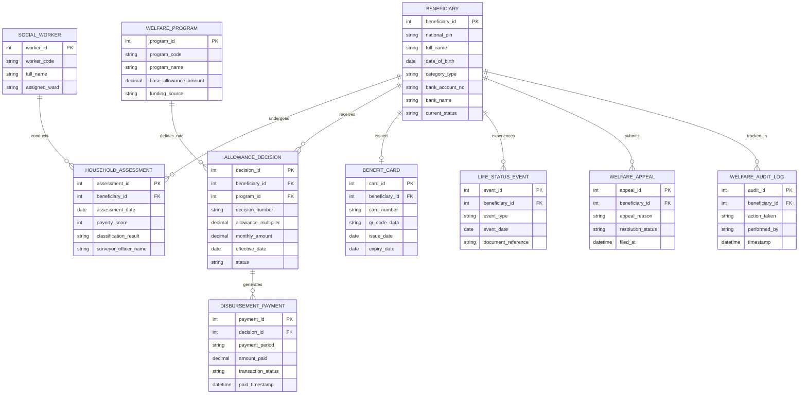

# Conceptual ERD — Social Welfare Management System

## Mermaid Code

## Entity Description Table | Bảng mô tả Entity

| # | Entity Name | Vietnamese Name | Description | Key Attributes | Main Relationships |
|---|-------------|-----------------|-------------|----------------|-------------------|
| 1 | BENEFICIARY | Đối tượng Thụ hưởng An sinh | Thông tin cá nhân đối tượng được hưởng chính sách an sinh xã hội | beneficiary_id, national_pin, full_name, category_type | Undergoes HOUSEHOLD_ASSESSMENT, receives ALLOWANCE_DECISION |
| 2 | HOUSEHOLD_ASSESSMENT | Phiếu Đánh giá Hộ nghèo | Kết quả điều tra chấm điểm nghèo đa chiều của hộ gia đình | assessment_id, assessment_date, poverty_score, classification_result | Belongs to BENEFICIARY, conducted by SOCIAL_WORKER |
| 3 | WELFARE_PROGRAM | Chương trình An sinh | Danh mục các chương trình bảo trợ xã hội và định mức tiền chuẩn | program_id, program_code, program_name, base_allowance_amount | Defines rate for ALLOWANCE_DECISION |
| 4 | ALLOWANCE_DECISION | Quyết định Trợ cấp | Quyết định phê duyệt hệ số và mức trợ cấp hàng tháng | decision_id, decision_number, monthly_amount, effective_date | Belongs to BENEFICIARY, WELFARE_PROGRAM, generates DISBURSEMENT_PAYMENT |
| 5 | DISBURSEMENT_PAYMENT | Giao dịch Chi trả Trợ cấp | Nhật ký tiền trợ cấp đã chi trả thành công qua ngân hàng | payment_id, payment_period, amount_paid, transaction_status | Belongs to ALLOWANCE_DECISION |
| 6 | BENEFIT_CARD | Thẻ An sinh Xã hội | Thẻ an sinh xã hội điện tử tích hợp mã QR xác thực đối tượng | card_id, card_number, qr_code_data, issue_date | Belongs to BENEFICIARY |
| 7 | LIFE_STATUS_EVENT | Biến động Nhân khẩu Sống | Sự kiện biến động nhân khẩu (từ đời, kết hôn, di chuyển nơi ở) | event_id, event_type, event_date, document_reference | Belongs to BENEFICIARY |
| 8 | SOCIAL_WORKER | Cán bộ Khảo sát An sinh | Thông tin công chức/viên chức xã phường phụ trách điều tra thực địa | worker_id, worker_code, full_name, assigned_ward | Conducts HOUSEHOLD_ASSESSMENT |
| 9 | WELFARE_APPEAL | Đơn Khiếu nại An sinh | Đơn khiếu nại của người dân về kết quả phân loại nghèo hoặc bị từ chối | appeal_id, appeal_reason, resolution_status, filed_at | Belongs to BENEFICIARY |
| 10 | WELFARE_AUDIT_LOG | Nhật ký Kiểm toán Quỹ | Lưu lịch sử tác động dữ liệu, duyệt trợ cấp và thay đổi mức chi | audit_id, action_taken, performed_by, timestamp | Belongs to BENEFICIARY |

## Relationship Description | Mô tả Quan hệ

| # | From Entity | Cardinality | To Entity | Relationship Label | Business Explanation |
|---|-------------|-------------|-----------|-------------------|----------------------|
| 1 | BENEFICIARY | one-to-many | HOUSEHOLD_ASSESSMENT | undergoes | Một người thụ hưởng trải qua nhiều đợt khảo sát rà soát định kỳ hàng năm |
| 2 | BENEFICIARY | one-to-many | ALLOWANCE_DECISION | receives | Một người thụ hưởng có thể nhận các quyết định trợ cấp khác nhau theo thời gian |
| 3 | WELFARE_PROGRAM | one-to-many | ALLOWANCE_DECISION | defines_rate | Một chương trình an sinh quy định khung mức trợ cấp cho nhiều quyết định |
| 4 | ALLOWANCE_DECISION | one-to-many | DISBURSEMENT_PAYMENT | generates | Một quyết định trợ cấp phát sinh nhiều giao dịch chi trả tiền hàng tháng |
| 5 | BENEFICIARY | one-to-one | BENEFIT_CARD | issued | Một người thụ hưởng được cấp một thẻ an sinh xã hội định danh |
| 6 | BENEFICIARY | one-to-many | LIFE_STATUS_EVENT | experiences | Một người thụ hưởng ghi nhận các sự kiện biến động sống (từ đời, thôi nghèo) |
| 7 | BENEFICIARY | one-to-many | WELFARE_APPEAL | submits | Một người thụ hưởng có thể nộp đơn khiếu nại về quyết định |
| 8 | BENEFICIARY | one-to-many | WELFARE_AUDIT_LOG | tracked_in | Mọi thay đổi về thông tin và mức tiền thụ hưởng đều được lưu log kiểm toán |
| 9 | SOCIAL_WORKER | one-to-many | HOUSEHOLD_ASSESSMENT | conducts | Một cán bộ khảo sát thực hiện đánh giá nhiều hộ gia đình |
