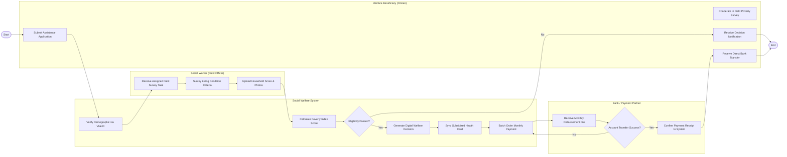

# Swimlane Diagram — Social Welfare Management System

## Mermaid Code

## Flow Description | Mô tả luồng

| Lane | Actor | Role in Flow |
|------|-------|-------------|
| 1 | Welfare Beneficiary (Citizen) | Nộp đơn trợ cấp, hợp tác cùng cán bộ khảo sát thực địa, nhận quyết định phê duyệt và nhận tiền trợ cấp qua tài khoản ngân hàng. |
| 2 | Social Welfare System | Xác thực định danh VNeID, tự động tính điểm nghèo đa chiều, kiểm tra điều kiện chính sách, xuất quyết định chi trả và gạch nợ thành công. |
| 3 | Social Worker (Field Officer) | Nhận danh sách khảo sát thực địa, đến từng gia đình chấm điểm tiêu chí và tải bằng chứng hình ảnh lên hệ thống. |
| 4 | Bank / Payment Partner | Tiếp nhận danh sách lệnh chi trả tiền trợ cấp hàng tháng, thực hiện chuyển khoản đến người thụ hưởng và đối soát kết quả. |
