# Action Tree — Social Welfare Management System

## Mermaid Code

```mermaid
graph TD
    Root["Social Welfare Management System"]

    Root --> M1["Beneficiary & Household Profile"]
    Root --> M2["Poverty Assessment & Scoring"]
    Root --> M3["Eligibility Determination Engine"]
    Root --> M4["Monthly Payment Disbursement"]
    Root --> M5["Recertification & Status Tracking"]
    Root --> M6["Fraud Prevention & Audit"]

    M1 --> A11["Register Beneficiary Application"]
    M1 --> A12["Sync Citizen Demographics VNeID"]
    M1 --> A13["Link Household Family Members"]
    M1 --> A14["Issue Digital Welfare Benefit Card"]

    M2 --> A21["Conduct Household Field Survey"]
    M2 --> A22["Score Multidimensional Poverty"]
    M2 --> A23["Upload Household Living Proofs"]
    M2 --> A24["Classify Poor Near-Poor Households"]

    M3 --> A31["Apply Welfare Policy Multipliers"]
    M3 --> A32["Check Duplicate Subsidy Programs"]
    M3 --> A33["Approve Allowance Benefit Decisions"]
    M3 --> A34["Issue Free Health Insurance Card"]

    M4 --> A41["Generate Monthly Disbursement List"]
    M4 --> A42["Execute Bank Direct Transfer Batch"]
    M4 --> A43["Process Home Delivery Cash Payments"]
    M4 --> A44["Reconcile Treasury Expenditure"]

    M5 --> A51["Schedule Annual Eligibility Review"]
    M5 --> A52["Report Death Marriage Life Events"]
    M5 --> A53["Adjust Subsidy Levels upon Status"]
    M5 --> A54["Process Benefit Rejection Appeals"]

    M6 --> A61["Detect Cross-Region Subsidy Duplication"]
    M6 --> A62["Verify Asset Ownership Database"]
    M6 --> A63["Log System Audit Trail Logins"]
    M6 --> A64["Export MOLISA Policy Statistics"]
```

## Module Description | Mô tả Module

| # | Module | Description | Actions |
|---|--------|-------------|---------|
| 1 | Beneficiary & Household Profile | Quản lý thông tin cá nhân đối tượng thụ hưởng, liên kết hộ gia đình và cấp thẻ an sinh số | Register Beneficiary Application, Sync Citizen Demographics VNeID, Link Household Family Members, Issue Digital Welfare Benefit Card |
| 2 | Poverty Assessment & Scoring | Đánh giá khảo sát thực địa tiêu chí nghèo đa chiều và phân loại hộ nghèo/cận nghèo | Conduct Household Field Survey, Score Multidimensional Poverty, Upload Household Living Proofs, Classify Poor Near-Poor Households |
| 3 | Eligibility Determination Engine | Động cơ kiểm tra điều kiện chính sách, áp dụng hệ số trợ cấp, chống hưởng trùng và phê duyệt quyết định | Apply Welfare Policy Multipliers, Check Duplicate Subsidy Programs, Approve Allowance Benefit Decisions, Issue Free Health Insurance Card |
| 4 | Monthly Payment Disbursement | Lập danh sách và thực hiện chi trả trợ cấp hàng tháng qua chuyển khoản ngân hàng/ví điện tử | Generate Monthly Disbursement List, Execute Bank Direct Transfer Batch, Process Home Delivery Cash Payments, Reconcile Treasury Expenditure |
| 5 | Recertification & Status Tracking | Rà soát định kỳ hàng năm, ghi nhận biến động nhân khẩu (từ đời, thôi nghèo) và xử lý khiếu nại | Schedule Annual Eligibility Review, Report Death Marriage Life Events, Adjust Subsidy Levels upon Status, Process Benefit Rejection Appeals |
| 6 | Fraud Prevention & Audit | Kiểm tra trục lợi an sinh, đối soát tài sản hộ gia đình và trích xuất báo cáo thống kê chính sách | Detect Cross-Region Subsidy Duplication, Verify Asset Ownership Database, Log System Audit Trail Logins, Export MOLISA Policy Statistics |
