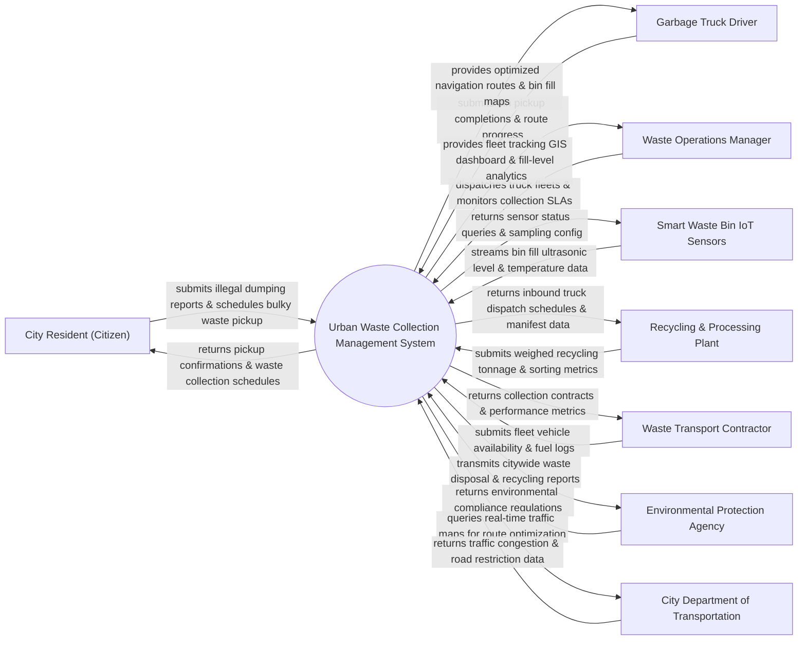

# Context Diagram — Urban Waste Collection Management System

## Mermaid Code

## Actor & Interaction Table | Bảng Actor & Tương tác

| # | Actor | Actor Type | Data Sent TO System | Data Received FROM System | Notes |
|---|-------|------------|---------------------|---------------------------|-------|
| 1 | City Resident (Citizen) | Primary | Illegal dumping report photos/GPS, bulky waste pickup requests | Collection schedule, ticket resolution status, service notice | Cư dân đô thị báo sự cố rác thải hoặc hẹn lịch thu gom rác cồng kềnh |
| 2 | Garbage Truck Driver | Primary | Bin collection completion confirm, route status, vehicle issues | Dynamic route navigation, priority bin locations, fill map | Lái xe thu gom rác thuộc công ty môi trường đô thị |
| 3 | Waste Operations Manager | Primary | Fleet dispatch orders, route adjustments, contractor targets | Real-time GIS fleet tracking, bin fill level alerts, SLA reports | Cán bộ điều hành Công ty Môi trường Đô thị (URENCO) |
| 4 | Smart Waste Bin IoT Sensors | Supporting | Ultrasonic fill level percentage, tilt angle, temperature | Sensor polling frequency config, battery status response | Cảm biến IoT siêu âm đo mức độ đầy rác tại thùng rác thông minh |
| 5 | Recycling & Processing Plant | Supporting | Weighbridge net weight, recycled material classification | Incoming truck manifest details, estimated arrival times | Nhà máy xử lý và phân loại rác tái chế / Trạm cân rác |
| 6 | Waste Transport Contractor | Supporting | Truck availability, driver shift logs, fuel consumption | Service performance metrics, monthly payment statements | Đơn vị nhà thầu vận chuyển rác thải tư nhân |
| 7 | Environmental Protection Agency | Regulatory | Environmental standards, landfill capacity limits | Waste tonnage statistics, recycling ratio analytics | Chi cục Bảo vệ Môi trường / Sở Tài nguyên & Môi trường |
| 8 | City Department of Transportation | Supporting | Traffic congestion data, truck weight restriction limits | Waste truck route queries, street collection schedule | Sở Giao thông Vận tải quy định luồng tuyến xe rác |

## System Boundary Description | Mô tả Phạm vi Hệ thống

Hệ thống Urban Waste Collection Management System (Hệ thống Quản lý Thu gom và Xử lý Rác thải Đô thị) chịu trách nhiệm tự động hóa quy trình thu gom rác thông minh: Giám sát mức độ đầy của các thùng rác thông minh bằng cảm biến IoT siêu âm, tự động tính toán lộ trình di chuyển tối ưu cho xe gom rác (Dynamic Route Optimization), điều động đội xe rác, quản lý trạm cân rác tại bãi lấp lấp/nhà máy tái chế và tiếp nhận phản ánh đổ rác trái phép của người dân. Tuy nhiên, hệ thống KHÔNG trực tiếp vận hành động cơ cơ khí nén rác trên xe và KHÔNG thay thế công việc quét dọn vệ sinh thủ công của công nhân môi trường.
