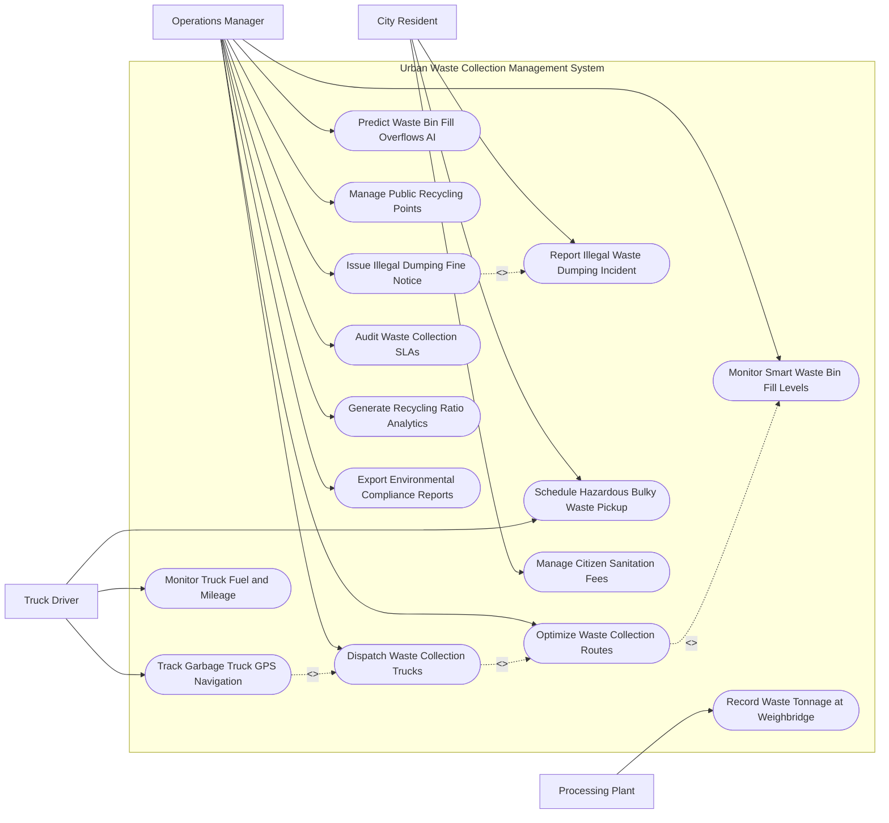

# Use Case Diagram — Urban Waste Collection Management System

## Mermaid Code

## Actor Table | Bảng Actor

| # | Actor | Actor Type | Role Description | Related Use Cases |
|---|-------|------------|------------------|-------------------|
| 1 | City Resident | Primary | Cư dân đô thị báo cáo sự cố rác thải, đặt lịch thu gom rác cồng kềnh và nộp phí vệ sinh | UC05, UC06, UC13 |
| 2 | Truck Driver | Primary | Lái xe thu gom rác di chuyển theo lộ trình dẫn đường GPS và xác nhận thu gom | UC04, UC06, UC10 |
| 3 | Processing Plant | Secondary / System | Trạm cân và nhà máy xử lý rác ghi nhận khối lượng rác thực tế | UC09 |
| 4 | Operations Manager | Primary | Cán bộ quản lý URENCO tối ưu hóa tuyến đường, điều xe rác và phạt vi phạm | UC01, UC02, UC03, UC07, UC08, UC11, UC12, UC14, UC15 |

## Use Case Table | Bảng Use Case

| # | UC ID | Use Case Name | Primary Actor | Secondary Actor | Description | Priority |
|---|-------|---------------|---------------|-----------------|-------------|----------|
| 1 | UC01 | Monitor Smart Waste Bin Fill Levels | Manager | Bin Sensors | Giám sát tỷ lệ phần trăm đầy rác của các thùng rác thông minh toàn đô thị | High |
| 2 | UC02 | Optimize Waste Collection Routes | Manager | GIS Engine | Thuật toán AI tính toán tuyến đường gom rác ngắn nhất chỉ ghé các thùng đã đầy | High |
| 3 | UC03 | Dispatch Waste Collection Trucks | Manager | Driver | Điều động các xe thu gom rác và phân công ca trực cho lái xe | High |
| 4 | UC04 | Track Garbage Truck GPS Navigation | Driver | Manager | Giám sát GPS thời gian thực vị trí xe rác và dẫn đường tới các thùng rác đầy | High |
| 5 | UC05 | Report Illegal Waste Dumping Incident | Resident | - | Cư dân chụp ảnh đính kèm tọa độ GPS phản ánh hành vi đổ rác bừa bãi | High |
| 6 | UC06 | Schedule Hazardous Bulky Waste Pickup | Resident | Driver | Đặt lịch hẹn thu gom các loại rác cồng kềnh (sofa, tủ, đồ điện tử) | Medium |
| 7 | UC07 | Predict Waste Bin Fill Overflows AI | Manager | AI Engine | Phân tích AI dự báo thời điểm thùng rác bị tràn dựa trên dữ liệu lịch sử | Medium |
| 8 | UC08 | Manage Public Recycling Points | Manager | - | Cấu hình và quản lý các điểm thu gom rác phân loại tái chế (Nhựa, Giấy, Kim loại) | Medium |
| 9 | UC09 | Record Waste Tonnage at Weighbridge | Plant | Driver | Tự động ghi nhận khối lượng rác (tấn) khi xe rác đi qua trạm cân nhà máy | High |
| 10 | UC10 | Monitor Truck Fuel and Mileage | Driver | Manager | Giám sát lượng tiêu thụ nhiên liệu và số kilomet di chuyển của xe rác | Medium |
| 11 | UC11 | Issue Illegal Dumping Fine Notice | Manager | Police | Lập biên bản xử phạt hành chính đối với cá nhân/doanh nghiệp đổ rác chui | High |
| 12 | UC12 | Audit Waste Collection SLAs | Manager | Contractor | Kiểm toán thời gian thu gom rác đúng hạn SLA của các nhà thầu | High |
| 13 | UC13 | Manage Citizen Sanitation Fees | Resident | PayGW | Quản lý thu phí vệ sinh môi trường hàng tháng của hộ gia đình | Medium |
| 14 | UC14 | Generate Recycling Ratio Analytics | Manager | EnvironmentalAgency | Thống kê tỷ lệ rác thải được phân loại tái chế so với tổng lượng rác | Low |
| 15 | UC15 | Export Environmental Compliance Reports | Manager | EnvironmentalAgency | Trích xuất báo cáo tuân thủ tiêu chuẩn môi trường nộp Sở TN&MT | Low |

## Use Case Specification | Đặc tả Use Case

---

### UC01 — Monitor Smart Waste Bin Fill Levels

| Field | Detail |
|-------|--------|
| **UC ID** | UC01 |
| **Use Case Name** | Monitor Smart Waste Bin Fill Levels |
| **Actor(s)** | Primary: Operations Manager / Secondary: Smart Waste Bin Sensors |
| **Description** | Giám sát thời gian thực tỷ lệ % rác trong thùng rác thông minh qua dữ liệu cảm biến siêu âm IoT. |
| **Precondition** | 1. Thùng rác thông minh được gắn cảm biến siêu âm kết nối mạng LoRaWAN/NB-IoT. |
| **Main Flow** | 1. SmartBinSensors đo khoảng cách từ nắp thùng đến bề mặt rác và gửi dữ liệu về hệ thống.   2. System tính toán mức độ đầy (Fill Level Percentage: 0% - 100%).   3. System hiển thị biểu tượng thùng rác trên bản đồ GIS theo màu sắc: Xanh (< 50%), Vàng (50-80%), Đỏ (> 80% - Cần thu gom khẩn).   4. OperationsManager mở giao diện Bảng điều khiển Giám sát Thùng rác.   5. Manager xem danh sách các thùng rác ở mức màu Đỏ cần thu gom trong ca trực.   6. System tự động chuyển danh sách thùng rác màu Đỏ sang phân hệ Tối ưu tuyến đường (UC02). |
| **Alternative Flow** | **AF1** — Cảnh báo cháy thùng rác: Cảm biến nhiệt độ trong thùng rác phát hiện nhiệt độ > 60°C (nguy cơ cháy rác), System phát âm thanh cảnh báo Đỏ khẩn cấp cho Manager. |
| **Exception Flow** | **EX1** — Cảm biến hỏng/Pin yếu (< 10%): System đổi biểu tượng thùng rác thành màu Xám ("Mất kết nối"), tạo lệnh bảo trì cho đội kỹ thuật. |
| **Postcondition** | Mức độ đầy của tất cả thùng rác đô thị được theo dõi chính xác, ngăn chặn tình trạng rác tràn ra đường. |
| **Business Rule** | **BR1**: Tần suất gửi dữ liệu cảm biến thùng rác là 30 phút/lần khi rác < 50% và 5 phút/lần khi rác > 80%. |

---

### UC02 — Optimize Waste Collection Routes

| Field | Detail |
|-------|--------|
| **UC ID** | UC02 |
| **Use Case Name** | Optimize Waste Collection Routes |
| **Actor(s)** | Primary: Operations Manager / Secondary: GIS Engine |
| **Description** | Thuật toán AI tự động tính toán lộ trình di chuyển tối ưu cho xe rác chỉ đi qua các thùng rác đã đầy, giúp tiết kiệm nhiên liệu. |
| **Precondition** | 1. Có danh sách các thùng rác đang ở mức độ đầy > 80% (UC01).   2. Dữ liệu bản đồ giao thông đô thị được cập nhật thời gian thực. |
| **Main Flow** | 1. Manager bấm lệnh "Tối ưu hóa Lộ trình Thu gom Ca trực".   2. System trích xuất danh sách tọa độ tất cả các thùng rác cần thu gom trong khu vực.   3. Thuật toán AI VRP (Vehicle Routing Problem) kết hợp dữ liệu giao thông thực tế để tính toán lộ trình di chuyển ngắn nhất.   4. System chia lộ trình cho từng xe rác dựa trên tải trọng tối đa của xe (Ví dụ: Xe 5 tấn gom được 40 thùng).   5. System xuất bản đồ lộ trình di chuyển tối ưu kèm thứ tự các điểm dừng thùng rác.   6. Manager duyệt lộ trình và đẩy xuống thiết bị dẫn đường của Lái xe (UC03). |
| **Alternative Flow** | **AF1** — Tối ưu lộ trình theo khung giờ ban đêm: System ưu tiên các tuyến đường tránh khu vực đông dân cư để giảm tiếng ồn xe rác đêm. |
| **Exception Flow** | **EX1** — Tuyến đường dự kiến bị tắc nghẽn giao thông: Thuật toán tự động tái tính toán lộ trình thay thế (Reroute) cho tài xế. |
| **Postcondition** | Lộ trình thu gom rác được tối ưu hóa, giảm 20-30% chi phí nhiên liệu và thời gian di chuyển xe rác. |
| **Business Rule** | **BR1**: Tổng tải trọng ước tính của các thùng rác trên một lộ trình không được vượt quá 95% tải trọng cho phép của xe rác. |

---

### UC03 — Dispatch Waste Collection Trucks

| Field | Detail |
|-------|--------|
| **UC ID** | UC03 |
| **Use Case Name** | Dispatch Waste Collection Trucks |
| **Actor(s)** | Primary: Operations Manager / Secondary: Garbage Truck Driver |
| **Description** | Điều động danh sách xe rác và phân công ca trực, lộ trình di chuyển cho lái xe thu gom rác. |
| **Precondition** | 1. Lộ trình thu gom rác tối ưu (UC02) đã được phê duyệt. |
| **Main Flow** | 1. Manager mở phân hệ "Điều động Đội xe Rác".   2. System hiển thị danh sách xe rác sẵn sàng và danh sách lái xe trong ca.   3. Manager chọn xe rác (Ví dụ: Xe 29C-123.45) và gán Lộ trình thu gom đã tối ưu.   4. Manager bấm "Phát lệnh điều động".   5. System truyền lộ trình dẫn đường và danh sách các thùng rác cần gom sang máy tính bảng trên cabin xe rác của Driver.   6. Driver bấm "Xác nhận nhận ca - Bắt đầu thu gom".   7. System chuyển trạng thái xe rác sang "Đang làm nhiệm vụ thu gom". |
| **Alternative Flow** | **AF1** — Phân công xe thu gom rác cồng kềnh (UC06): Manager gán lệnh thu gom rác cồng kềnh cho các xe tải thùng hở chuyên dụng. |
| **Exception Flow** | **EX1** — Xe rác gặp sự cố hỏng hóc giữa đường: Driver bấm "Báo hỏng xe", System cảnh báo Manager điều xe rác dự phòng đến tiếp quản lộ trình. |
| **Postcondition** | Lực lượng xe rác xuất bến thu gom rác đúng lộ trình được giao. |
| **Business Rule** | **BR1**: Lái xe rác bắt buộc phải xác nhận lệnh điều động trước khi xe rời bãi đỗ 15 phút. |

---

### UC05 — Report Illegal Waste Dumping Incident

| Field | Detail |
|-------|--------|
| **UC ID** | UC05 |
| **Use Case Name** | Report Illegal Waste Dumping Incident |
| **Actor(s)** | Primary: City Resident / Secondary: Operations Manager |
| **Description** | Cư dân chụp ảnh, đính kèm tọa độ GPS phản ánh hành vi đổ rác chui, rác thải vứt bừa bãi sai quy định. |
| **Precondition** | 1. Cư dân sử dụng ứng dụng di động Đô thị Thông minh. |
| **Main Flow** | 1. Resident mở ứng dụng, chọn mục "Phản ánh Đổ rác Trái phép".   2. Resident chụp ảnh hoặc quay video đống rác thải vi phạm/biển số xe đổ rác chui.   3. System tự động lấy vị trí tọa độ GPS chính xác từ điện thoại.   4. Resident chọn loại rác vi phạm (Rác sinh hoạt, Xỉ than xây dựng, Hóa chất độc hại) và bấm "Gửi".   5. System sinh Mã phản ánh sự cố (Dump Ticket ID) và phát thông báo tới Manager.   6. Manager xác minh thông tin, điều xe rác đến dọn dẹp và chuyển dữ liệu hình ảnh sang Thanh tra Môi trường/Công an để xử phạt (UC11).   7. System thông báo kết quả dọn dẹp kèm ảnh chụp thực tế cho Resident. |
| **Alternative Flow** | **AF1** — Thưởng điểm xanh cho cư dân báo án đúng: System tự động tích điểm thưởng voucher dịch vụ công cho cư dân khi phản ánh được xác minh là đúng sự thật. |
| **Exception Flow** | **EX1** — Ảnh bị mờ không rõ hiện trường: System yêu cầu Resident chụp lại ảnh bổ sung trước khi chuyển cán bộ xử lý. |
| **Postcondition** | Điểm rác tự phát được dọn dẹp kịp thời, đối tượng vi phạm bị lập hồ sơ xử lý hành chính. |
| **Business Rule** | **BR1**: Sự cố đổ rác trái phép gây cản trở giao thông phải được xe rác đến thu dọn trong vòng tối đa 2 giờ. |

---

### UC09 — Record Waste Tonnage at Weighbridge

| Field | Detail |
|-------|--------|
| **UC ID** | UC09 |
| **Use Case Name** | Record Waste Tonnage at Weighbridge |
| **Actor(s)** | Primary: Processing Plant / Secondary: Garbage Truck Driver |
| **Description** | Tự động cân và ghi nhận khối lượng rác thực tế (tấn) khi xe rác đi qua trạm cân tại bãi lấp lấp/nhà máy xử lý rác. |
| **Precondition** | 1. Xe rác chở đầy rác di chuyển đến trạm cân nhà máy xử lý rác.   2. Trạm cân điện tử (Weighbridge) và camera đọc biển số tự động hoạt động bình thường. |
| **Main Flow** | 1. Driver lái xe rác lên bàn cân điện tử của trạm cân.   2. System tự động đọc biển số xe qua camera OCR và nhận diện RFID chip trên xe.   3. System ghi nhận Tổng khối lượng xe + rác (Gross Weight).   4. Driver di chuyển xe vào khu vực trút rác.   5. Driver lái xe rác rỗng quay lại bàn cân lần 2.   6. System ghi nhận Khối lượng xe rỗng (Tare Weight).   7. System tính toán Khối lượng rác thực tế (Net Weight = Gross Weight - Tare Weight).   8. System in Phiếu cân rác điện tử, lưu vào CSDL và gửi xác nhận khối lượng cho Công ty Môi trường (UC14). |
| **Alternative Flow** | **AF1** — Phân loại khối lượng theo loại rác: Trạm cân ghi nhận riêng khối lượng rác tái chế (nhựa/giấy) vs rác hữu cơ trút vào lò đốt. |
| **Exception Flow** | **EX1** — Khối lượng rác vượt quá tải trọng xe cho phép (> 120%): System phát cảnh báo xe quá tải, tự động lập biên bản ghi nhận vi phạm an toàn giao thông. |
| **Postcondition** | Khối lượng rác trút vào bãi/nhà máy được kiểm soát minh bạch, làm căn cứ thanh toán chi phí thu gom cho nhà thầu. |
| **Business Rule** | **BR1**: Sai số cho phép của trạm cân rác điện tử không được vượt quá ±0.5% tổng khối lượng. |
