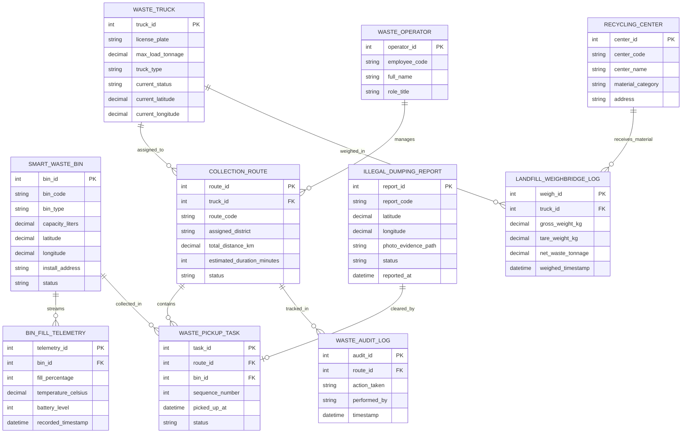

# Conceptual ERD — Urban Waste Collection Management System

## Mermaid Code

## Entity Description Table | Bảng mô tả Entity

| # | Entity Name | Vietnamese Name | Description | Key Attributes | Main Relationships |
|---|-------------|-----------------|-------------|----------------|-------------------|
| 1 | SMART_WASTE_BIN | Thùng rác Thông minh | Thông tin vị trí, dung tích và phân loại rác của thùng rác công cộng | bin_id, bin_code, bin_type, capacity_liters, status | Streams BIN_FILL_TELEMETRY, collected in PICKUP_TASK |
| 2 | BIN_FILL_TELEMETRY | Dữ liệu Mức đầy Cảm biến | Chuỗi dữ liệu thời gian thực % rác, nhiệt độ và pin do cảm biến IoT gửi | telemetry_id, fill_percentage, temperature_celsius, recorded_timestamp | Belongs to SMART_WASTE_BIN |
| 3 | WASTE_TRUCK | Xe Thu gom Rác | Thông tin xe rác, tải trọng tối đa và vị trí GPS thời gian thực | truck_id, license_plate, max_load_tonnage, current_latitude | Assigned to COLLECTION_ROUTE, weighed in WEIGHBRIDGE |
| 4 | COLLECTION_ROUTE | Lộ trình Thu gom Rác | Tuyến đường di chuyển gom rác đã được thuật toán AI tối ưu hóa | route_id, route_code, assigned_district, total_distance_km | Belongs to WASTE_TRUCK, contains WASTE_PICKUP_TASK |
| 5 | WASTE_PICKUP_TASK | Nhiệm vụ Thu gom Thùng rác | Điểm dừng thu gom cụ thể tại một thùng rác trên lộ trình xe | task_id, sequence_number, picked_up_at, status | Belongs to COLLECTION_ROUTE, SMART_WASTE_BIN |
| 6 | ILLEGAL_DUMPING_REPORT | Báo cáo Đổ rác Trái phép | Hồ sơ phản ánh đống rác tự phát/đổ rác chui từ người dân | report_id, report_code, photo_evidence_path, status | Cleared by WASTE_PICKUP_TASK |
| 7 | LANDFILL_WEIGHBRIDGE_LOG | Nhật ký Cân Rác Trạm Cân | Ghi nhận tổng khối lượng rác (tấn) thực tế xe trút vào bãi/nhà máy | weigh_id, gross_weight_kg, tare_weight_kg, net_waste_tonnage | Belongs to WASTE_TRUCK, received by RECYCLING_CENTER |
| 8 | RECYCLING_CENTER | Nhà máy Xử lý / Tái chế Rác | Thông tin cơ sở tiếp nhận và phân loại xử lý rác tái chế | center_id, center_code, center_name, material_category | Receives material from LANDFILL_WEIGHBRIDGE_LOG |
| 9 | WASTE_OPERATOR | Cán bộ Điều hành Rác thải | Cán bộ URENCO điều động đội xe, duyệt lộ trình và quản lý nhà thầu | operator_id, employee_code, full_name, role_title | Manages COLLECTION_ROUTE |
| 10 | WASTE_AUDIT_LOG | Nhật ký Kiểm toán Thu gom | Lưu vết thời gian thu gom thực tế so với cam kết SLA và lộ trình xe | audit_id, action_taken, performed_by, timestamp | Belongs to COLLECTION_ROUTE |

## Relationship Description | Mô tả Quan hệ

| # | From Entity | Cardinality | To Entity | Relationship Label | Business Explanation |
|---|-------------|-------------|-----------|-------------------|----------------------|
| 1 | SMART_WASTE_BIN | one-to-many | BIN_FILL_TELEMETRY | streams | Một thùng rác phát ra chuỗi nhiều bản ghi dữ liệu cảm biến đo mức đầy |
| 2 | WASTE_TRUCK | one-to-many | COLLECTION_ROUTE | assigned_to | Một xe rác được phân công di chuyển theo các lộ trình thu gom khác nhau |
| 3 | COLLECTION_ROUTE | one-to-many | WASTE_PICKUP_TASK | contains | Một lộ trình thu gom bao gồm danh sách nhiều nhiệm vụ thu gom tại các thùng rác |
| 4 | SMART_WASTE_BIN | one-to-many | WASTE_PICKUP_TASK | collected_in | Một thùng rác nằm trong nhiều lượt thu gom theo các ca làm việc |
| 5 | WASTE_TRUCK | one-to-many | LANDFILL_WEIGHBRIDGE_LOG | weighed_in | Một xe rác thực hiện cân khối lượng rác nhiều lần tại trạm cân |
| 6 | WASTE_OPERATOR | one-to-many | COLLECTION_ROUTE | manages | Một cán bộ điều hành quản lý và phê duyệt nhiều lộ trình xe rác |
| 7 | COLLECTION_ROUTE | one-to-many | WASTE_AUDIT_LOG | tracked_in | Mọi hoạt động di chuyển thu gom rác được ghi nhật ký kiểm toán SLA |
| 8 | ILLEGAL_DUMPING_REPORT | one-to-one | WASTE_PICKUP_TASK | cleared_by | Mỗi phản ánh đống rác trái phép được thu dọn bằng một nhiệm vụ thu gom |
| 9 | RECYCLING_CENTER | one-to-many | LANDFILL_WEIGHBRIDGE_LOG | receives_material | Một nhà máy tái chế tiếp nhận rác từ nhiều lượt xe rác đến trút rác |
